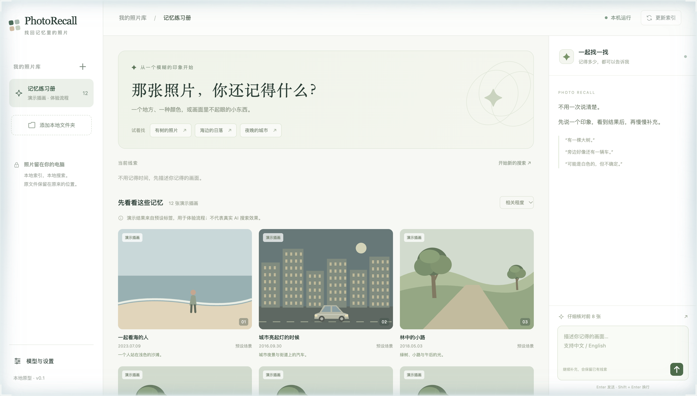

<div align="center">

# 🔎 PhotoRecall — Remember a Little, Find It All

**Describe the photo the way you remember it. Your Mac finds it — nothing ever leaves your machine.**

English · [简体中文](README.zh-CN.md)

    



</div>

## What is it?

You remember *"the birthday where someone made that gesture next to a red car"*, not the file name. PhotoRecall is a **local, conversational photo search** for large personal libraries. You describe what you remember — a place, a colour, a number of people, a sign in the background — add or retract clues turn by turn, and it keeps looking until the right photo (or the whole related set) turns up.

- **Private by design** — original photos are only read, never modified; indexes, models and inference stay on your machine.
- **Built for Apple Silicon** — tuned for an M1 Pro / 16 GB Mac (PyTorch MPS, models loaded one stage at a time).
- **Honest ranking** — unknown and conflicting candidates are kept and shown, not silently dropped. Relevance scores are not match probabilities.

## How it works (v0.6 pipeline)

```mermaid
flowchart LR
    A[Scan folders] --> I[Layered index<br/>global · local crops · OCR · captions · people]
    U[Your clues + reference photo/crop] --> Q[Versioned query state]
    I --> R[Multi-channel recall]
    Q --> R
    R --> C[Keep all candidates]
    C --> D{Bounded controller}
    D --> RR[Optional small-batch rerank]
    D --> V[Verify on original: full + crop + OCR + detection]
    RR --> E[Update ranking]
    V --> E
    E --> X[One bounded expansion on conflict]
    X --> R
    E --> F[Feedback: retract clue · "not this one" · "more like this" · continue]
    F --> Q
```

Three search modes: **find that one photo**, **find a related group**, **find everything** (batch scanning with a coverage ledger: unprocessed / supported / conflicting / unknown / tool error / user-excluded).

## Models (all local)

| Stage | Model |
|---|---|
| Main index (2048-d) | Tencent **WeMM-Embedding-2B** |
| Multi-condition rerank | Alibaba **CORE-Reranker-2B** |
| Whole-image gap-filling + 4 local crops | **SigLIP 2** |
| Counting lower-bound / location | **YOLO26n** |
| Dialogue parsing / on-demand verification | Ollama `qwen3:4b`, `qwen3-vl:4b-instruct` |
| Optional adapters | Qwen3-VL Embedding / Reranker, Grounding DINO, InsightFace |

Weights (~9.7 GB for the two main models) are **not** in this repo; download scripts are in `scripts/`.

## Progress

| Version | What it adds | State |
|---|---|---|
| v0.4 | Hybrid retrieval: WeMM + CORE rerank + SigLIP local recall + original-image detail checks | ✅ measured on M1 Pro; **not** a verified 95%-accuracy product |
| v0.5 | Local hybrid retrieval, evaluation datasets | ✅ |
| **v0.6** | Full search pipeline with bounded controller, feedback loop, collection coverage ledger | 🟡 **written & statically checked only** — not yet run on real photos, no automated test run, no accuracy/performance benchmark |

Known limits: exact people counts, occlusion, negation, left/right relations and small gestures can still be wrong; detection counts are lower bounds. Not included: phone access, HEIC/RAW/video/Live Photos; not tested at the 10k-photo scale.

## Roadmap

- [ ] Run & benchmark v0.6 end-to-end on a real library; publish accuracy and latency numbers.
- [ ] Qwen multimodal recall/rerank and open-vocabulary localisation adapters (entry points exist).
- [ ] People grouping.
- [ ] Scale test at 10k+ photos.
- [ ] iPhone / HEIC / Live Photos path (research notes in `docs/`).

## Quick start

```sh
python3 -m venv .venv
.venv/bin/python -m pip install -r requirements.txt
.venv/bin/python -m pip install -r requirements-ai.txt      # local AI models
.venv/bin/python scripts/prepare_ai.py --download
.venv/bin/python scripts/prepare_retrieval.py --download
.venv/bin/python scripts/prepare_detector.py --download
PYTORCH_ENABLE_MPS_FALLBACK=1 .venv/bin/python run.py --open   # http://127.0.0.1:8765
```

The home page opens with a built-in **"Memory Workbook"** of illustrated demo scenes (`demo/`) so you can click around without any photos; the old UI remains at `/legacy`.
Then: add a photo folder → *Update files* → *Build search index* → describe your photo.

Tests: `.venv/bin/python -m unittest discover -s tests`.

## Docs (mostly Chinese)

[v0.6 pipeline design](docs/v0.6完整链路开发说明-2026-10-27.md) · [Dev log (zh)](docs/DEVELOPMENT_LOG.zh-CN.md) · [v0.4 implementation & measurements](docs/v0.4本机实现与实测.md) · [Research: open-source projects & papers](docs/开源项目与论文调研.md) · [Immich & market study](docs/2026-10-16Immich架构与市场可行性调研.md) · [Apple/Google photo search ideas](docs/苹果与谷歌照片检索思路.md) · [Evaluation datasets](docs/评测数据集-2026-10-27.md).

## Credits & license

Uses WeMM, CORE-Reranker, SigLIP 2, YOLO, Qwen and others under their own licences (a vendored Qwen3-VL helper keeps its licence in `app/flow/vendor/`). Project code: [MIT](LICENSE) © 2026 Zeran Wang.
