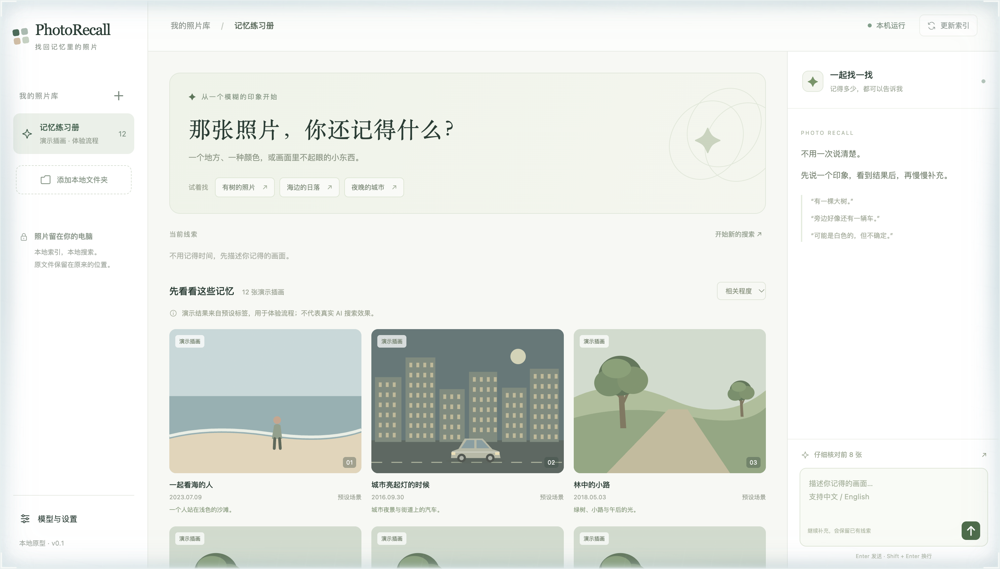
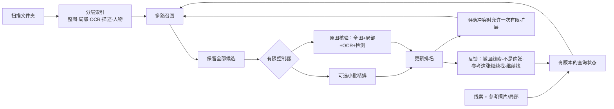

<div align="center">

# 🔎 PhotoRecall · 只记得一点点，也能找回那一张

**用你记得的样子描述照片，Mac 帮你找出来，全程不出本机。**

[English](README.md) · 简体中文

    



</div>

## 这是什么

你记得的是"那次生日，有人在红色汽车旁比了个手势"，而不是文件名。PhotoRecall 是面向大型个人相册的**本地对话式照片搜索**：描述你记得的地点、颜色、人数、背景里的招牌，一轮轮补充或撤回线索，它会一直找，直到找到那一张（或整组相关照片）。

- **隐私优先**：原照片只读、不改写；索引、模型、推理都在你的电脑上。
- **为 Apple Silicon 优化**：面向 M1 Pro / 16 GB（PyTorch MPS，模型分阶段互斥加载）。
- **诚实的排序**：未核对、未知、条件冲突的候选都保留并显示，不悄悄丢掉；相关性分数不等于匹配概率。

## 工作原理（v0.6 链路）



三种任务：**找那一张**、**找相关的一组**、**尽量找齐全部**（按成员快照逐张处理，用覆盖账本记录：未处理 / 支持 / 冲突 / 未知 / 工具错误 / 用户排除）。

## 使用的模型（全部本地）

| 阶段 | 模型 |
|---|---|
| 主索引（2048 维） | 腾讯 **WeMM-Embedding-2B** |
| 多条件精排 | 阿里 **CORE-Reranker-2B** |
| 整图补漏 + 4 个局部向量 | **SigLIP 2** |
| 数量下限 / 位置 | **YOLO26n** |
| 对话解析 / 按需核验 | Ollama `qwen3:4b`、`qwen3-vl:4b-instruct` |
| 可选适配 | Qwen3-VL Embedding / Reranker、Grounding DINO、InsightFace |

两个主模型权重约 9.7 GB，**不在本仓库**；下载脚本见 `scripts/`。

## 目前进度

| 版本 | 新增内容 | 状态 |
|---|---|---|
| v0.4 | 混合检索：WeMM + CORE 精排 + SigLIP 局部召回 + 原图细节核对 | ✅ 已在 M1 Pro 实测；**不是**已通过 95% 准确率验收的产品 |
| v0.5 | 本地混合检索、评测数据集 | ✅ |
| **v0.6** | 完整搜索链路：有限控制器、用户反馈闭环、集合任务覆盖账本 | 🟡 **只完成开发与静态检查**，尚未在真实照片上运行，未跑自动化测试，没有准确率/性能测评 |

已知限制：精确人数、遮挡、否定、左右关系、小手势仍可能出错；检测数量只是下限。不含手机接入、HEIC / RAW / 视频 / Live Photos；没有在一万张规模上实测。

## 路线图

- [ ] 在真实相册上完整跑通并评测 v0.6，公布准确率与耗时。
- [ ] Qwen 多模态召回/精排、开放对象定位适配（入口已有）。
- [ ] 人物分组。
- [ ] 万张以上规模测试。
- [ ] iPhone / HEIC / Live Photos 路线（调研见 `docs/`）。

## 快速开始

```sh
python3 -m venv .venv
.venv/bin/python -m pip install -r requirements.txt
.venv/bin/python -m pip install -r requirements-ai.txt      # 本地 AI 模型
.venv/bin/python scripts/prepare_ai.py --download
.venv/bin/python scripts/prepare_retrieval.py --download
.venv/bin/python scripts/prepare_detector.py --download
PYTORCH_ENABLE_MPS_FALLBACK=1 .venv/bin/python run.py --open   # http://127.0.0.1:8765
```

首页自带插画版"**记忆练习册**"演示场景（`demo/`），没有照片也能点着玩；旧版界面在 `/legacy`。
然后：添加照片文件夹 → 「更新文件」→「建立搜索索引」→ 输入线索。

测试：`.venv/bin/python -m unittest discover -s tests`。

## 文档

[v0.6 完整链路开发说明](docs/v0.6完整链路开发说明-2026-10-27.md) · [开发日志](docs/DEVELOPMENT_LOG.zh-CN.md) · [v0.4 本机实现与实测](docs/v0.4本机实现与实测.md) · [开源项目与论文调研](docs/开源项目与论文调研.md) · [Immich 与市场可行性调研](docs/2026-10-16Immich架构与市场可行性调研.md) · [苹果与谷歌照片检索思路](docs/苹果与谷歌照片检索思路.md) · [评测数据集](docs/评测数据集-2026-10-27.md)。

## 致谢与许可证

使用 WeMM、CORE-Reranker、SigLIP 2、YOLO、Qwen 等模型，各自遵循其许可证（`app/flow/vendor/` 内的 Qwen3-VL 辅助代码保留了原许可证）。项目代码：[MIT](LICENSE) © 2026 Zeran Wang。
