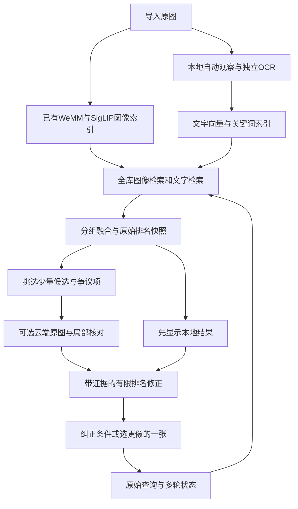

# PhotoRecall：免训练、本地索引与少量云端核对的重设计

日期：2026-10-15。依据：当前 Lexar 项目代码、只读数据库、用户粘贴的另一份建议、项目及模型的一手文档。用户已表示接受少量候选照片上云。本次只做研究和设计，没有上传照片、调用付费推理、下载权重、训练或修改运行程序。

## 1. 这次改变什么

上一版把“训练轻量排序器”放得太靠前，没有充分照顾用户没有标注数据、希望尽快落地的约束。本版把训练、人工数据集建设、自适应主动学习和模型蒸馏移出首期。

推荐路线：**本地自动建立图像与文字两种索引 → 无需训练的混合召回 → 保留原始排名 → 少量候选用云端强视觉模型核对 → 有限度修正排名。**

核心改变有三个：

1. 把通用的看图理解移到导入阶段，自动生成可复用的观察记录；每次搜索不再重复让本地2B模型审64张。
2. 把现有CORE从必经裁判改成可关闭的辅助模块；在本图库未证明有益之前，不允许它覆盖整个初排。
3. 用现成云端模型核对少量最有价值或最有争议的候选；不需要用户准备训练数据。

这是可实施的优先方案，不是已验证的90%准确率结论。新增描述、云端视觉判断也会误识别，必须保留图像通道、未知状态和原排名。

## 2. 对另一份方案的判断

值得保留：完整查询、多入口检索、官方精排模板对齐、少量原图核对、对话状态、缓存、明确区分基准与个人相册。

不建议首期采用：

| 建议 | 本次判断 |
|---|---|
| 每批16张，用召回分拟合精排分的单调映射 | 召回与精排的分歧正是待解决的问题，单调关系未必成立；被选择的少量样本也有偏差。精排有误时会把误判传播到未看过的照片 |
| 按阳性产出率停止，并显示估计找回比例 | 没有可靠标签、随机抽样设计与统计假设，不能可信地估算全库相关图片数量。首期只显示实际检索/核对数量，不显示“已找回95%” |
| 给前20–30张逐条件重复询问模型 | 条件越多调用越多，容易比现在更慢；多个不可靠概率相乘也会误杀。对同张图一次输出所有条件的观察状态，必要时才补看局部 |
| 用标注数据学习统一分数 | 可以是后期方向，但不符合这次免训练的约束 |
| 同一组抽样确认后，将匹配结论传播到整组 | 连拍中的手势、眼神、持物和人数可能不同。只传播事件关联和候选资格，不传播细节是否符合 |
| 多轮仅在上一轮高分图内验证 | 第一轮没找进来的目标将永久丢失。每轮都重新检索全库索引，已核对证据按条件版本复用 |
| “精排一定更准” | 不成立。Qwen官方当前表中图像检索一项，2B embedding为74.8、2B reranker为74.0；这是该基准结果，不等于CORE在本图库的实测 |

来源：[Qwen官方评测表](https://github.com/QwenLM/Qwen3-VL-Embedding#model-performance)。此表与不同镜像/版本可能有差异，应固定引用日期；不使用二手镜像数据拼表。

## 3. 这轮新增的代码证据

当前项目并不是完全没有自动描述功能：

- `app/providers/ollama.py:138` 的 `describe()`已经输出caption、objects、actions、colors、viewpoint、visible_text等字段，并要求看不清时返回unknown。
- `app/engine.py:709` 附近的 `analyze_library()`会保存到`annotations`，但使用图库缩略图作为输入，描述向量使用现有SigLIP文本编码。
- 只读查询时，`annotations`总记录数为**0**；两个真实图库分别为871张、338张，描述覆盖都是0。
- `app/engine.py:395`启用`retrieval_vnext`后直接返回`pipeline.search()`，此前读出的`annotations`没有传入新链路。
- `app/pipeline.py:250`附近的新版`recall()`没有caption/OCR文字检索通道。
- `web/app.js:198`的分析按钮调用`retrieval-index`，而非已有的`analysis`接口。
- 数据库开关`retrieval_vnext=true`、`semantic=true`。

因此，本次建议是**复用并接通已有描述能力，补上文字检索与独立OCR**。不能只让用户点击当前“分析”按钮，也不能声称当前已实现了描述混合检索。

上一轮发现仍成立：`merge_reranked()`用0.5把低分已检查项放到所有未检查项之后；CORE实际查询会丢弃软条件；固定尾部抽样会占用64张预算；页面有可能尚未应用后端新排序。相关复现与历史耗时见上一版审计文件。

另需区别：不同模型、不同查询、不同候选集合的分数不可直接比较。若“评分降低”只是更换模型后数值变小，不一定表示质量下降；真正要检查的是正确照片的名次和前排误入数量。

## 4. 找到的可借鉴项目：成熟产品、研究原型分开看

| 项目/论文 | 已核查的内容 | 本项目采用什么 | 不据此推断什么 |
|---|---|---|---|
| [PhotoPrism描述生成](https://docs.photoprism.app/developer-guide/vision/caption-generation/) | 已有Ollama描述/标签接入，支持模型和提示配置 | 自动离线观察、增量版本化、模型来源记录 | 不等于直接复制即可获得高准确率 |
| [PhotoPrism模型比较](https://docs.photoprism.app/developer-guide/vision/model-comparison/) | 对描述与标签分别测量；公开16张图、720px、RTX4060的测试条件 | Qwen3.5-4B作为本地描述候选；避免盲目认为9B一定好 | 其中88%等是特定标签覆盖指标，绝非相册检索准确率；秒数不移植到M1 Pro |
| [Immich搜索](https://docs.immich.app/features/searching/) | 图像语义、OCR、描述、日期、位置等搜索能力；多语言模型选择 | 保留快速图像索引，专门处理文字/元数据 | 没有证据证明其在用户模糊查询上达到90% |
| [photo-search](https://github.com/AtharvaPingale/photo-search) | README给出图像向量、caption向量、关键词、OCR的RRF组合与可编辑过滤条件 | 借鉴模块接口、元数据来源验证与反馈方式 | 个人项目，未独立复现实测；不复制其训练流程或性能数字 |
| [PlugIR，ACL 2024](https://aclanthology.org/2024.acl-long.46/) / [代码](https://github.com/Saehyung-Lee/PlugIR) | 对话转图注式查询、根据候选生成不重复的问题，无需微调检索模型 | 多轮状态与一次有效澄清；不默认连续问5轮 | 研究代码含训练基线，不能把所有脚本都当作免训练产品 |
| [Google Ask Photos官方说明](https://blog.google/products-and-platforms/products/photos/ask-photos-google-io-2024/) | 理解问题、组织检索、再查看候选图，并记住更正 | 检索后再调用强视觉理解；保存更正 | 未公开足够细节复刻全部后端，也没公布本任务90%指标 |
| [Apple人物与照片研究](https://machinelearning.apple.com/research/recognizing-people-photos) | 本地身份线索与人物、地点、事件关联 | 按事件组织候选，用户确认身份后复用 | 这是2021年公开内容，不是今天自然语言搜索全部实现 |

另外核查了[Local-aiPhotos](https://github.com/giuvilas/Local-aiPhotos)等本地自动描述项目。它们证明“本地生成描述再检索”可实现，但没有足够独立效果证据，故不作为90%准确率依据。

## 5. 推荐架构与模型分工



| 职责 | 推荐选择 | 说明 |
|---|---|---|
| 原图语义 | 保留WeMM-Embedding-2B、SigLIP2整图/局部 | 已有索引继续复用；不因增加caption丢掉视觉入口 |
| 本地自动描述 | 优先试`Qwen3.5-4B`，4bit、关闭长推理；以现有`qwen3-vl:4b-instruct`作基线 | 首先沿用Ollama接口，减少迁移；MLX是后续可替换运行后端。并非已证明更适合全部照片 |
| 描述文字向量 | `Qwen3-Embedding-0.6B` | 现成多语言文本模型，不训练；独立索引，不与WeMM向量混存或点积 |
| OCR | macOS Vision的`VNRecognizeTextRequest` | 小型Swift辅助程序返回文字、框、方向信息；运行时核对支持语言。文字模糊仍保留未知 |
| 关键词 | SQLite FTS5，加适当中文分词/字符n-gram处理 | 不引入新数据库；不能以默认英文空格分词假装支持中文 |
| 云端准确率优先核对 | `gemini-4-argon`作为首选试验配置，每轮仅少量图 | 官方列为支持图像输入、结构化输出的稳定模型；不能以旗舰名称替代相册实测 |
| 云端速度/成本对照 | `gemini-3.8-flash` | 同样支持图像及结构化输出；若与Argon结果相当而更快，则用Flash |
| CORE-2B | 默认不自动跑64张，保留可选对照与离线模式 | 接口/批处理一致性测试通过且确有收益后再启用特定查询 |

依据：[Qwen3.5-4B模型卡](https://huggingface.co/Qwen/Qwen3.5-4B)、[PhotoPrism模型配置](https://docs.photoprism.app/user-guide/ai/ollama-models/)、[Qwen3-Embedding-0.6B](https://huggingface.co/Qwen/Qwen3-Embedding-0.6B)、[Apple OCR接口](https://developer.apple.com/documentation/vision/recognizing-text-in-images)、[Gemini 4 Argon](https://ai.google.dev/gemini-api/docs/models/gemini-4-argon)、[Gemini 3.8 Flash](https://ai.google.dev/gemini-api/docs/models/gemini-3.8-flash)。云端型号和价格核对日期为2026-10-15，实施时确认账户可用性。

这里不再推荐为了“更强”就让本机同时常驻WeMM、CORE、9B描述模型。16GB机器上描述任务在空闲时运行，在线检索优先，模型切换有边界。

## 6. 导入阶段：一次观察，多次利用

每张图生成一条短而结构化的观察记录：主体与属性绑定、明显动作、场景、可见文字、构图、无法确认事项。保存原图指纹、模型/提示版本、输入尺寸与来源。图片原文、OCR原文、用户命名和模型猜测不能混为同一级事实。

例如“有人在桌边，手在彩色积木附近，疑似搭积木；没有看清手部接触”，应保留“不确定搭建动作”，不能自动写成“孩子正在拼乐高”。只描述可见内容，不补品牌、地点、亲属关系或拍摄年代。

执行策略：

- 复用`describe()`和`annotations`，修改输入为原图方向归一化后的适当分辨率副本，避免沿用过小图库缩略图。
- 一次调用输出全部字段，输出长度设限；无需每个字段单独看一遍图。
- 不为每张照片默认生成四份长局部描述。先做整图，细节查询遇到需要时再取原图局部，缓存观察。
- 文字向量先为整条观察记录生成一个；只有局部证据证实有收益时才增加局部条目。
- 独立OCR负责可读文字；VLM的`visible_text`只作为补充，不冒充OCR真值。
- 支持增量、暂停、失败重试；描述覆盖不全时仍能搜索全库图像，并记录缺失状态。
- 描述与OCR是检索索引，不是训练标签。无需人工逐图标注。

代价是首次导入会更慢。实际时间为照片数×本机平均描述耗时，应先测少量图后给出预计完成时间，不能引用RTX4060或其他M系列的秒数承诺本机速度。

## 7. 搜索阶段：全库找，不逐轮缩死

1. 保存用户原句和条件来源。简单查询直接编码；只有纠正、否定、复杂时间或多轮指代时调用查询解析器。改写不可以新增用户没说的地点、人物和动作。
2. 在全库跑图像入口、描述文字入口、OCR/可靠元数据入口。保留完整描述，放宽查询只是补充入口；解析失败仍可用原文查。
3. 使用按来源家族归一化的RRF起步。图像里的整图/四窗口不算五票，caption和其派生标签也不算独立多票。用名次融合，避免直接相加不同模型分数。
4. 保留主图像通道头部与文字独有候选，避免一张照片因为描述缺失而消失。保存每路分数/名次，参数固定、可回退，暂不训练融合器。
5. 同类照片很多时按事件/近重复组展示代表，用户可展开；不能把一组中不同细节的照片永久去重。
6. 每次补充或纠正条件，都重新查全库索引。上一轮低分和没显示的图片仍有机会进入新结果。

一期候选量建议从每家族前200、融合池约300–500试起。这是计算预算，不是“所有符合照片”的上限；宽泛类别要继续分页/展开，不能截断后宣布找齐。

## 8. 云端核对：看少量证据，不让模型盲目打总分

首轮最多12张独立照片，建议分2–3个请求、每个4–6张，最多2个并发。保持每图独立ID；不要拼成64宫格再让模型寻找小物件。这个批次大小是实施起点，需检查跨图混淆、网络和服务限额。

候选起点：本地融合前8张，加文字/局部入口独有的2–4张；重复则从剩余队列补足。若某种查询明显偏OCR或区域，候选配额可按类型调整。预算允许时最多再补8张，总共20张；不能因模型说“都不符合”自动把整个相册上传。

输出按每张图逐项记录：

```json
{
  "photo_id": "opaque-id",
  "conditions": [
    {"id": "c1", "state": "supported", "evidence": "桌面可见多个拼接积木块"},
    {"id": "c2", "state": "unknown", "evidence": "手部过小，不能确定正在搭建"}
  ],
  "needs_detail": true
}
```

不要输出“正确率96%”之类自报概率。不要求长篇推理；只返回短观察证据、supported/contradicted/unknown和需补看的区域。格式正确不等于事实正确，服务端必须检查照片ID与条件ID。

重要限制：

- 没看到，不等于不存在；遮挡、模糊、微小目标都应是unknown。
- 用完整图维持场景上下文；若争议是手势、小物体、文字，再看对应局部。整图和裁剪是同一候选，不增加整库上传范围。
- “可能是蓝色”作为偏好，不因红色便排除。人物身份只有用户提供的对应关系才能使用，不让模型根据外观猜名字。
- 初次核对不附带本地分数或“这张应该符合”的提示，减少迎合初排的倾向。
- 使用付费API配置，传选中图的可控尺寸副本及必要查询；默认剥离无关EXIF。此任务中没有进行任何上传。
- 请求超时或服务不可用直接保留本地结果，不让用户等到整轮失败。

云端缓存键包含原图指纹、查询/条件版本、模型ID、提示版本、图像分辨率与裁剪区域。不同查询的证据不能仅凭照片ID复用；与问题无关的观察可独立保存。

## 9. 防止“精排后变差”的明确规则

一期不把两类分数硬凑成一个概率，也不让云端随意重排全库。

采用**原始顺序保留、有限插入提升、负向判断谨慎处理**：

1. 固定保存本次本地排名`base_order`，模型核对只是另一个结果版本；前端能切回原顺序。
2. 对有明确正面证据的候选，首轮最多选4张插入推荐前列；其余照片保持本地相对顺序，去重后显示。
3. 这样原始前8张至多被挤到前12张，而不会因一个低分掉到几百名。这个规则限制损失幅度，**不能数学保证Hit@5完全不降**。
4. unknown保持原有地位；某项分数低或一次模型说“不符合”，均不自动全局后移。
5. 明确冲突先记录。涉及小目标/遮挡或与现有证据相反的判断，先补看局部；首期只有用户明确排除或可靠的显式元数据过滤才移出主要结果。元数据缺失不当作冲突。
6. 如果用户在核对结果里看见正确照片，点击“就是这张/符合”可立即置前；这是交互状态，不需要训练。
7. 头部结果被新模型改坏的查询独立记录，允许按查询类型关闭增强。不能只统计平均改进而忽略被毁掉的结果。

这是保守上线方案的取舍：它暂时不能把所有误入项都清除，但优先防止正确图片被一次错误判断压没。若后续少量真实使用验收证明更自由的重排稳定有益，再扩大重排范围。

## 10. 模糊记忆的处理

“有树和车”可能同时符合100张，没人能从未表达的信息推断唯一目标。这时需要帮用户认出来，而不是继续把同一个模糊句子交给更大模型。

先展示相关且事件不同的代表图，允许“更像这张”“同一次拍摄”“不是这种场景”。只有候选之间存在明显差别时，问一个高区分度问题，例如“更接近白天街道，还是夜间停车场？”；用户不回答也能继续浏览。

PlugIR为不微调检索模型的对话改写提供了依据，但本项目不必照搬多轮自动问答和聚类研究管线。用户的每次更正都应重新检索全库。事件邻居只扩大候选，不继承细节结论。

## 11. 速度与费用：明确收益来自哪里

当前历史64张后台精排约66秒，其中评分调用约49秒。这条工作量被移出普通查询主路径，普通查询可直接用已有图像和文字索引给出结果。难例则走少量云端请求，避免本机串行审64张。

这并不意味着同一份CORE代码被加速了几倍。新方案是改变计算位置与调用次数，必须按端到端延迟比较。

可设置的工程目标（尚未实测）：本地热查询首屏约1–3秒；少量云端增强目标5–15秒、到20秒仍未返回就保留本地结果并显示核对状态。网络、云端推理和WeMM冷加载可能超出目标；准确率优先模型不一定满足Flash的延迟。

按2026-10-15官方标准付费价，假设一次请求合计8000输入token、1000输出token（输出含实际计费的推理token）：

- Gemini 4 Argon：当前输入$2/百万、输出$10/百万，示例约$0.026；当前页注明2026-12-01分别变为$4/$20。
- Gemini 3.8 Flash：当前输入$0.75/百万、输出$3.75/百万，示例约$0.00975；当前页注明2027-01-01分别变为$1.50/$7.50。

这是token预算举例，不是12张照片的固定报价。不同分辨率、裁剪、重试和思考预算都会改变费用；程序要根据实际usage记录，并限制每轮请求数。同步少量多图请求不等于异步Batch API，不用Batch价估算实时体验。[官方价格](https://ai.google.dev/gemini-api/docs/pricing)

不优先投入：CORE视觉token缓存深度改造、每查询在线拟合排序器、同时部署多个大模型、引入图数据库或大型向量服务。它们不是当前最直接的收益来源。

## 12. 不训练，也能做最低成本验收

用户无需标注几千张图。先利用过去已经明确“我就是要这张”的失败例，记录查询与目标文件，即可自动比较目标在基础版/新版的排名。再在日常搜索里记录“找到了/没找到”，不把未点击图默认标成负例。

可先用10–20个已知例做回归检查，再逐渐积累新的实际使用案例。它们用于判断是否改坏，不用于训练。检查可以由实现者运行，用户只需确认少量含糊的目标，不先布置大规模标注作业。

90%应拆成清楚的目标：

- 找指定图：真实查询中，目标出现在前5或前10的比例。
- 找一类图：前10符合的比例、还有多少同类图能继续找到。
- 模糊记忆：一次搜索和允许一次反馈后的成功率分别报。
- 自动确认：标为符合的项目正确率与覆盖率一起报，不能只确认极少数容易图片就声称系统90%。

20次成功18次可以写“这20次中18次找到”，不能说已经证明所有私人相册准确率90%。也不能用模型自报置信度或自动描述生成的查询证明真实用户搜索效果。

## 13. 具体改动顺序

| 顺序 | 具体工作 | 交付判断 |
|---|---|---|
| 1 | 修0.5合并和软条件丢失；保存原始顺序；让CORE可关闭；修显示排名版本 | 已知正确图片不再因为阈值规则整段后移 |
| 2 | 接通已有`describe/annotations`；加增量后台任务、原图适配、独立OCR；接文字向量与FTS | 数据实际存在，并且新版recall确实读取；缺描述图片仍可被图像通道找到 |
| 3 | 增加单一云端provider，选中候选上传、结构化条件证据、缓存、超时与预算 | 少量候选能完成核对，模型失败不阻塞本地搜索 |
| 4 | 加有限插入提升、原始/增强排名切换、事件展开、全库多轮重查 | 不发生排序覆盖、照片永久消失或组内结论误传播 |
| 5 | 用已有失败例和新日常使用对比Qwen描述模型、Argon/Flash、关闭/开启CORE | 选出本机实际更合适的配置，而非按参数量或宣传榜单决定 |

现有`app/main.py`返回`local_only=true`，未来启用云端时必须更新接口和界面说明，按每库/每次设置体现实际状态；不能开启上传后仍宣称完全本地。

第一期不训练任何模型。主要新增是描述文字检索、一个云端核对适配器和可回退排序，而非再堆一个复杂Agent系统。新模型名称是候选配置；已经核查到可用文档和接口，不代表已在这台Mac或这个图库完成效果验证。
