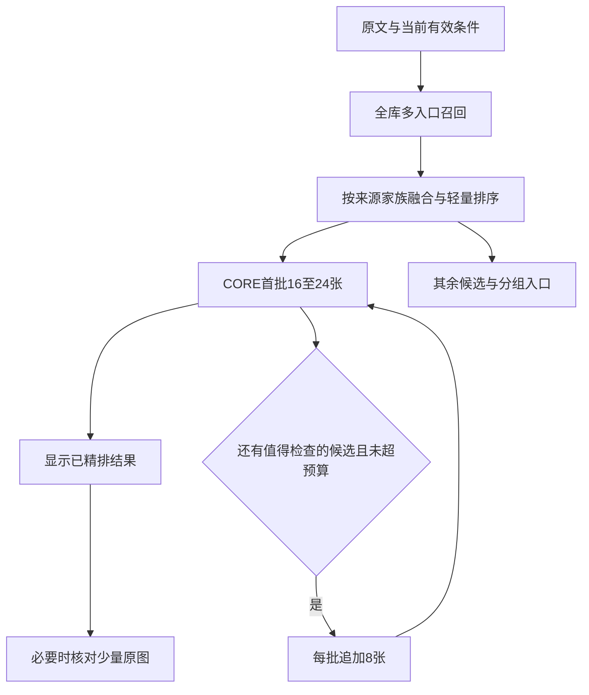

# PhotoRecall v0.4：首轮排名与精排速度改进方案

日期：2026-10-15。项目：`/Volumes/Lexar/桌面项目归档/PhotoRecall`。运行约束沿用项目记录：M1 Pro、16GB、PyTorch MPS、本地照片。

本次工作是代码与数据审阅、公开资料调研、现有纯排序函数复现及方案设计。没有改动运行程序，没有启动训练或新一轮私人照片模型推理。数据库以只读事务读取；审阅期间数据库有新搜索写入，因此报告引用固定快照。证据见同目录 `2026-10-15检索审计证据.json`，包含代码哈希、查询阶段记录和复现结果。

## 1. 结论：保留模型，先修排序与调度，再训练轻量排序器

当前 WeMM-2B + CORE-2B 已经在 Mac 上运行，上一轮“CORE 的 Mac 适配待验证”已经不再是这个版本的主要阻碍。现在应解决三个层次：

1. **立即修正分数合并、软条件丢失和页面旧顺序问题。**这些问题训练新视觉模型也不会自动消失。
2. **在召回与 CORE 之间增加便宜的候选排序。**先用按来源分组的融合基线；积累人工反馈后训练 LightGBM 小排序器。先让首批候选更值得看，再减少昂贵精排量。
3. **优化模型装卸与可复用图像计算。**按时间预算渐进精排；相同64张的实际推理提速和减少到24张的工作量减少，分别报告。

首选架构是：**全库多入口召回 → 轻量排序几百张 → CORE首批16–24张 → 按需每次追加8张 → 极少量原图细节核对。**

这些候选数是实验起点，不是允许降低命中率的上线指标。若新初排的Hit@24不及旧方案精排入口Hit@64，继续保留较大预算并改善初排。无标注数据不能承诺准确率提升或一分钟必然降为几秒。

## 2. 当前流程与可保留的部分

### 导入阶段

- 保留旧 SigLIP 2 整图向量。
- 为每张照片建立四个重叠局部向量，仍用 SigLIP 2。
- 建立 WeMM-Embedding-2B 2048维整图向量，最大262144像素。
- 缓存 YOLO 检测框和可见数量下限。
- 保存原图指纹、EXIF方向、模型版本；增量更新。

数据库快照有1221条照片记录，1209张具有新版整图及四局部索引；这包括不同图库，不能当成当前单个图库大小。最近任务在871张图库上运行，新版索引覆盖871张。

### 一次搜索

1. Qwen3 4B先解析中文条件，每次调用`keep_alive=0`。
2. 同步阶段走SigLIP整图和最多三个条件的局部检索，返回第一批候选。
3. 后台再次召回，加入WeMM完整查询、必要条件综合、放宽软条件查询。
4. 各入口最多500张，通过RRF合并为最多500张；读取数量/日期反证。
5. `select_candidates()`取64张：前16张、入口配额、候选后段抽样，再补足。
6. CORE最多两张一批，在约0.25MP输入上进行yes/no评分；部分情况自动再加32张，最多96张。
7. 分数≥0.5的已评分项在最前，其后是全部未评分项，最后是分数<0.5的已评分项。
8. 需要时用户再调用Qwen3-VL 4B逐项看原图。页面异步刷新，有时保留旧顺序等待手动应用。

保留现有全库向量、专业精排、增量索引、原图、版本缓存和三态证据。CORE已经只计算yes/no权重差，没有长文本生成，也已避免完整词表投影；“关掉长解释”“只输出一个分数”不能再被当作新增提速措施。

## 3. 第一轮不准：具体原因与证据

### P0：0.5阈值被错误地用于决定整段结果的位置

位置：`app/pipeline.py`的`merge_reranked()`，约第60行。

当前顺序为：已评分≥0.5 → 未评分 → 已评分<0.5。二分类决策界限不等于在本图库、每种查询上都校准过的相关性边界。低于0.5的一张照片，仍可能是所有候选中最符合的一张。

实际缓存中，查询`A photograph showing lego bricks`共有96个评分，最大0.3036007，全部低于0.5。这证明当前代码会把这96张全部放到未评分结果后面；**它不证明96张里有哪些照片真正相关**，本次未给它们做人工视觉标注。

纯函数复现：初始A、B、C、D，CORE分别为A=0.60、B=0.49、D=0.01，C未评分；最终变成A、C、B、D。未评分C仅因为“没看过”，便超过已评分第二名B。

**建议：排序与是否确认匹配彻底分开。**

- 同一查询、同一模型配置的已评分集合，按CORE原始logit连续排序；sigmoid也保持顺序，但保存logit方便后续校准与蒸馏。
- 在尚未建立校准融合前，显示明确标识的“已精排结果”与可展开的“更多待精排候选”，不按0.5将整个低分组塞到未评分组后面。
- 不把已评分都标成符合。高低分只描述相对顺序；“没有可信匹配”需要独立的标注集校准和未知处理。
- 最终如需一张统一排行榜，用具有缺失标记的融合模型或校准方案，不能把缺CORE分数填0，也不能直接相加不同模型原始分数。

### P0：模糊线索在精排时可能被全部抹掉

位置：`app/pipeline.py:377`调用`query_text(..., relaxed=True, english=True)`。

例子：“汽车，可能是蓝色”。召回使用颜色，但CORE实际收到“a car”，蓝色没有参与精排；缓存键也基于这个放宽后的英文查询。只有全为软条件、放宽后为空时才回退完整查询。

放宽软条件用于补召回很合理，但最终排序不能只看放宽版本。

建议保留两个表示：完整意图和可靠锚点。可靠锚点决定主要相关性，软线索参与偏好排序但不硬排除。过渡期可使用可靠锚点CORE分数，加一个受限的软线索向量排序项做开发集对照；不为每张图再跑第二遍CORE。后续由小排序器学习软线索权重。精排缓存记录实际输入文本及分辨率，最终融合缓存另含完整条件版本。

### P1：多个相关入口重复投票，RRF忽略了主次

位置：`fuse()`与`recall()`。每个局部条件都是独立RRF入口，与WeMM完整描述具有相同投票权。三个来自同一SigLIP模型的局部列表，可能共同压过一个更符合完整语义的WeMM列表。增加条件会改变入口数，也会改变模型家族的总权重。

另外，局部只取最后三项非排除条件，较早但重要的条件可能不再参加局部召回。必要条件综合使用0.7×最低百分位+0.3×平均百分位，某个模型不擅长的小细节会明显拉低真实目标；这条列表适合作补充，不适合被当作联合条件成立的证明。

建议先按四个信息家族融合：WeMM整体语义、SigLIP整图、SigLIP局部、结构化信息。每个家族内部归一化权重，新增改写或局部条件不增加这个家族的总票数。分别保留完整句、去掉一个不确定细节后的句子、关键实体入口。局部条件按信息价值、用户强调与新补充线索选取，不只取最后三条。

使用开发集比较家族权重；不在未经验证的情况下宣称某组手调比例最佳。品牌词如iPod可检索“iPod”和“便携音乐播放器”等有依据的同义/上位概念，但不能凭查询扩展捏造颜色、型号或场景。加OCR的收益要在可见文字任务中单独验证。

### P1：64张不是融合排名前64张，而且探索名额较多

当前算法沿候选第33名至第500名等间距抽样约四分之一预算。纯函数模拟：五个入口完全同序时，64个名额中只有50个来自前64；第50–63名被跳过，换成第95、126……500名等14张。

这不是逻辑错误本身：探索确实可能找到漏在后面的目标。但固定等间距探索没有利用“哪一张最有可能改变前排”，吞吐有限时性价比不高，也容易让用户误以为“已经核对了前64张”。

改为首批大部分来自轻量排序高分项，少量名额保留入口分歧和事件代表。探索比例由验证集确定，可从10%–20%起试。后续按预计收益与单位成本追加；保留基础探索名额，防止评分误判导致永久停止。额外候选仍需独立评分，不能继承近邻照片的“符合”。

### P1：主索引晚加入，且必须全覆盖才参与

`search()`初次调用`recall()`不启用WeMM，后台`refine()`才开启。因此首屏仍由较弱的SigLIP决定。新版索引如果缺任意一张，`len(main_rows)==len(valid)`条件又会让整个主索引不参与；局部索引也有类似的全覆盖要求。

建议简单单轮描述直接编码原文，尽早使用WeMM，不必先等4B解析器。复杂追加/否定/撤回再做结构化解析；解析结果与原文并存，异步更新要以查询版本隔离。已完成索引的照片使用主索引，未完成的走补漏并明确标记；融合器加入“来源是否可用”特征，避免仅因有更多索引就无条件加分。

### P1：页面可能仍然显示上一版排列

`web/app.js:67–73`在live刷新时用`visibleOrder`恢复旧顺序。`pollVerification()`在页面下滚超过80像素或预览图打开时，完成后仍保持旧顺序，按钮提示“排序已完成 · 点击更新”。

因此“页面穿插”可能同时包含模型误排与显示未应用，不能一概认定CORE失效。建议为每次查询维护`ranking_revision`和`displayed_revision`；完成后自动应用最终顺序并保持当前照片为滚动锚点，或在固定可见区域清楚显示待应用状态。界面应显示“本批64张已排，余下未排”，不要暗示500张都按同一模型排过。

## 4. 慢在哪里：可确认的耗时，不能猜成硬盘问题

| 最近数据库记录 | 后台任务耗时 | 首批预览就绪 | 评分调用累计 | 自动补查 |
|---|---:|---:|---:|---:|
| 拼乐高，64张 | 66.126秒 | 35.211秒 | 48.723秒 | 0 |
| 乐高积木，96张 | 80.342秒 | 30.286秒 | 67.337秒 | 32 |

这些时间来自现有`search_runs`，不是本次重跑。后台任务计时开始前，可能已经执行条件解析和同步首屏召回，因此不能把66.126秒称为完整点击到完成时间。

`inference_ms`围绕`score/score_many`调用计时，包含其内部模型装载、照片读取/解码、前处理、模型前向和同步，**不是纯GPU计算时间**。64张记录中其余约17.4秒还包括其他后台阶段；不能直接归因到Lexar读取。

### 4.1 一级：先做成本低、行为容易保持一致的优化

**补齐分段计时。**记录解析、每个模型装载、查询编码、向量扫描、图片读取/解码/缩放、视觉编码、语言模型前向、写缓存、首批展示、排队与总墙钟时间。MPS单段测试要正确同步。记录缓存命中数、实际精排数量、batch大小、OOM回退、峰值内存和交换情况。

**减少模型切换。**当前模型互斥卸载，任务结束也卸载WeMM和CORE；每次对话`keep_alive=0`。这对16GB避免内存爆掉有价值，但冷装载成本大。

- 短查询先走原文向量，不启动4B解析器；复杂会话才解析。
- 将同一请求的WeMM整句、放宽句、分项编码收集起来，在同一模型驻留阶段完成。
- 同一批3–12张原图核对期间让Qwen-VL保持加载，批次结束或内存压力出现时才卸载，而不是每张图都`keep_alive=0`。
- CORE在会话短空闲期保温，例如30–60秒为待测起点。新WeMM阶段仍需协调内存，不能假设保温就消除所有切换。
- 后续若量化或轻量查询编码器能够释放足够内存，再测两个核心模型共同驻留。禁止直接移除全局互斥锁让多个大模型竞争16GB。

**缓存精排用的输入图像。**为原片生成正确EXIF方向、匹配实际像素预算的精排预览或预处理张量，避免每次解码大JPEG后再缩小。原图继续用于细节核对；不是拿低质量网页缩略图代替模型输入。缓存键包含指纹、方向、缩放规则、色彩处理和处理器版本。

已有batch=2不能再作为新功能承诺。测batch=1/2，并在内存许可时比较4；记录每图耗时和与单图排序的一致性。按视觉token长度分桶可减少padding，批处理不是同时开多个线程调用同一GPU。

### 4.2 二级：复用与查询无关的视觉编码

当前CORE每次查询都重新计算候选图的视觉编码。可缓存CORE视觉塔输出，复用到不同查询，这是比“相同原句的最终分数缓存”更广的复用。

本地安装的Transformers Qwen3-VL实现返回`pooler_output`及多层`deepstack_features`。缓存必须包含这些内容、图像网格、模型与处理器版本；仅保存最终一个视觉向量并不等价。语言模型的查询—图片联合前向仍必须执行。

当前提示把Query放在Document图片之前，后续decoder状态已经依赖查询，不能跨不同问题复用整段图像KV。也不能随意调换模板顺序来求缓存，否则会改变模型输入分布与评分。

缓存存储要先估算：若一张图有256个合并后token、隐藏维2048、FP16、最终及三层DeepStack共四组，约4MiB/张；一万张约39GiB，仅为示例量级，实际按张量形状统计。采用热点LRU/有限磁盘缓存或离线可选构建，不默认全库放RAM。

缓存方案通过同一批图与查询的logit误差、排序一致性、EXIF和长宽比测试才能上线。若视觉编码仅占评分调用的30%，即使完全消除这一部分，该部分也最多提速约1.43倍；不能把这项优化宣传成整轮5倍加速。

### 4.3 三级：MLX与量化作为可测候选

MLX生态和MLX-VLM提供Apple Silicon推理、Qwen3-VL及量化相关实现，值得做CORE同权重的运行后端对照。[MLX示例](https://github.com/ml-explore/mlx-examples)、[MLX-VLM](https://github.com/Blaizzy/mlx-vlm)。

但“支持Qwen3-VL聊天”不等于直接支持CORE专用精排。必须保留CORE权重、模板、yes/no评分头、视觉前处理、DeepStack及位置编码。先验证同精度一致性，再测8bit/4bit。小目标、否定、关系是量化回归重点；量化可能主要节省内存而非等比例提速。现成缓存分支也要逐一验证是否保存完整视觉信息，不能看到`cached_image_features`名字就直接接入。

当前是一次前向评分，推测解码和长文本KV压缩并非主要优化方向。不把生成模型的tokens/s当作精排images/s。

## 5. 推荐的新框架：增加便宜的中间排序层

主索引继续WeMM，精排继续CORE；先不增加另一个几B模型。轻量层读取已保存的向量/元数据，不重新跑图像识别。

### 5.1 无训练版本先上线验证

- 查询分为找某张、多条件细找、找一类。用户不必选技术模式，由描述和交互判断，允许修正。
- 原文、结构化完整句、可靠锚点参与召回；软条件放宽只用于补漏。
- RRF按家族限额，保留各路候选分数、名次及缺失状态。
- 高分候选优先，少量入口分歧和不同事件代表进入首批；不再等间距抽取候选尾部。
- 未评分集可浏览、可继续检查，评分低不代表从图库消失。
- 首批之后按真实时间预算和剩余候选价值追加；替换“正向≥四分之一或正向<4就多跑32”的规则。该规则可能在容易和困难两头都额外跑很久，且依赖未校准0.5。

轻量层能增加可靠性，但不能凭空创造未被索引保留的小手势特征。如果错误长期集中在某种小物体，应补足相应局部表示或原图核对，再谈训练。

### 5.2 有标注后训练小排序器：这是最值得做的小模型

**模型：LightGBM LambdaRank，或先用带正则的线性排序作基线。**它学习怎样组合现有证据，不直接从像素识别物体。训练与推理可在CPU执行，不必再常驻一个视觉语言模型。[LightGBM LGBMRanker文档](https://lightgbm.readthedocs.io/en/latest/pythonapi/lightgbm.LGBMRanker.html)。

建议输入约20–40个可解释特征：WeMM完整/锚点/软线索相似度及名次；SigLIP整图/局部匹配；条件匹配分布；各来源是否存在；OCR文本相关性；用户确定的日期匹配；检测数量下限与未知状态；查询类型；事件代表与近重复信息。计数反证仍可能受检测误报影响，不应无审计地变成永久排除。

标签为0不相关、1主题相关但明显不满足、2部分满足或细节未知、3符合可观察需求。找特定照片另记录目标文件；宽泛类别允许多张3级相关，不能把所有非点击图当负例。

建议首轮收集100–200个不同主题/事件的查询、每条20–40个判定，约2,000–8,000对，仅作小模型试验起点，不能保证样本已经充足。重点标记容易排错的近似照片：弹吉他vs拿着吉他、乐高作品vs彩色玩具、iPodvs手机、钢琴谱vs其他文字图片。

按查询和事件划分训练/验证/测试；同一事件连拍、同查询改写不能跨集合。来自用户“更像这张/不是这张”的反馈与人工标签保留来源。仅收集已展示结果会有位置偏差，需要少量抽样未展示候选供标注。

CORE连续分数可作为弱监督，人工修正与不确定标记必须保留，不能用其0.5二值化来生成真值。当前1651条精排缓存涉及多个模型版本、查询和图片，并不等于1651个人工正确训练样本；现有32条搜索记录也有重复与暂停，不能直接算32个独立任务。

初排训练不得使用上线时尚未计算的CORE分数，否则会产生特征泄漏。若后续训练最终融合器，需单独处理是否具有CORE分数、候选选择偏差与分数校准。

### 5.3 什么时候才训练视觉模型

| 失败表现 | 优先动作 |
|---|---|
| 目标进了候选，但被0.5分组/旧UI顺序压后 | 修实现，无需训练 |
| 目标在500内，频繁进不了首批24/64 | 训练轻量候选排序器、改善入口与配额 |
| 目标连500都进不来，属于稳定细分概念 | 增强区域/OCR；再用困难负例微调embedding或蒸馏 |
| 目标进CORE，仍常被属性/关系误判 | 收集对比样本，考虑CORE LoRA，不先训分类器 |
| 准确率已达标，主要是查询编码冷启动慢 | 可研究蒸馏更小的查询编码器到固定WeMM空间；不能随便换不同向量空间的文本模型 |
| 问题只说“有人的照片”，库里几百张都符合 | 展示多样候选并获取有效反馈，训练无法读出没有表达的记忆 |

CORE论文展示了将精排知识转移到embedding的研究路线，可作为后期训练参考；Sentence Transformers也提供蒸馏与困难负例流程，但其文本检索示例的速度倍数不适用于本相册。[CORE](https://github.com/Alibaba-NLP/core-emb)、[蒸馏文档](https://www.sbert.net/examples/cross_encoder/training/distillation/README.html)。

从零训练小视觉分类器现在不划算：要重新获得开放类别、中文、关系与细节能力；固定类别识别提高也未必改善模糊记忆检索。首版不训练大模型。

## 6. 模糊查询、很多同类照片：要改变结果组织与评价方式

“弹吉他的照片”可能是找某次演出，也可能想看全部弹吉他照片。信息不足时，多张都合理；算法不能知道用户尚未表达的目标事件。

宽泛查询首屏可按拍摄事件或视觉近重复组展示代表照片，保留“展开本组”。组内仍可排序，不能把同一连拍不同手势永久去重。不同事件的图片优先保证相关性，再兼顾覆盖；单纯追求多样性会把弱相关图片提前，也需限制。

用户点一个代表图后，可以选择“同一次/类似场景/就是这张”，再展开或检索。需要文字澄清时只问一个高区分度问题，如室内独奏还是舞台演出，避免连续要求用户补长描述。

找一类照片不能以64或500为“所有匹配”的上限。为候选集做分页/按事件展开，继续后台按预算处理；未评分结果明确标识。找某张则关注前5命中及交互轮数，两者分开验收。

## 7. 大公司与开源实践：具体借什么，不照搬什么

| 依据 | 可以借鉴 | 本项目的落地 |
|---|---|---|
| Google Ask Photos，2025更新 | 简单查询尽快返回，复杂理解后台继续 | 简单原文直检索；不让4B解析和64张精排阻挡所有结果。但渐进显示不能替代最终延迟验收 |
| Google YouTube，2016论文 | 候选生成与最终排名分工 | 改善进入昂贵排序的样本，而不只换更强末端模型；推荐系统历史点击建模不直接等于私人照片搜索 |
| Vespa分阶段排序 | 便宜函数覆盖大量候选，更贵模型只处理较小集合；保存各阶段特征 | 增加轻量中间排序、阶段级日志；不需要为了这一思想迁移现有SQLite到Vespa |
| Apple ANSA，2022公开资料 | 共享视觉表示与多任务信号，离线准备可复用信息 | 区域、对象框、可复用视觉输出提前计算；不是苹果今天全部照片搜索实现的披露 |
| LightGBM / Sentence Transformers | 排序训练、弱监督蒸馏、困难负例 | 先学证据组合，再考虑视觉模型微调，训练与线上使用保持一致 |

来源：[Ask Photos更新](https://blog.google/products-and-platforms/products/photos/updates-ask-photos-search/)、[YouTube论文页面](https://research.google/pubs/deep-neural-networks-for-youtube-recommendations/)、[Vespa分阶段排序](https://docs.vespa.ai/en/ranking/phased-ranking.html)、[Apple ANSA](https://machinelearning.apple.com/research/on-device-scene-analysis)、[LightGBM](https://lightgbm.readthedocs.io/en/latest/pythonapi/lightgbm.LGBMRanker.html)、[Sentence Transformers训练说明](https://sbert.net/docs/cross_encoder/training_overview.html)。

## 8. 实施清单、验收与时间预算

### 第一步：修正确性并建立可比较的基线，估计1–2个工作日

- `pipeline.py / merge_reranked`：去掉0.5驱动的全段后移，连续评分与确认状态分离。
- `pipeline.py / query_text、refine`：完整意图不丢软条件，记录实际评分文本及缓存键。
- `web/app.js / renderGallery、pollVerification`：后端排名版本与显示版本一致；保留滚动锚点。
- 保存阶段明细：完整召回名次、实际选中ID、精排分数/原始logit、最终排名、显示排名、各段耗时与缓存命中。
- 补测已有batch=2与单图输入的数值/排序一致性。上述三个纯函数问题已有复现，但模型数值一致性尚未测。

### 第二步：改融合与调度，估计2–4个工作日

- 按来源家族归一化、主检索更早进入、局部线索按价值选择、支持索引缺失掩码。
- 简单查询绕过大解析器，复杂查询保留正确的会话更新。
- 保留64张作为对照；实验16/24/32首批与8张追加，探索名额替换固定等间距。
- 用“实际时间预算+尚未检查候选价值+用户继续搜索”决定扩展，取消依赖0.5的固定补32。
- 有限预处理缓存与批内模型保温；只读测量Lexar加载/解码后，再决定是否在内置磁盘放可再生缓存。

### 第三步：运行后端与视觉缓存试验，估计3–5个工作日

- 先测各段占比，收益不足的优化不做深度实现。
- 比较原图解码与预处理缓存，视觉输出缓存与实时视觉塔。
- 如果MLX/量化比PyTorch实现有明确收益，再接成可切换后端；保持原实现可回退。
- 同模型同64张同分辨率下比较冷、热、新查询与缓存查询，不能把缓存命中宣传为新问题提速。

### 第四步：轻量排序器，估计3–5个工程日，标注另计

- 人工标注开发与锁定测试集，训练线性/LightGBM两个小基线。
- 对照原RRF、分组RRF、学习排序；通过后才缩小常规CORE候选数。
- 若500池本身丢目标，先修召回，不对小排序器提出无法完成的任务。

以上是任务拆分估算，硬件后端适配可能额外耗时，不是已完成工作。前两步不需要重新训练或重建全库视觉索引。

### 必测指标

| 问题 | 指标与比较 |
|---|---|
| 目标在64外 | 候选Hit@500、实际选中Hit@16/24/32/64，按明确/模糊查询分组 |
| 相关项被无关项穿插 | nDCG@10、Precision@10、前10错误插入数；分别看服务端与页面实际顺序 |
| 找指定照片 | Success@1/5、多轮成功率、目标文件排名；相似事件命中另计 |
| 找所有同类照片 | 多正例Recall@K、事件覆盖、分页发现量，不能用单目标Hit替代 |
| 加速是否真实 | 点击到初始候选、首批CORE结果、预算内完成、同64张全部完成，分别报P50/P95 |
| 冷热与资源 | 新查询/重复查询、冷启动/热模型、图片缓存状态、内存/交换、真实处理张数 |

建议先锁定至少100个多事件查询，其中包含模糊原句、同义改写、2–3轮纠正、相似干扰项；生日例与已用于修补的iPod等属于开发/回归，不作为未见泛化成绩。广义相关类别应人工标记多个正例；不能只给一张正确图、其余一律当错误。

初始上线门槛：新初排的Hit@24至少达到旧选择器Hit@64的水平，前10质量不降，困难类别单独检查；不足则不缩预算。目标可设为简单查询首屏P50≤3秒、首批精排P50≤15秒、常规完整请求P95≤30秒，但这些是待验证要求。

按历史64张评分调用约48.7秒做工作量粗算，24张同等平均成本约18.3秒，尚未算其余开销，且批次与冷启动不一定线性。所以只把64改24，不能宣称已经达到10秒；需要初排命中提升与运行成本优化同时成立。若同64张的目标是约25秒，必须测出足够的单图/批量推理加速，单靠界面渐进显示不算完成。

## 9. 本次建议的优先级

**最先做：修0.5分组、完整软线索、显示旧顺序；其次做按家族融合、简单查询直检索、分段计时与渐进预算；然后训练轻量候选排序器，并根据实测决定视觉缓存或MLX后端。**

当前不建议再换一套大模型、从零训练图片分类器、固定扩大到256张或给所有照片生成更长描述。先把已有模型的有效信息用对，并让每次昂贵评分集中在最有价值的候选上。训练如果要做，第一笔投入应是带人工反馈的小排序器；视觉模型微调放到能明确定位“表示能力缺口”的阶段。
