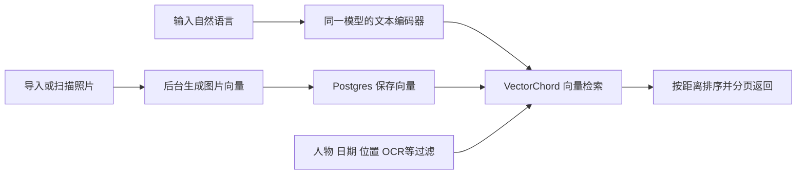
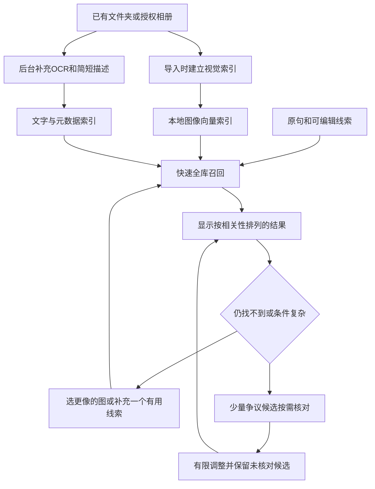

# PhotoRecall：Immich 架构、市场竞争与继续投入判断

调研日期：2026-10-16。对象：Lexar 中的 PhotoRecall、当前 Immich 发布版、手机系统相册、独立 App、桌面/NAS 软件和活动相册服务。

**结论：找照片的需求真实存在，但“用中文描述、本地 AI 搜照片”已经是成熟能力，不能再作为这个项目独立成立的理由。现阶段不建议继续扩张成通用相册产品；建议限定为一个短期验证项目，检查它能否解决现有产品失败的复杂找图任务。若不能明显超过配置正确的 Immich、Synology Deep Search 等，应优先使用或集成现成产品。**

这不是说有人做了就不能做。新产品需要证明的是：对某类经常找照片的人，在实际任务上节省足够时间、减少足够多失败，而且使用成本值得他们迁移或付费。现在有需求存在的证据，没有 PhotoRecall 已获得这种优势的证据。

## 1. 证据范围和限制

本次做了四类核查：

- 拉取并阅读 Immich 的实际发布版代码，固定为 **v3.3.3，提交 d2dac658fe1c67e8bbd08aa18200a32e5d45b9e4**；GitHub release 标示 2026-10-14 发布。
- 阅读产品官网、官方帮助、模型文档、论文和应用商店页面。公开正文优先 Lightpanda；群晖/QNAP 等正文缺失或被拦截时使用内置网页工具补查。
- 使用真实浏览器读取抖音相关视频页面的可见评论，另读 V2EX、Reddit 和独立评测。评论是个案，不是随机市场调查。
- 重新读取原研究聊天最新进展，并只读检查 PhotoRecall 当前代码与数据库，区分昨天的缺陷和今天的实现。

没有对全部竞品做统一图库实测，没有训练模型、下载权重或上传私人照片。本报告的“支持某能力”来自官方资料，不能换算成“该能力准确率高”。未获得可核验的中国市场付费用户数、留存率或销售额，因此不编造市场规模。

小红书搜索页面要求登录，本次未读到可核验的笔记评论；未取得足够可靠的微信公众号用户评论材料。这两类不计入需求证据。抖音读取的是页面与可见评论，没有把视频标题当成算法测评。

## 2. Immich 到底如何实现

### 2.1 已核查的标准路径

它把大量计算放在索引阶段。普通搜索并不需要对候选逐张生成文字解释，也不必每次启动一个聊天模型来理解“树”“红车”等短查询。

| 源码位置 | 实际行为 | 对 PhotoRecall 的意义 |
|---|---|---|
| [smart-info.service.ts，后台编码](https://github.com/immich-app/immich/blob/d2dac658fe1c67e8bbd08aa18200a32e5d45b9e4/server/src/services/smart-info.service.ts#L69) | 队列计算图片 embedding，写入搜索表；检查模型变更，避免混入不兼容向量 | 索引版本、增量更新和查询计算应分离 |
| [search.service.ts，查询编码](https://github.com/immich-app/immich/blob/d2dac658fe1c67e8bbd08aa18200a32e5d45b9e4/server/src/services/search.service.ts#L325) | 文本编码后缓存；也能取已有图片向量进行以图搜图；查询缓存键含模型和语言 | 同一句重复查询不用重复编码；用户选一张“更像的”可作为有效线索 |
| [search.repository.ts，查询执行](https://github.com/immich-app/immich/blob/d2dac658fe1c67e8bbd08aa18200a32e5d45b9e4/server/src/repositories/search.repository.ts#L320) | 设置 VectorChord probes，合并过滤，按向量距离排序、分页 | 普通路径是检索系统，不是逐图问答流水线 |
| [database.ts，过滤](https://github.com/immich-app/immich/blob/d2dac658fe1c67e8bbd08aa18200a32e5d45b9e4/server/src/utils/database.ts#L510) | 描述文字、OCR 等有独立查询条件；新版过滤树也有对应实现 | “支持 OCR”不等于自动将 OCR、描述、视觉做混合重排 |
| [visual.py](https://github.com/immich-app/immich/blob/d2dac658fe1c67e8bbd08aa18200a32e5d45b9e4/machine-learning/immich_ml/models/clip/visual.py)、[textual.py](https://github.com/immich-app/immich/blob/d2dac658fe1c67e8bbd08aa18200a32e5d45b9e4/machine-learning/immich_ml/models/clip/textual.py) | 图片和文字分别前处理、编码，推理使用模型会话；标准图片路径一次得到全图向量 | 不需要默认运行多个 2B/4B 模型，模型前处理必须与权重匹配 |
| [默认配置](https://github.com/immich-app/immich/blob/d2dac658fe1c67e8bbd08aa18200a32e5d45b9e4/server/src/dtos/config.dto.ts#L627)、[ML 配置](https://github.com/immich-app/immich/blob/d2dac658fe1c67e8bbd08aa18200a32e5d45b9e4/machine-learning/immich_ml/config.py#L58) | 默认 CLIP 为 ViT-B-32__openai；模型闲置释放默认 300 秒，支持缓存/预加载相关设置 | 默认模型不是所有语言最佳；连续交互不应反复冷加载 |

上述结论限于核查的标准 Smart Search 路径：没有看到它默认串联“大模型规划→64 张大模型精排→逐张核对”。不代表它能保证多对象关系、否定词或所有模糊记忆都正确，也不代表其所有功能只用一个模型。

### 2.2 中文模型选择：应该先做强基线

Immich 官方发布版文档的简体中文评测表如下。这个表尤其重要，因为不能拿默认英语模型的弱结果作为我们胜出的证据。

| 模型 | 官方中文综合 Recall 指标 | 基准内存 MiB | 基准耗时 ms |
|---|---:|---:|---:|
| nllb-clip-large-siglip__v1 | 79.70 | 4,226 | 75.05 |
| XLM-Roberta-Large-ViT-H-14__frozen_laion5b_s13b_b90k | 75.22 | 4,014 | 39.14 |
| ViT-SO400M-16-SigLIP2-384__webli | 72.36 | 3,854 | 56.57 |
| ViT-B-16-SigLIP2__webli | 66.84 | 3,038 | 5.81 |

**这些数字不是个人相册准确率。** 官方指标结合不同数据集的 R@1、R@5、R@10，耗时是在 7800X3D、Linux、f32、暖机后的模型基准；不是 M1 Pro 的首屏时间，也不包括完整导入成本。只能用于选择待测候选，不可说 NLLB 在你的图库一定提升 7 个百分点。

官方建议：主要使用固定非英语语言时考虑 NLLB；混合语言查询可考虑 XLM 或 SigLIP2。NLLB 需要正确设置查询语言，更换模型需要重建对应索引。商用选型还应单独核对具体权重及上游许可；本次 NLLB 转换仓库卡片没有给出足够完整的许可说明，所以它首先是实验对照候选。

来源：[固定版本的评测定义与中文表](https://github.com/immich-app/immich/blob/d2dac658fe1c67e8bbd08aa18200a32e5d45b9e4/docs/docs/features/searching.md#L195)、[当前搜索说明](https://docs.immich.app/features/searching/)、[模型转换仓库](https://huggingface.co/immich-app/nllb-clip-large-siglip__v1)。

### 2.3 值得复用的范围

Immich 已有完整的相册、导入、后台任务和移动端体系，并支持扫描外部目录。可用只读挂载索引 Lexar 的副本/目录，避免重新做整个相册。外部文件变动需要扫描；当前文档明确提醒，外部资产移动路径后，其内部相册/描述关联可能丢失。这也是“文件还在但应用里的组织信息不便迁移”的具体边界。[外部图库官方说明](https://docs.immich.app/features/libraries/)

若 PhotoRecall 面向 Immich 用户，优先做通过正式 API 获取资产与授权范围的独立搜索界面/服务。不要直接改它的内部数据库表，也不要假设核心产品已经提供稳定插件接口或任意向量导出接口。具体 API、权限、分页与版本兼容要在集成前验证。若主要用户没有 NAS，则保留当前文件夹入口更合适，不能为了借用 Immich 强迫所有人配置服务器。

## 3. 竞品地图：哪些能力已被覆盖

表中能力依据是官方说明；“待验证”表示本次没有统一实测。不同产品的版本、地区、硬件和语言支持差别很大。

### 3.1 手机系统与系统级入口

| 产品/平台 | 已经提供的能力 | 对我们意味着什么、尚存边界 |
|---|---|---|
| [Apple 照片](https://support.apple.com/en-lamr/guide/iphone/iph392d77d5f/ios) | 兼容 Apple Intelligence 的设备可用人物、动作、服装等自然语言描述找照片，也可定位视频内容 | 普通个人相册面对强系统入口；能力受设备/地区/语言限制，不能说所有 iPhone 都有同等能力 |
| [Google Photos / Ask Photos](https://support.google.com/photos/answer/15318661?hl=en-GB) | 先给相关结果，复杂问题再用 Gemini 后台缩小范围；支持切回经典搜索 | “先快后细”已有产品先例；开放范围和功能依地区而异，不适合假设中国用户都可直接使用 |
| [Samsung Gallery](https://news.samsung.com/global/interview-a-new-and-enhanced-gallery-experience-how-samsung-transformed-photo-searching-and-video-editing-with-the-galaxy-s25-series) | Galaxy S25 官方公开 VLM、自然语言搜图、人物衣着/时间/位置线索与端侧模型压缩思路 | 厂商拥有系统整合与训练资源，基本语义检索难形成壁垒；具体机型不能一概而论 |
| [华为图库](https://consumer.huawei.com/cn/support/content/zh-cn00415375/) | 支持语义及时间/地点/人物组合；官方列出缺元数据、人物未命名、索引未完成等搜索失败原因 | 中文组合搜索不是空白；该帮助页列的是特定系统/机型范围，不能外推全部 HarmonyOS 设备 |
| [荣耀图库](https://www.honor.com/cn/support/content/zh-cn15858732/) | 自然语言语义搜图、分类结果和继续追加关键词；官方说明端侧处理、离线可用 | “离线中文、多轮缩小范围”已有覆盖；亲属关系等宣传不等于可从图像可靠推断身份 |
| [OPPO AI 意图搜索](https://www.oppo.com/cn/smartphones/series-find-n/find-n5/) | 从相册、文档、便签等入口按描述搜索，官方明确包括模糊提问 | 相册搜索正被整合进系统助手；依版本开放，不能将网络识图/问屏混同为全库搜索 |
| [vivo 蓝心 / S18 Pro](https://www.vivo.com.cn/vivo/s18pro/) | 官方产品页已列自然语义搜图 | 有直接竞争能力；本次未取得足够公开材料拆解其搜索模型和真实复杂查询效果 |
| [小米 AI 引擎](https://privacy.mi.com/AIEngine/zh_CN/) | 官方说明相册等自然语言检索及本地数据库 | 证明已有该能力方向；隐私说明不是全机型功能清单，也不提供准确率证据 |
| [Windows Photos](https://support.microsoft.com/en-US/Windows/Apps/Photos/search-photos) | Copilot+ PC 支持描述式搜索已索引的本地照片 | “Windows 本地句子搜图”也不是空白；硬件覆盖范围仍有限 |

苹果官方当前仍列有中国大陆设备/账户地区相关限制。因此中国 iPhone 用户存在覆盖缺口，但这是可能变化的产品条件，不能作为长期竞争优势。[Apple 可用性说明](https://support.apple.com/en-lamr/121115)

### 3.2 独立软件、开源项目和商业工具

| 产品 | 运行形式与已提供能力 | 现实竞争力与边界 |
|---|---|---|
| [Immich](https://docs.immich.app/features/searching/) | 开源自托管相册，视觉语义、OCR、人物/时间/位置过滤、手机备份与外部库 | 基础功能完整；部署维护有门槛；相关性排序并非“只返回绝对符合” |
| [Ente Photos](https://ente.com/help/photos/features/search-and-discovery/magic-search) | 开源体系、端到端加密照片服务，设备上建索引、加密同步索引、离线语义搜索 | “隐私＋AI”已有成熟竞争；官方说明英语通常更好，索引前需要取得照片 |
| [PhotoPrism](https://docs.photoprism.app/developer-guide/vision/caption-generation/) | 自托管照片管理，可用本地 Ollama 生成描述和标签 | 证明离线描述是可落地方法；不证明描述一定完整或能提高所有查询的结果 |
| [Queryable](https://queryable.app/) / [寻隐](https://apps.apple.com/cn/app/id1664361663) | iPhone 本地语义搜索；Queryable 官网列文字/参考图搜索、部分搜索核心开源 | 美区标价 US$4.99 买断；官方承认无 OCR、无后台索引、跳过尚未下载的 iCloud 照片，旧 Mac 版不推荐。不是完全没有限制，也不是全功能源码与商用 App 同步开放 |
| [拾光相册，Android](https://play.google.com/store/apps/details?hl=zh&id=com.cooke.picklight) | 本机 AI 自然语言找照片、相似度范围调节；Plus 含以图找图和指定文件夹/日期 | 已有轻量独立 App；非英语查询通过端侧翻译转英语，索引与翻译模型准备有成本。未把商店介绍当作准确率实测 |
| [Synology Deep Search](https://www.synology.com/en-us/products/deep-search) | 独立 Mac/Windows 软件：本地/外接盘、描述、OCR、人物、时间/位置组合；无需 NAS | 与 PhotoRecall 桌面目标高度重合；US$49.99 买断、30 天试用；当前不支持 NAS/网络共享盘，支持简繁中文；有硬件要求 |
| [Peakto](https://cyme.io/en/products/peakto/features/conversational-search/) | Mac 跨目录、编辑软件目录和外接盘，描述搜索照片/视频，断开盘后仍可搜已建索引 | “不搬照片、跨库查找”已经是产品卖点；专业摄影工作流整合强，不能只凭跨盘宣称差异 |
| [Excire Foto 2027 / Search 2026](https://excire.com/en/) | 本地 Mac/Windows 照片管理，以及 Lightroom Classic 搜索插件；描述、相似图、人脸和整理能力 | 专业用户已有付费选择；Foto 2027 已发布，不能沿用旧版列表判断市场。中文实际效果需对照验证 |
| [Eagle AI Search](https://cn.eagle.cool/support/article/ai-search) | 素材管理中的以图找图、自然语言搜索 | **官方帮助明确：自然语言搜索利用已有文字信息，不是直接理解整张图像。** 不应把它与 Immich 的文字到图像编码器完全等同；但 Eagle 用户的工作流和文字资料仍是重要竞争资源 |
| [QNAP Qsirch](https://www.qnap.com/en-uk/software/qsirch) | NAS 语义搜图、全文/OCR；新版 AI Mode 进一步覆盖多媒体自然语言搜索 | 普通语义搜索与新版 LLM/VLM 模式是两档能力，硬件要求不同；不能把最强能力假设为所有家用 NAS 都能运行 |
| [Mylio](https://support.mylio.com/find-photos-fast) | 跨设备照片管理、SmartTags、动态搜索与筛选 | 解决组织和查找，但这份官方资料不足以证明与完整自由句复杂检索等价 |
| [ACDSee](https://www.acdsee.com/en/photo-studio/ai/) | AI 标签、人脸及图像相关的查找/管理工具 | 是成熟的工作流替代品；本次不把标签检索宣传扩张为任意自然语言关系理解 |
| [喔图云摄影](https://www.alltuu.com/) | 活动照片直播，AI 找照片/人物视频，App、桌面、小程序，公众号/小程序相册嵌入，赛事付费下载 | 活动组织方/摄影师已经在为交付和传播购买服务；其场景不同于搜索个人手机里全部历史照片 |

**不要混淆三个市场：**个人历史相册搜索、专业素材/摄影资产管理、活动现场人脸找图。都叫 AI 搜图，但购买人、数据来源和付费理由不同。本次未找到足够可验证的证据，证明某个独立小程序已解决“无需额外导入、持续搜索用户手机全部相册”的完整流程；不能因此声称小程序市场是空白。

价格仅为 2026-10-16 官方页面展示的地区价格，不能视为中国市场定价或营收证据。产品列表只覆盖检索相关的典型替代方案，不是所有应用商店产品的穷尽清单。

## 4. 用户反馈说明什么：需求有，但不能直接推导销量

| 来源与时间 | 实际读到的内容（概述） | 可以支持的判断 | 不能支持的判断 |
|---|---|---|---|
| [抖音：Immich 本地相册介绍](https://www.douyin.com/video/7367185404774059291)，视频发布 2024-05-10；评论于本次读取 | 多条评论询问服务器地址、端口、离家访问和部署后打不开；也有人不理解如何开始 | 对非技术用户，自托管安装和访问门槛是真问题 | 不能证明他们需要更复杂检索、更愿意付费，不能当作 2026 版功能测评 |
| [V2EX：Immich 使用疑问](https://www.v2ex.com/t/1118200)，2025-03 | 有使用/迁移问题，也有人推荐；发帖者的 Live Photo 下载疑问后来得到纠正；中文查询讨论涉及模型未调整 | 默认设置、操作路径和用户认知会影响体验 | 不能继续引用已被纠正的说法，宣称 Immich 不支持该功能 |
| [V2EX：存储模板](https://www.v2ex.com/t/1163318)，2025-10 | 用户担心未来换软件时，相册/标签组织无法完整跟着迁移，偏好长期可读的目录组织 | 可迁移性、目录所有权有价值 | 不证明所有 Immich 元数据都无法导出，也不证明用户会付费买我们的软件 |
| [Reddit：换模型后体验改善](https://www.reddit.com/r/immich/comments/1h7m5da/completely_blown_away_by_image_search_once_you/)，2024-12 | 用户自述约十万张图库，更换搜索模型后，对多种查询明显满意 | 现成模型选对可能已有很强实用性，必须认真设置对照产品 | 自述不是我们复现的十万张测试；不能引用其感受当 80%/90% 指标 |
| [Reddit：搜摩托车混入无关图](https://www.reddit.com/r/immich/comments/1ms1xed/can_you_improve_the_results_of_smart_search/)，2025-08 | 相关摩托车照片后，还出现人物、其他物品和空地等；用户想限制结果 | 相似度列表与匹配集合的差别是实际痛点 | 不证明多数用户都不满意，也不证明换一个大模型一定解决 |
| [Digital Camera World：Excire Search 2026](https://www.digitalcameraworld.com/photography/photo-editing/excire-search-2026-review-ai-powered-image-searching-in-lightroom-classic)，2026 | 评测总体肯定查找帮助，也指出漏图和新增照片初始化步骤 | 成熟付费软件仍有准确性与维护边界 | 不是在同一照片集上比较 PhotoRecall，不能据此排列准确率名次 |

这个样本偏向愿意公开讨论软件的人，技术社区尤其偏向自托管用户。官方站上的好评属于厂商精选，商店下载/星级/代码星数也都不能当付费需求。这里没有足够证据支持任何精确的 TAM、渗透率或商业收入预测。

## 5. 真正还没充分解决的痛点

### 5.1 复杂条件和错误记忆

“有树”是类别；“车旁边有个人，像是在外婆家，也许是春节，但时间记不清”同时包含对象、关系、个人知识和不确定记忆。照片无法自行证明“外婆家”，也无法从衣服可靠推断亲属身份。错误的时间如果被解析成硬过滤，正确照片可能永远找不到。

需要：区分确定条件与模糊线索；日期不确定时保留原范围；由用户选一张相似照片或确认人物身份，形成可复用关联。补问应能实质改变结果，不应让用户反复改写同义词。

这不只是提示词问题。Winoground 相关研究指出，视觉语言任务还涉及关系、常识、小物体和分辨率等困难；SigLIP2 改进了多语言和语义能力，但其论文没有保证任意私人相册条件都能满足。[Winoground 分析](https://aclanthology.org/2022.emnlp-main.143/)、[SigLIP2 论文](https://arxiv.org/abs/2502.14786)

### 5.2 大类要找全，目标图要靠前

这两个任务应该分别评估：

- **找某张图**：前 5 或前 10 张中找到目标，通常比搜出全部同类更重要。
- **找全部某类图**：遗漏、误入、翻页、连拍和去重展示都重要。只审四张或 64 张不能回答“图库一共有多少张符合”。

当前许多产品提供相关性排序，用户却期待一个干净完整的集合。这是产品机会，也是非常难的算法承诺。不能用统一 0.5 阈值、模型自报置信度，或者把未核对图片全部隐藏来伪造“严格匹配”。

### 5.3 多个位置、完整索引和生命周期

外接盘、旧手机备份、NAS、Apple Photos、截图散落会造成查找困难。但 Peakto、Mylio、Immich、Deep Search 已解决其中不少问题，所以仅“跨文件夹”不够。

真正值得做好的是：不改变原目录、索引覆盖透明、可暂停续建、文件变动后不引用旧描述、找到后能立即打开原图/复制路径/导出结果。iCloud 尚未下载的图、断开盘、权限撤销、Live Photo 和视频不能在产品里被静默忽略。它们都是真实工作量，不能全部归为模型不准。

### 5.4 成本和信任

用户会同时在意首次建库耗时、内存/电量、要不要买硬件、是否上传照片、是否需要运维。端侧运行本身已有大量竞品，但清楚可控的索引状态、可恢复排序和不损失原文件的工作流仍决定产品是否好用。

### 5.5 哪些痛点更可能形成付费需求

| 用户群 | 需求判断 | 竞争与成交障碍 | 建议 |
|---|---|---|---|
| 普通手机用户 | 找照片有价值，但频率与紧迫程度差异很大 | 自带功能、低价 App、安装授权和索引成本 | 不以大众消费订阅为当前首要商业目标 |
| 多年、多设备、多外接盘的个人重度用户 | 找回失败的代价更高，和你自身问题更一致 | 现成桌面/开源方案已多；用户群规模未证实 | 最适合先做小范围验证 |
| 摄影师、设计师、内容创作者 | 反复找素材有可计量时间成本 | Excire、Peakto、Eagle 等已占工作流，换软件成本高 | 必须带来明显节省，优先做集成或插件式入口 |
| 小团队素材库 | 查询、权限和复用有业务价值 | 元数据标准、多人权限、交付和维护会使范围迅速膨胀 | 只有真实试点客户时才扩展 |
| 活动/学校/赛事 | 人脸找图、交付、传播有明确交易链 | 喔图等成熟服务在场，和模糊历史回忆不是同一需求 | 不为了“更好收费”盲目转向 |

上述是对证据的商业推断，不是已经完成的用户访谈结论。当前最合适的切口是**重度个人图库的复杂找回**，不是因为那里没有竞品，而是因为可以用现有项目和你自己的失败案例低成本验证。

## 6. 当前 PhotoRecall：最新状态，不能再沿用昨天的结论

只读核查时，项目已接入 v0.5：WeMM/SigLIP 图像向量、OCR、Qwen3.5 描述、独立文字向量与分组融合。昨日发现的 0.5 阈值式全局降序问题，已有保守排序修改记录；不能把它当作当前唯一原因。

但当前还有一个明确冲突：

- `app/hybrid.py:270` 默认详细核对预算为 4，上限 8。
- `app/matching.py` 将没有 inspection 的候选判为 unreviewed。
- `web/app.js:72` 搜索筛选时，主视图使用 matched 分组，其他候选进入另一视图。

因此，“四张中只有一张通过，主结果只显示一张”是规则组合产生的结果。**这不说明全库只有一张符合，也不是训练一个更强模型就能修复的缺陷。** 后端保留候选也不等于用户能在主结果中看见它们。

数据库覆盖快照：

| 图库规模 | 有描述 | 有描述向量 | 有 OCR 记录 |
|---:|---:|---:|---:|
| 871 张 | 17 | 0 | 92 |
| 338 张 | 108 | 96 | 338 |

这是本次只读查询时的状态，后台运行后可能变化。“有 OCR 记录”不代表照片一定识别出文字，也不等于 OCR 正确。描述覆盖未齐时，无法公平评价完整混合方案，更不能把无描述资产当作不满足条件。

当前代码仍有查询后逐图生成核对、多个模型互斥加载和手动 CORE 路径。以前“64 张约一分钟”的历史耗时不是 v0.5 当前路径的实测值。必须重新测量冷启动、暖启动、首屏和最终更新，不能直接宣称把预算改成四张就等于解决性能问题。

## 7. 推荐架构：先做到可靠，再验证是否超过竞品

### 7.1 只维护一条简单的默认搜索路径

**默认配置建议：**一个已验证的多语言双编码器负责主视觉搜索；OCR 和描述作为后台索引补充；简单查询不经聊天模型；少量难例才调用视觉核对；CORE 默认关闭。现有 WeMM 与 SigLIP 索引先保留作对照，不要先删除重建，也不要为了“多模型保险”强制每次全部运行。

### 7.2 模型与模块取舍

| 职责 | 近期做法 | 开启/保留的证据门槛 |
|---|---|---|
| 视觉主召回 | 对比现有 SigLIP2、WeMM 单路，以及 Immich 的 NLLB-large / SigLIP2-SO400M 配置 | 在同一批中文真实任务中看 Top-5 找回、前排误入和端到端时间；选一条默认主路 |
| OCR | 复用现有独立 OCR；按明确文字线索调用 | OCR 原文与图像分开保留，模糊识别不作绝对反证 |
| 离线描述 | 复用已有 Qwen3.5-4B 和 Qwen3-Embedding-0.6B，先补齐一个代表图库 | 只有独立对照证明增益才扩大到全库；简短可见事实，不默认生成冗长故事 |
| 查询理解 | 原句直接用于编码；日期/人物/明确约束用规则和状态处理，复杂句才启用小模型 | 解析结果可查看/修改；不能删掉“也许、好像”等不确定性 |
| 关系、数量、否定 | 对目标附近少量候选读原图，必要时看局部 | 没看清为未知；模型分歧不直接移除候选 |
| 云端核对 | 用户已接受可选少量候选；保留云端适配接口，模型由小规模困难样本对照选择 | 本轮不调用；严格限制候选数量，并与全本地模式分别评价成本和收益 |
| CORE 重排 | 高级可选实验，先记录对哪些查询有利/有害 | 未证明普遍增益前不能覆盖全部基础顺序 |

这是免训练方案。商用移动端不要因为某 App 使用 MobileCLIP 就直接复制其权重：Queryable 的代码许可与 Apple 模型许可是不同层面；官方 MobileCLIP 模型许可有研究用途限制，应按具体版本核对。另行授权情况不能从别人上架推断。[Queryable 说明](https://queryable.app/)、[Apple 模型许可原文](https://github.com/apple-aiml-research/ml-mobileclip/blob/main/LICENSE_MODELS)

### 7.3 召回与排序怎么改

1. **候选范围和核对预算分开。** 图像/文字索引可检索几百或更多候选；昂贵核对只处理其中少量。初始前 64 之外的照片仍可因补充线索进入前排。每轮从全库重检，不锁死在上一轮列表。
2. **不再由四张核对结果决定主列表数量。** 主列表呈现相关性结果，核对状态是附加信息。只有用户主动选择严格筛选时，才单独呈现已核对较符合的子集，同时清楚显示还有多少未核对。
3. **大类与复杂找图分开处理。** 大类支持分页/逐步扩大范围、按相关性或日期排序；复杂找图集中优化前排与有价值的追问。不能用一个固定候选数兼顾两者。
4. **相似照片聚合只改变展示。** 连拍/同事件可折叠，用户可展开所有照片；不能把一张核对通过的结论传播到整个事件，也不能去重后让用户误以为其他照片不存在。
5. **不直接相加不同模型分数。** 保留当前按模型家族去重贡献的融合思路；同一个模型的多次改写/局部裁剪不算多份独立证据。没有完整 caption 的照片保留视觉竞争资格。
6. **重排先观察，后启用。** 同时记录原始名次和新名次，统计正确目标被提升/被压低的比例。小模型的自报概率不是经过校准的匹配概率，固定位置偏移也不是准确性的证明。
7. **只把可靠约束当硬过滤。** 明确指定的拍摄时间、确认的相册/人物关联可以过滤；缺失 EXIF、模型没提到对象、看不清数量都不应轻易判为不符合。用户明确排除条件仍要结合证据强度，而不是把“没检测到”当“不存在”。

### 7.4 性能应该优化哪里

Immich、Ente、Samsung 等共同可借鉴的部分是预先编码和尽量短的在线路径。Google 的公开产品流程则支持先显示结果、复杂查询后台再细化。它们的内部实现不能被臆测成同一套架构。

近期顺序：

- 先移除普通查询中不必要的规划、CORE 和逐张核对；主搜索编码器保持合理暖缓存，避免每轮重复装载。
- 先发布视觉结果，后台文字增强不得阻塞首屏；补充排序要保留用户已浏览位置，明确提示可应用更新。
- 缓存查询向量、图片预处理、条件版本与核对结果。条件变化时只复用仍有效的观察，不能复用过期“总判定”。
- 建库时按批让出资源；在线请求优先，但不要承诺可立即中断正在运行的大模型推理。
- 量出取图/解码、模型加载、文本编码、向量检索、核对生成、前端渲染各段耗时，再决定是否换推理后端或并行。

对现有约千张库，先测现成向量矩阵或当前实现，没必要为了向量检索再引入复杂集群。例：十万张、每张 1024 维 float32 的单路原始向量约 391 MiB，局部/文字多路、数据库、模型内存另计。向量数量不是唯一瓶颈，重复加载大模型可能更昂贵。

**建议验收目标而非现有成绩：**本地索引完成、暖启动时首屏 p95 ≤2 秒；困难查询首轮增强 p95 ≤15 秒。云端网络和冷启动单列。未达到时减少在线任务或采用更轻编码器；不通过隐藏候选或牺牲找全来达标。

## 8. 是否需要训练

**现在不需要训练自己的小模型。** 目前已经有可定位的流程缺陷、未补齐索引以及未比较的强开源基线。先训练会把工程问题与模型问题混在一起，消耗算力也无法证明价值。

三星公开的做法包括利用生成式模型构造搜索语句、训练/优化并压缩模型。这说明训练可能有用，也说明其能力来自数据、目标和端侧工程的组合；不能把“用合成数据训练一下”当廉价保证。[Samsung 官方工程访谈](https://news.samsung.com/global/interview-a-new-and-enhanced-gallery-experience-how-samsung-transformed-photo-searching-and-video-editing-with-the-galaxy-s25-series)

只有当固定对照显示：某类关系/中文表达持续失败，现成编码器、OCR/描述和少量核对都解决不了，才考虑微调。届时公开数据能减少训练集制作成本，但仍需与你场景一致的少量验证。自动生成的错误描述也会成为错误训练标签。

“无需标注大量训练数据”完全可实现；“完全不检查任何真实结果却证明 90% 准确率”不可实现。验证任务可直接来自你日常失败案例：输入原话、找到目标后点一下确认即可，不需要手工标整库。

## 9. 什么才算本质提升

### 9.1 不应再作为创新点的功能

本地运行、中文输入、自然语言、以图找图、OCR、离线描述、跨文件夹、可追加条件、对话式入口，分别都已有产品覆盖。把这些拼起来能成为有用工具，但不能因此断言存在商业优势。

### 9.2 值得验证的具体承诺

> 对有多年跨盘照片的中文重度用户，现有搜索找错或漏找时，能通过一次有用的补充操作，把真正目标放进前几张；大类查询继续保留可浏览的相关集合，不因为核对预算少而只剩几张。

要证明这个承诺，至少需要三个结果：失败任务恢复率明显提高；简单任务不被复杂流程拖慢或排坏；用户愿意持续使用并为节省的时间付费。

可能形成积累的是：稳定的跨库接入、用户授权保存的纠正/人物与事件关系、与工作流结合、真实困难任务的持续评估和排错能力。公共模型拼装很容易被复制，不能作为长期优势。纠正记录应可删除/导出，也不能把用户的私人照片默认为训练资产。

### 9.3 最小比较实验

先做一个代表图库和约 40 个真实查询，快速排除无效方向；再扩展到约 10 位目标用户、每人 20 个实际任务。这里的人数是建议的探索规模，不是具备总体代表性的统计调查。

**对照组：**当前 PhotoRecall；关闭昂贵核对的简化版本；正确语言设置且索引完整的 Immich；与你目标设备相符的 Deep Search/Peakto/手机自带搜索中至少一个。先控制同一批可访问照片和索引完成状态。手机只可访问部分相册时不能与全盘软件直接比较。

| 任务类型 | 记录指标 | 避免的误判 |
|---|---|---|
| 已知目标找回 | 目标是否进入 Top-5/Top-10，首次找到所用时间 | 不只看平均相似度分数 |
| 大类查找 | 前 20 张相关比例；在可完整判断的小图库上测召回率 | 只检查前 20 无法知道整库漏了多少 |
| 复杂条件 | 条件符合度、错误类型、原本正确却被重排压低的比例 | 不让模型给自己判卷 |
| 模糊记忆/追问 | 一次补充前后的成功率、总操作数与时间 | 不只挑成功示例演示 |
| 图库无目标 | 是否坦诚显示不确定、是否仍冒充找到 | 所有查询都返回高分不等于准确 |
| 性能 | 冷/暖启动、首屏/最终排序、p50/p95、内存、索引时间 | 不混用离线建库与查询耗时 |

保留一部分查询直到方案固定后再测；比较顺序打乱，使用相同预算。对同一用户重复任务要防止“已经记住照片在哪”的学习效应。小样本给出逐任务结果和区间，不只报一个漂亮百分比。

**建议继续投入门槛（业务决策目标，不是学术定律）：**

- 在强竞品失败的困难任务子集中，至少有约四分之一被我们补救，且整体目标找回率没有下降。
- 找到目标的中位时间明显降低，例如约 50%，并满足前述首屏目标；简单查询不能出现系统性退步。
- 明确范围内的大类前 20 结果可把相关比例 ≥90% 作为目标，同时单列召回，不能以隐藏难图来提高数字。
- 目标用户在连续两周真实任务中主动复用；少量用户愿意接受明确价格的后续试用/购买安排。点赞和“听起来不错”不算。

如果只在你自己的几张演示图上更好，换图库即失效，不能称为超过市场。如果最佳模型配置的 Immich 已满足你大多数任务，继续使用它并修补个别入口可能是最划算的决定。

## 10. 商业和工程取舍

| 路线 | 我的判断 | 理由 |
|---|---|---|
| 继续做大众 AI 相册，加入备份、分享、编辑、云同步 | 不建议现在投入 | 被系统厂商、Immich、Ente 与成熟商业软件共同覆盖，维护成本远超搜索算法 |
| 纯手机语义搜索 App | 可做个人工具，商业优先级低 | 自带入口与低价独立 App 竞争强，端侧适配/索引/权限并不轻松 |
| 现有 PhotoRecall 收缩为桌面找回助手 | 建议限期验证 | 最贴近你的问题和当前代码，可低成本判断是否有实际改善 |
| 为 Immich/已有资料库提供搜索增强入口 | 有条件值得做 | 不重造备份/管理；要验证 API、权限、版本兼容与真实用户需求 |
| 垂直专业工作流 | 有真实客户时再做 | 工作价值更容易计量，但当前没有客户验证，不能凭想象转成企业项目 |

建议约两周作为决策验证周期，而非承诺两周完成商业产品：第一阶段建立强竞品与当前版本对照；第二阶段修正结果门槛、缩短默认链路；第三阶段只测试少量困难案例增强；最后用真实使用决定继续或停止。具体工期取决于安装、索引和获取测试用户的时间。

成本评价应计算用户总成本：购买/部署、等待建库、硬件资源、日常维护、每次找图和纠错所用时间。开源许可证免费不等于使用成本为零；更高的模型指标也不等于总成本更低。首期保持本地可独立完成主要任务，云核对独立计量，不能把调用费用藏在长期买断价格里。

**给项目的最终建议：保留现有成果，停止扩张功能与增加模型，先用 Immich 的强中文配置和一个成熟桌面产品做真实对照；只为对照暴露的失败设计改进。没有明显优势就转为自用或集成；有可重复优势和实际使用需求，再投入产品化。**

## 附：实施时可直接检查的位置

- 当前结果数量冲突：`app/hybrid.py:270`、`app/matching.py:5`、`web/app.js:72`。
- 当前实现说明：`docs/v0.5本地混合检索.md`、`docs/保守排序与iPhone路线-2026-10-16.md`。
- 历史问题与设计，不代表当前全部仍存在：`docs/2026-10-15准确率与速度改进调研.md`、`docs/2026-10-15免训练混合检索重设计.md`。
- 本次没有修改运行代码；本文件中的模型、预算、延时和验证计划均为建议，未声称已跑出效果。
