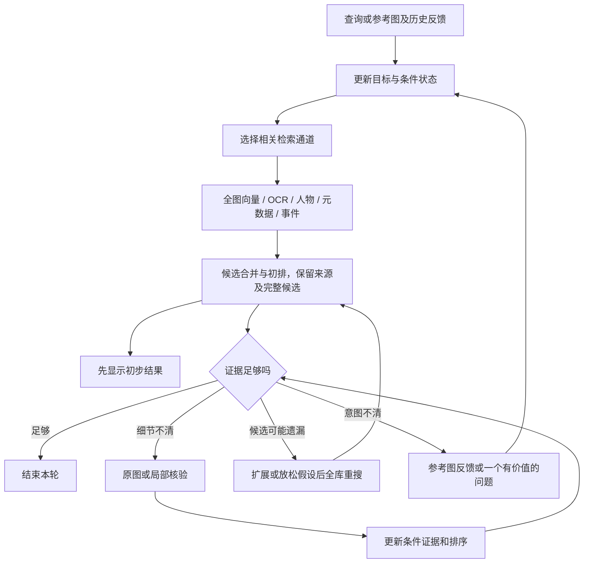

# PhotoRecall：SCM、Lap 源码审计与统一检索框架建议

日期：2026-10-27。范围：实际代码中的模型与搜索链路、七类需求覆盖、重点论文及可验证方案。本轮没有修改 PhotoRecall 的检索实现，没有安装或运行竞品，也没有产生新的准确率或速度实测。

## 1. 项目目标应如何确定

你的推进顺序成立：先建立可用系统，证明体验与客观结果提升，再提炼论文问题。补充两点：从第一天保留可重复实验；在动手前对照已有工作，避免完成后才发现只是复现。

产品目标：用户用自然语言、参考图或少量反馈，在个人图库中找回一张或一组照片。简单问题直接返回，复杂问题按需增加计算；准确性优先，但每次扩展都要有预算、取消和停止机制。

“统一覆盖七类需求”应指它们都有处理路径和可评估输出，不等于已经能对任意问题给出正确答案。无法辨认的图片、用户记忆完全错误、图库无目标都需要被区分。

## 2. 本轮源码审计依据

沿用上一轮取得的固定提交，避免把不同时间的网页和代码混在一起。主结论来自函数实现，不依赖 README 的性能宣传。

| 项目 | 固定提交 | 已核对主要文件 |
|---|---|---|
| SCM | `3833216610aeb77c2c1488b7b6ebab745a1c9ef7` | `indexer/models.ts`、`indexer/indexer.ts`、`main.ts`、`main-lib/rank-search.ts`、`main-lib/llm/models.ts`、`main/ipc/llm-ask.ts`、`src/hooks/useMemorySearch.ts` |
| Lap | `6c14b183e2ce5bf1035f57fad790ced706b342f4` | `scripts/download_models.sh`、`src-tauri/src/t_ai.rs`、`src-tauri/src/t_sqlite.rs`、`src-tauri/src/t_cmds.rs`、`src-vite/src/components/ImageSearch.vue` |

这是指定版本的静态审计，不宣称穷尽项目所有路径或等于实际性能测试。

## 3. SCM 实际怎样搜索

### 3.1 模型

[固定版本模型注册表](https://github.com/allenv0/SCM/blob/3833216610aeb77c2c1488b7b6ebab745a1c9ef7/indexer/models.ts#L81)

- 默认：`Xenova/clip-vit-large-patch14-336`，CLIP ViT-L/14@336，768 维，量化图像推理配置。
- 可选：`onnx-community/siglip2-large-patch16-256-ONNX`，SigLIP2-L/16@256，1024 维。
- 另有名为 EmbeddingGemma-2 的图文可选注册项，768 维；本轮没有独立验证该权重及其效果，不将其列为我们的推荐主模型。
- 每个图库选择一个活动模型并使用对应索引，并非三个模型每次同时投票。代码中的作者自测速度和小样本成绩不能当作我们的测试结果。

### 3.2 主搜索路径

建库侧：图片预处理 → 图像向量；文件名短语也可有向量；OCR 等信息后台补充、缓存。查询侧：活动模型编码查询（含代码中的文本均值校正）→ 扫描图库向量 → 规则加分 → 截断 → OCR 排序补充 → 近重复抑制 → 返回。

[评分核心](https://github.com/allenv0/SCM/blob/3833216610aeb77c2c1488b7b6ebab745a1c9ef7/main-lib/rank-search.ts#L218)具体做法：

1. 遍历图库，计算余弦相似度；不是此函数内的 HNSW 搜索，也不是 VLM 联合看图。
2. 文件名词面命中加分，系数 0.2。
3. 文件名有字面重合时，允许文件名短语向量补分，系数 0.6；不是对任意照片生成细节描述。
4. 应用最低分和图库相对分位截断，OCR 字面命中有部分保留例外。
5. 截断后再加 OCR 词命中的排序分，系数 0.5，避免 OCR 抬高截断线后挤掉纯视觉结果。
6. 结果较多时扫描至多前 500 个候选，使用图像向量相似度大于 0.92 的近重复规则，最后取 topK；具体执行受候选数量与选中数量分支影响。

这里有两处不能照搬：

- 集合检索要找全时，分位截断和近重复隐藏可能移除用户想要的照片。建议展示时分组，保留可展开的全部成员与完整候选池。
- 注释称保留前 60%，但代码用 `floor(N*(1-relativeKeep))` 作降序边界。relativeKeep=0.6、100 个互异分数时，无其他约束会保留前 41 个，而非 60 个；同分、绝对阈值和 OCR 例外会改变数量。这是静态推导，不是运行复现。此前若仅按注释理解“保留 60%”，应以本次实际代码审计为准。

[main.ts 的阈值校准](https://github.com/allenv0/SCM/blob/3833216610aeb77c2c1488b7b6ebab745a1c9ef7/main.ts#L579)使用噪声与样例查询估计分数范围。它是启发式阈值设置，不是验证了正确率的置信度模型。

### 3.3 Ask 模式不是逐张视觉核验

[模型表](https://github.com/allenv0/SCM/blob/3833216610aeb77c2c1488b7b6ebab745a1c9ef7/main-lib/llm/models.ts#L61)默认 Qwen3-1.7B Q4_K_M，另有 Llama3.2-3B，明确为文字模型、MVP 无视觉输入。

[Ask 处理函数](https://github.com/allenv0/SCM/blob/3833216610aeb77c2c1488b7b6ebab745a1c9ef7/main/ipc/llm-ask.ts#L211)收集 OCR、对白、文件名等文字证据，无证据时直接返回。不能将它描述为“视觉 Agent 已能理解任意照片细节”。

**判断：SCM 是扎实的本地检索工程参考，但主搜索没有已经解决否定、数人、错误记忆或严格属性绑定的专门机制。**

## 4. Lap 实际怎样搜索

### 4.1 模型与图像信息损失

[下载脚本](https://github.com/julyx10/lap/blob/6c14b183e2ce5bf1035f57fad790ced706b342f4/scripts/download_models.sh)：默认图文权重来自 CLIP ViT-B/32 的量化 ONNX 导出。

[图像处理](https://github.com/julyx10/lap/blob/6c14b183e2ce5bf1035f57fad790ced706b342f4/src-tauri/src/t_ai.rs#L466)直接缩放为 224×224，再归一化并编码。建库时优先使用已有缩略图，失败回退原图。

这有利于成本，但可能损失细小文字、物种特征、手势和背景人物；直接拉伸还改变宽高比例。这是从处理过程推导的信息风险，未实测其影响大小。不能看到界面流畅，就认定模型可以精确理解局部细节。

多语言选项从 lap-binaries 的发布附件获取文字模型；检查了输出维度匹配，但该下载入口本身没有足够依据让本轮确定其上游训练来源。**不擅自给它冠以 NLLB 或 XLM 的名字；维度相同本身也不证明跨模型语义空间对齐。**

### 4.2 搜索路径

[实际函数](https://github.com/julyx10/lap/blob/6c14b183e2ce5bf1035f57fad790ced706b342f4/src-tauri/src/t_sqlite.rs#L6874)：

1. 文字查询编码成向量；以图搜索则取指定图片已有向量，必要时生成。
2. 从 SQLite 取可搜索文件的向量 BLOB，应用相册、文件类型和排除范围等约束。
3. Rust 逐行计算余弦相似度，保留超过可配置阈值的结果。
4. 相似度降序排序。
5. 批量读取照片信息后，按原相似度 ID 顺序恢复输出。

在这个搜索函数内，没有发现大视觉模型精排、OCR 联合排序或多轮错误记忆处理；也没有固定前 64 截断。这里是线性扫描，不能将其他模块用于近重复分组的 HNSW 实现误写成主文字搜索算法。

**判断：Lap 值得借鉴数据接入、以图检索、资源身份和排序回填；不足以单独成为我们的高准确率统一框架。**

## 5. 七类目标，以及源码能覆盖到哪里

“支持”以下均指存在处理能力，不代表在每张图上识别正确。

| 类别 | 例子 | SCM/Lap 的现有帮助 | 我们仍需补什么 |
|---|---|---|---|
| S1 指定照片 | 生日双手合十的那张 | 全图语义召回、Lap 参考图 | 目标池外恢复、细节区分、前排质量 |
| S2 找一类全部照片 | 所有有鸟的照片 | 对全库评分 | 分页/覆盖管理、类别核验、保留相似连拍；不能用去重替代找齐 |
| S3 模糊或错误记忆 | 好像晚上，可能 2019 年 | 模糊语义能提供起点 | 不确定条件与可撤回假设、事件关联 |
| S4 多轮反馈 | 不是这些，第二张接近 | 历史查询/参考图可借鉴 | 反馈作用范围、状态更新、全库重搜 |
| S5 细粒度 | 喜鹊而非其他鸟 | 基础模型部分知识 | 高分辨率局部和专项识别；开放类别无法保证 |
| S6 否定/数量/关系 | 没车；只有一人；人在车左边 | 向量可能提供弱相关候选 | 对象绑定、明确冲突和未知判断 |
| S7 文字/小细节 | 某银行名的纸、远处小鸟 | SCM OCR；Lap 图像检索 | 原图 OCR、局部放大、图像不可读判断 |

没有核实到一篇论文已经把这七类需求全部高质量解决。应选择主框架，再补模块，并按类别验证；不能把能力覆盖表当效果证明。

## 6. 重点论文与应该如何使用

| 工作 | 核心机制和可复用部分 | 主要对应需求 | 代码/验证边界 |
|---|---|---|---|
| [DeepImageSearch / ImageSeeker](https://arxiv.org/html/2602.10809v1) | 语义检索、元数据、看图工具、照片子集及记忆 | S1、S3、S4，部分集合与复杂条件 | [官方代码](https://github.com/RUC-NLPIR/DeepImageSearch)；人大/OPPO 作者。是主框架参考，不是七类全解产品 |
| [PlugIR，ACL 2024](https://aclanthology.org/2024.acl-long.46/) | 把多轮对话整理成查询；基于候选提非重复问题 | S3、S4 | [官方代码](https://github.com/Saehyung-Lee/PlugIR)。方法不要求重训检索器；候选偏离和用户记错仍需补救 |
| [AMBER，2026 预印本](https://arxiv.org/html/2610.02831v1) | 从多次局部排序聚合全局名次，自适应分配比较预算 | S1、S5、S6 的候选排序，非完整逻辑证明 | [官方代码](https://github.com/wnlfc/AMBER)。只在给定池内；批量查询调度不等于单用户延迟优化 |
| [Qwen3-VL-Embedding/Reranker](https://arxiv.org/abs/2601.04720) | 双编码召回与图文联合相关性精排 | S1、S2 基础排序，其他类别部分支持 | [模型及推理代码](https://github.com/QwenLM/Qwen3-VL-Embedding)。可作强基线，不替代条件核验 |
| [NegBench](https://negbench.github.io/) | 否定检索评测及合成负向描述训练研究 | S6 | [代码与数据构建](https://github.com/m1k2zoo/negbench)。说明否定已有研究；不是“少人做因此必然新颖” |
| [UMIVR，ICCV 2025](https://arxiv.org/html/2507.15504v1) | 识别文本歧义、检索映射不确定性与帧质量，并生成针对性问题 | S3、S4，画质判断可借鉴 | [官方实现](https://github.com/bingqingzhang/umivr)。原任务是视频，迁移照片属于我们的待验证设计 |
| [PhotoCraft，2026 预印本](https://arxiv.org/abs/2606.03099) | working/episodic/semantic 分层记忆，训练无关的 Agent 增强 | 长链路 S3、S4 | 本轮仍未确认完整官方实现；搜索到同名照片编辑器不能冒认为该论文代码 |
| [Ask-to-Retrieve，ICMR 2026](https://dl.acm.org/doi/10.1145/3805622.3810597) | VQA 引导的信息增益提问 | S3、S4 | 论文元数据可检索，本轮正文提取失败；未核实官方代码，不列为首选复现对象 |

### 6.1 哪一篇最适合做整体起点

选择 ImageSeeker 的工具边界作为研究骨架，而不是把 SCM 或 Lap 包装成万能 Agent。已有论文证明多步上下文检索值得研究，但不证明框架复制后就好用。该论文表 3 的指定配置中，去掉元数据读取工具，F1 从 36.8 降到 31.1，说明元数据在这个任务里有实测价值；不是 PhotoRecall 的预计提升。

### 6.2 哪一篇最直接对应“精排有时更差、还很慢”

AMBER 值得对照，但不能直接当提速保证。主要实验是前 50 候选、每次观察 10 张，平均 24 次 VLM 调用；低预算平均 8 次。CIRR 的 R@1 从同池基础模型 48.80 到 54.07，但 R@50 仍为 96.94：**候选内重排不创造池外召回**。这些指标不是你图库的成功率。

本轮读到了完整实验设置；这使我们更应谨慎地选择性借鉴，而非默认多次 VLM 竞争比一次专用 reranker 更适合本机。

### 6.3 闭源产品与论文不能随意对应

Google Ask Photos 的官方说明披露先出结果、再后台处理复杂查询；Excire、Peakto 有成熟产品入口。但本轮没有核实它们公开了可复现的完整生产架构。不能因某公司参与论文就认定手机产品采用同一实现，也不能把某个产品演示归功于我们猜测的模型。

## 7. 建议的统一框架：一个核心，按证据不足的原因升级

以下为本项目设计建议，不是声称已有论文已验证全部组合。

### 7.1 建库：把可提前完成的计算移出搜索等待

保留稳定 photo_id、原图与缩略图关系、索引版本和每项任务状态。全图 embedding 必需；OCR、人物、时间地点和时间邻近事件按数据情况补充。描述可作补充检索通道，不把描述当原图的完整替身。

不必为所有照片固定生成大量局部向量。先对已知细节问题或高价值照片建立局部索引，核验时再读高分辨率原图。离线索引耗时和在线查询延迟分别报告。

### 7.2 查询状态：先确定哪些条件可以信任

记录目标是“一张”还是“一组”，并将条件标为确定、猜测、撤回。保留“不知道”和“可能记错”，不要擅自把推测改成事实。对“第二张类似”，记录引用的 photo_id；不要只存其当前排序位置。

普通短查询可以直接走检索，不强制先调用 LLM。复杂句再解析；“简单/困难”不能仅凭句子长度判断。高相似度也不是正确概率。

### 7.3 召回：扩大空间，但不盲目给重复信号加票

从单一强召回器开始，按题目启用 OCR、人物或时间等必要通道。跨模型用排名融合或经验证的分数校准，不直接相加不可比相似度。给各通道保留候选配额，避免一个通道包揽。

初始可以试验合并 200—500 个候选、首屏只展示 20 个；这是待调参数，不是新固定上限。集合任务持续分页/扩展，不宣称首批结果已找齐。多路和更多候选也可能引入噪声，必须测净收益。

### 7.4 核验：区分相关性与必要条件

普通相关性 reranker 回答“像不像这段描述”；条件核验回答“是否支持这个具体条件”。两者分开记录。

例：“红衣人在黑车左边”，需要识别人和车、正确绑定颜色与位置；“没有车”需要给出足够视野下的不存在证据，未检测到不等于不存在。

输出可采用支持、冲突、未知及证据区域。只有经过验证的明确冲突才能用于强排除；未核验和看不清不能被自动藏掉。用户要求“只有一人”时，背景人物同样需要纳入定义。

### 7.5 调度：依据失败原因决定下一步

| 情况 | 合理行动 | 不合理的固定动作 |
|---|---|---|
| 普通对象语义已足够 | 返回并允许用户继续 | 每题跑完 64 张看图 |
| 候选总体接近，但某个局部不清 | 放大少量关键区域核验 | 给整张缩略图反复打分 |
| 候选都不对或反馈否定 | 检查索引覆盖，扩大/改变召回 | 永远在原 top64 重排 |
| 多个合理解释并存 | 参考图选择或一个区分性问题 | 自动补造具体细节 |
| 证据持续不足 | 返回可能结果与不确定点，允许取消 | 无预算循环直到模型给出肯定答案 |

首版用少数明确规则实现调度，不急于训练策略网络或复杂多 Agent。可用“最多再扩展两次”“核验批次 4/8 张”等作为试验预算；必须测当前硬件表现后再定默认值。新结果若因异步回填改变排名，要保持 photo_id 与核验记录绑定。

## 8. 模型怎么选，怎样不再陷入不断换模型

### 推荐比较的最小集合

- 保留项目当前 WeMM/SigLIP 路径，作为历史基线；本轮没有重跑，不宣称当前表现已知。
- 加一个 Qwen3-VL-Embedding-2B 基线，使用官方查询模板与前处理。先测试它是否胜出，再决定替换。
- 在学校 A40 上用 8B 版本做质量上限对照，不将“更大必然更准”作为假设。
- 精排对照：不精排、专用 Qwen3-VL-Reranker-2B、现有 CORE。只跑固定同池，再看全链路。
- Qwen3-VL 指令视觉模型负责按需条件核验，和专用 Reranker 不是同一个任务；少量云端疑难图为可选分支，基准评估中单列成本和收益。

不用为了模仿 Lap 把主模型退回 ViT-B/32，也不因 SCM 默认 CLIP-L 就认定它对中文个人相册最好。编码速度、索引体积、分辨率与中文细粒度都需要同图库比较。

M1 Pro 16GB 的本地常用配置与 A40 的质量实验分开；两张 A40、每次六小时可以运行分批实验和缓存向量，不保证任意 8B 模型、分辨率、并发或训练配置均可直接容纳。首期不训练基础视觉模型。

## 9. 验证怎样做，才同时服务产品和论文

### 阶段 A：先把错误来源分开

1. 目标是否在完整索引里？
2. 是否进入候选前 50/100/500？
3. 同一候选集上，精排前后目标名次怎样改变？
4. 条件核验是否错排除？
5. 数据库回填、分页、去重与前端展示是否再次改变顺序？

正确目标不在池里时，不能归咎于精排；目标池内但显示不对时，也不能直接换 embedding。

### 阶段 B：最小实验序列

| 版本 | 变化 | 要回答的问题 |
|---|---|---|
| B0 | 一个检索器，最少规则 | 普通召回实际能达到哪里 |
| B1 | 替换一个召回器，同图库同问题 | 更强模型是否真有收益 |
| B2 | 在选定召回器上加相关通道 | 互补证据是否减少遗漏 |
| B3 | 固定候选，对照几种精排 | 是否改善前排，哪些类别退化 |
| B4 | 加按需条件核验 | 严格条件更准，还是错排除更多 |
| B5 | 加反馈与池外恢复 | 首轮失败后能否找回 |
| B6 | 加预算调度 | 同等调用成本下是否更好，简单题是否减少等待 |

这张表是实验顺序，不要求累计保留每个模块；无净收益就撤回。

### 阶段 C：数据与指标

先用 30—40 个已知答案的开发问题筛错，再扩大到例如 150—300 题的分层集合，留下不参与调参的测试部分；数量是工作量建议，不是统计充分性保证。

公共数据分工：DISBench 测上下文，CIRR/CIRCO 测参考图与修改、单/多目标，NegBench 测否定，PhotoBench 可作个人照片检索对照，具体下载资格、许可与标注协议执行前核对。不能把它们混成一个无定义准确率，也不要用合成查询同时训练与测试。

| 目标 | 主要报告 |
|---|---|
| 单图找回 | Hit@1/5/20、目标排名、候选覆盖 |
| 集合找齐 | 集合查准/查全与 F1；按相似连拍定义明确相关集 |
| 否定/关系/细节 | 条件级错误、错排除率、未知率，不仅总体相关度 |
| 多轮恢复 | 1/2/3 轮累计成功、额外调用数、用户回答负担 |
| 时间 | 首批结果、完成时间的中位数/P95，冷启动与热启动分开 |
| 体验 | 盲测两个排序版本，找对所需时间、点击/反馈次数与偏好；开发者自己觉得好不能替代 |

当允许系统说“无法判断”时，同时报告覆盖率和被回答问题的正确率，防止靠少回答获得表面高准确率。图库无答案也要单列评测。

## 10. 论文放在什么位置

将产品开发与论文贡献同时观察，但不让“凑一个新框架名称”决定功能。

可能的具体贡献包括：错误记忆条件的撤回与恢复；候选外恢复的预算决策；否定与属性绑定中保留未知证据；在固定预算下避免精排退化。它们只是候选问题，需要逐项查重，不能现在认定原创。

如果最终提升只来自更换强模型或修复排序 ID，则优先作为工程成果。若某个机制在公共任务和保留测试中都有效、对比强基线仍胜出，并能通过消融说明原因，再考虑投稿。人类体验明显提升是产品证据；论文还需要客观实验、相关工作与可重复记录。

**建议实施基调：借 SCM/Lap 的工程习惯，借 ImageSeeker 的工具边界，选择性加入 PlugIR 的反馈机制与 AMBER 的预算思想；以七类任务验证每个新增模块。先搭一个简洁、可回退、可测的系统，再让实验决定论文贡献。**
