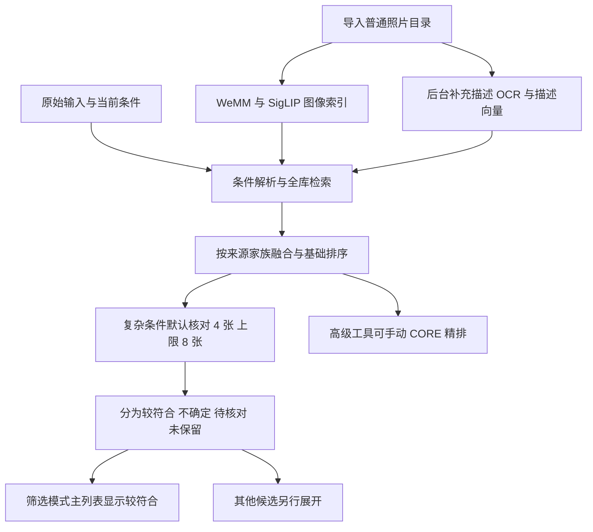
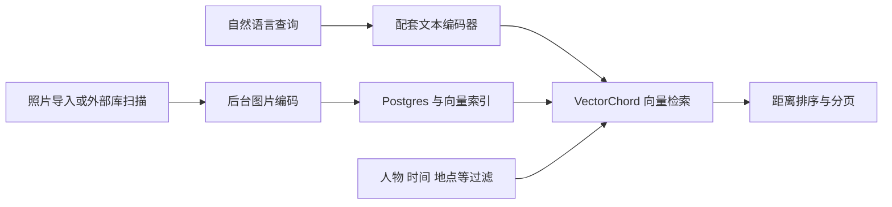
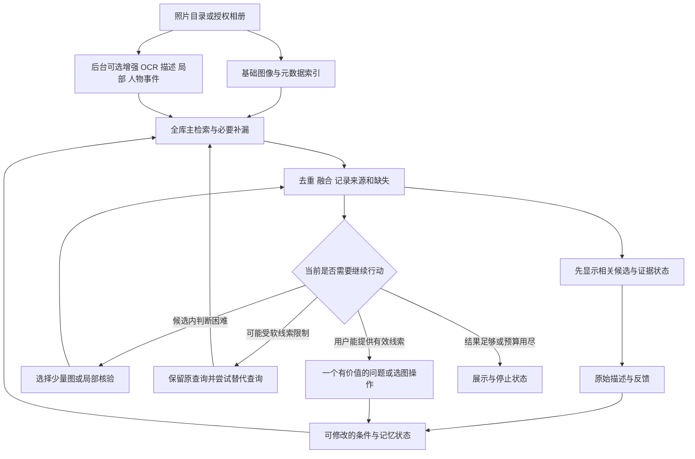

# PhotoRecall 项目全景档案与研究路线总整理

> **项目目标：让用户凭不完整、模糊甚至部分错误的记忆，通过自然语言和少量反馈，从自己的照片中可靠地找回目标。**
>
> **研发原则：准确率优先，速度其次；先用现成模型建立强基线，定位失败环节，再决定是否需要训练。**
>
> 本文把最初想法、需求变化、已实现的原型、模型尝试、实际失败、外部方案调研和潜在研究方向串在一起，作为后续开发与研究的统一入口。

**整理日期：2026 年 10 月 21 日。**

**资料时间范围：主要探索与调研发生于 2026 年 10 月 13—17 日；本次于 10 月 21 日重新读取项目文档、实验记录及部分当前代码、数据库状态。本文不是截至 10 月 21 日的全网文献穷尽更新。**

**当前项目位置：** `/Volumes/Lexar/桌面项目归档/PhotoRecall`。

**阅读方式：**第 1—4 节讲项目是什么、为什么演变；第 5—9 节讲实际做过什么、效果和问题；第 10—14 节讲外部建议、竞品、用户反馈与论文；第 15—19 节讲训练、任务拆解、拟议架构和验证；第 20—22 节给出当前结论、未完成清单和资料入口。

**项目速览：**

| 最关心的问题 | 当前答案 | 详细位置 |
|---|---|---|
| 到底要做什么？ | 帮用户凭模糊记忆和少量反馈，找回指定照片或一类照片 | 第 1—3 节 |
| 已经做到什么？ | 有本地桌面原型；图像／文字混合检索、精排与核对等组件已接入 | 第 4—6 节 |
| 效果是否已经很好？ | 部分开发任务排名改善；独立准确率、整体延迟与竞品优势尚未证明 | 第 7—8 节 |
| 为什么继续研究？ | 初次漏召回、错误记忆与多轮恢复仍有实际问题 | 第 9—16 节 |
| 接下来最值得做什么？ | 修好基线，验证一条可靠的目标恢复策略，再决定训练或扩展 | 第 17—21 节 |

**章节导航：**

- [原始想法](#1-最初为什么想做-photorecall) · [项目目标](#2-现在整个项目的目标是什么) · [八类场景](#3-从用户表达归纳出的八类场景) · [探索时间线](#4-项目探索是怎样一步步变化的)
- [原型现状](#5-已经做出来的原型是什么) · [模型清单](#6-用过哪些模型分别做了什么) · [实际效果](#7-实际得到过哪些效果) · [失败原因](#8-效果为什么不好按失败位置拆解)
- [尝试方向](#9-已经探索过哪些改进方向) · [外部建议复核](#10-用户提供的外部方案吸收了什么又修正了什么) · [大公司思路](#11-大公司公开资料带来的架构启发) · [Immich](#12-immich-深入研究为什么它是必须认真对待的基线)
- [市场与用户反馈](#13-市场上已经有什么是否还有做的必要) · [论文和开源清单](#14-论文开源项目和它们分别解决了什么) · [数据与训练](#15-没有自建大数据训练路线是否可行)
- [拆解小问题](#16-把整个大项目拆成哪些小问题) · [拟议架构](#17-基于全部探索形成的拟议架构) · [实验设计](#18-怎样做实验才能证明链路变好了)
- [实施与手机路线](#19-后续实施顺序与个人可行性) · [当前判断](#20-截至本次整理可以确认什么) · [待办](#21-下一次继续工作时的检查清单) · [本地证据](#22-本地证据与原始资料入口)

---

## 0. 先区分：事实、观察、建议与设想

这段探索中，出现过很多“可以做”“值得尝试”“已经接通”“测试通过”。它们代表的进展不同，不能合并成一个已经成熟的系统。

| 本文标记 | 含义 | 不能据此推断 |
|---|---|---|
| **已实现** | 代码中已有对应流程，或有明确实施记录 | 所有图库都已完成处理、效果已经达标 |
| **已做开发集验证** | 在少量已知照片、接口或人工选定任务上有结果 | 在独立真实任务中达到同样准确率 |
| **用户观察** | 实际使用中报告的问题或改善 | 已完成控制变量实验、原因已经唯一确定 |
| **代码／记录审计** | 从代码、缓存、数据库或历史日志定位问题 | 每个问题都已重新运行模型复现 |
| **外部作者报告** | 论文、模型卡或厂商公布的方法与结果 | PhotoRecall 已复现，或可直接换算为相册准确率 |
| **拟议方案** | 讨论形成、尚需实现和验证的路线 | 已经带来收益 |
| **潜在研究点** | 有明确问题、可能值得实验的方向 | 已经确认新颖、一定可以发表论文 |

本次整理只读核对现有成果并生成本文，没有重新训练模型、重新跑私人图库准确率测试，也没有上传照片。

主要依据包括：原始研发聊天《调研 AI 照片搜索方案》、本聊天的架构与市场探索、引用聊天《PhotoRecall深度调研》、用户粘贴的外部方案，以及项目 `docs/` 和 `data/` 中的记录。引用聊天是讨论材料；其中的外部事实仍以一手来源与实际记录为准。

---

## 1. 最初为什么想做 PhotoRecall

### 1.1 原始问题：记得经历，找不到照片

最开始的困扰不是缺一个照片分类器，而是：照片越来越多，用户记不清年份和文件位置，却仍然记得一些画面、人物或经历。

典型表达是：

> “我记得以前有一张大树的照片，旁边可能有一辆车，但不知道是什么时候拍的。”

用户希望先输入一点记忆，看到可能的照片；然后继续补充“还有车”“车好像是蓝色”“应该只有一个人”，一步步找回目标。

因此，最初的想法已经包含三个部分：

1. 用自然语言描述照片，而不是依赖文件名、预先手写标签或准确日期。
2. 能继续追加和纠正条件，搜索过程具有连续性。
3. 从一个有很多照片的库中，找到某一张、几张，或者一类照片。

当时用“AI Agent”“大语言模型”“分析软件”“网站”等称呼探索实现形式。后来逐渐明确：**核心是一套照片检索系统，LLM 可以帮助理解、组织和互动，但不需要从零训练一个大语言模型。**

### 1.2 很早就提出的范围要求

项目不能只绑定某个 App 或某家手机厂商的生态。

除了 iPhone 相册，还要考虑 Mac、Windows、移动硬盘、旧手机备份和普通图片文件夹。即使是十几年前的 PNG／JPEG、数字文件名、没有人工标签，也应该能根据可见画面搜索。

这带来两个独立问题：

- **内容理解：**图片里有什么、在做什么、与描述有什么关系。
- **资料接入：**图片在哪、有没有授权、文件是否离线、索引是否完成、是否还能打开原图。

没有 EXIF 的照片仍能做内容检索，但无法凭空知道拍摄年份。跨平台接入也不会自动提高模型的理解能力。

### 1.3 用户一直强调的底线

- 改进要适用于整个链路，不能只把某一张生日照或某一次 iPod 搜索调好。
- 模型分数高不够，要确实找到用户需要的照片。
- 大类搜索不能因为预算少，最后只给一两张。
- 精排不能经常把本来正确的照片压到后面。
- 可以慢一点，但不能每次都等一分钟甚至更久。
- 尽量不要求大规模自行收集、标注训练数据。
- 最终有做成手机 App 的愿望，但先把桌面上的实际检索效果做好。

这些底线贯穿了后续的模型更换、流程重设计和研究定位。

---

## 2. 现在整个项目的目标是什么

### 2.1 长期目标

**帮助用户从自己的大量照片中，通过自然语言、不完整记忆与少量交互，可靠地找回目标，并能清楚知道哪些结果已经获得证据、哪些仍不确定。**

长期规模可以是一万至数万张；这目前是目标规模，不是已完成的统一质量验收规模。

### 2.2 两种主任务必须分开

| 主任务 | 用户真正想得到什么 | 首要指标 |
|---|---|---|
| **找一张／少数指定照片** | 心里有目标，希望尽快看到它 | Success@1／5、多轮成功率、找到目标的总时间 |
| **找出一类照片** | 希望尽量找齐，如所有鸟、所有某次旅行中的用餐照片 | Precision、Recall、分页覆盖、漏检与误报 |

第一种任务可能只需要前五张中的一张正确；第二种任务不能因为前五张很准，就宣布全库已经找齐。

### 2.3 优先级与现实资源

| 维度 | 目前共识 |
|---|---|
| 准确性 | 第一优先，尤其关注目标漏召回和错误降序 |
| 失败恢复 | 第一轮失败后仍能重新寻找，不能困在原候选集 |
| 速度 | 次于准确性，但必须测量和限制无意义计算 |
| 实现难度 | 尽量复用现成模型与公开代码，避免一开始叠太多模块 |
| 训练 | 可探索专项微调；目前没有必须训练的充分证据 |
| 桌面环境 | 已有 M1 Pro／16GB Mac 原型，使用 MPS 与本地 Ollama 等组件 |
| 训练算力 | 学校可同时使用两张 A40，每次六小时 |
| 云端 | 用户接受可选云端核对，只上传少量候选；不是默认上传全库 |
| 移动端 | 长期产品目标；不作为第一轮研究实验的硬性限制 |
| 论文与商业化 | 先验证有用的结果；实验规范和相关工作检查从第一天开始 |

### 2.4 “90%／95%”应怎样理解

最初提出“准确率希望达到百分之九十多”，表达的是体验目标。它需要进一步定义。

可以讨论的一个目标是：

> 在目标确实存在、线索可验证的独立任务中，经过最多三轮交互，目标进入前五张的比例。

但还要同时报告无目标时的错误确认、严格条件违反、未完成索引和耗时。不能通过隐藏大量未知照片来制造高精确率，也不能只报告最好的一类查询。

**目前没有证据证明 PhotoRecall 已经达到整体 90% 或 95%。**早期文档中的 98% 候选命中、90% 首轮成功、95% 三轮成功及秒级延迟均属于建议门槛，不是已测成绩。各版提出过不同规模的测试集和预算，它们是探索中的方案变化，没有全部执行。

---

## 3. 从用户表达归纳出的八类场景

这些场景不是八个互斥按钮。一次输入可以同时包含单目标、否定、人物、时间和不确定偏好。

| 编号 | 场景 | 示例 | 难点 | 在当前路线中的位置 |
|---|---|---|---|---|
| S1 | 指定照片找回 | “生日时双手合十许愿的那张。” | 目标进入候选、靠前、区分相似连拍 | 核心任务 |
| S2 | 集合检索 | “把所有有鸟的照片找出来。” | 找齐、控制误报、继续浏览，不能被 64 张封顶 | 长期核心任务，独立评测 |
| S3 | 模糊／错误记忆 | “好像晚上吃饭，附近可能有山。” | 不完整线索、记错颜色或年份、不可靠条件 | 核心研究候选 |
| S4 | 多轮反馈 | “不是这些，第二张比较像，应该在室外。” | 更新状态、理解反馈范围、重新搜索全库 | 核心能力 |
| S5 | 开放类别细粒度 | “只找喜鹊，不要其他鸟。”“某型号汽车。” | 相似类别、局部特征、模型知识不足 | 专项增强，非首期全覆盖 |
| S6 | 否定、数量、属性与关系 | “只有一个人。”“没有车。”“红衣人在黑车左边。” | 否定、数背景人物、绑定正确对象、视角歧义 | 困难测试与按需核验 |
| S7 | 文字与微小／模糊细节 | “写着某银行名字的纸。”“远处一只小鸟。” | OCR 漏字、分辨率、文字不可读、局部定位 | 辅助检索与 Unknown 管理 |
| S8 | 人物、事件与跨照片关联 | “和小明去云南时在饭店拍的照片。” | 目标图本身未必出现小明或地标，需要同事件证据 | 后续上下文增强 |

另有一个必须贯穿所有场景的边界：**图库里可能根本没有符合要求的照片。**系统需要允许未找到、证据不足和适当停止。

### 3.1 为什么不能完全依靠提前写标签或描述

用户指出过一个关键问题：一张图片内容很多，提前生成的描述只要漏掉用户后来关心的一点，就可能失去检索入口。

例如描述只写“生日聚会”，没有写“双手合十”；或写“汽车旁合照”，没有写背景路人。仅靠这段文字，后续问题再精细也无法恢复未记录的信息。

因此形成的共识是：**保留原图；图像特征作为主检索表示；描述、标签、OCR 和元数据用于补充；必要时针对当前问题重新查看原图或局部。**

### 3.2 几个不能混淆的概念

- “有一个主要人物”与“全画面恰好只有一个人”不同。
- “同一画面里有人和车”与“这个人在和这辆车合照”不同。
- “画面左侧”与“车辆自身左侧”不同；二维框不能单独证明三维车头前后。
- “没有检测到人”与“可以确认没有人”不同。
- “照片中写着银行名，但看不清”与“可以确认没有银行名”不同。
- “用户明确要求蓝车”与“用户觉得可能蓝车”不同。
- “照片属于和小明的旅行事件”与“照片里可见小明”不同。

这些差别解释了为什么普通语义相似度即使很高，仍不等于满足完整需求。

---

## 4. 项目探索是怎样一步步变化的

下表按主要探索顺序整理，不把所有讨论强行对应成独立发布版本。v0.3、v0.4、v0.5 是记录中已有称呼；后续 Agent 方案尚未成为已验收版本。

| 阶段 | 当时的想法／问题 | 做了什么或形成什么方案 | 得到了什么认识 |
|---|---|---|---|
| ① 最初设想 | 模糊记忆找图、树→车→颜色逐轮筛选 | 调研系统相册与开源方案，明确不必从零训练 LLM | 已有很多产品，关键是实际找回能力 |
| ② 基础原型 | 先验证能否搜索普通文件夹 | 网页、本地图库、缩略图、元数据、SigLIP 2 语义索引、条件状态 | 流程能跑，整图相似度对细节不足 |
| ③ 多维描述与逐项核对 | 光影、构图、动作、人数容易不准 | Qwen 解析、详细画面描述与字段向量、Qwen-VL 看图核对 | 描述有帮助，但遗漏、猜测和逐图开销明显 |
| ④ v0.3 数量筛选 | “只有一个人和车”混入多人照 | 结构化数量约束、YOLO 检测下限、候选逐项核对、Unknown | 背景与遮挡人物仍困难；只显示通过者会降低覆盖 |
| ⑤ 重新审视架构 | 不能不断为单个失败补一道慢核对 | 查 Apple／Google、ImageScope、CORE，提出全图＋局部＋专业召回／精排 | 应先建可复用索引，查询只处理有限候选 |
| ⑥ v0.4 本机实现 | 验证准确率优先组合能否在 16GB Mac 运行 | WeMM-2B 整图、SigLIP 局部、RRF、CORE-2B、按需细节核对 | 少量任务改善，但完整精排常需一分钟以上 |
| ⑦ 通用排序链路改进 | iPod 等同类照片漏到 80—100 名或 64 之外 | 更大候选池、入口配额、前段预览、自动补查、缓存、批量与 UI 改进 | 预算选择、分数组合、显示顺序也会造成损失 |
| ⑧ 10 月 15 日审计与外部方案比较 | 精排插入无关图、延迟高、训练数据难准备 | 核查 0.5 分组、软条件丢失、相关来源重复投票；讨论学习排序与免训练混合检索 | 工程缺陷、模型能力、评测缺失必须分开 |
| ⑨ v0.5 本地混合检索 | 不希望每个查询默认精排 64 张 | 加 OCR、离线描述、描述向量、关键词；默认少量原图核对，CORE 转高级可选 | 查询工作可前移，但增强索引慢且不完整 |
| ⑩ 保守排序与展示调整 | 披萨照片核对矛盾、正确图反被后移 | 保留原始排名主干、限制调整、矛盾标 Unknown、OCR 后置、增加严格筛选 | “只核对四张＋主结果只显示通过者”又产生覆盖冲突 |
| ⑪ Immich 与市场深调研 | 同类产品很多，做这个是否还有意义 | 读取 Immich 固定版本源码、竞品及用户反馈 | 基础语义搜索不是市场空白，需证明困难任务优势 |
| ⑫ 训练路线探索 | 有两张 A40，但没有大规模自标数据 | 查公开数据、专项训练方法、复现规模与资源边界 | 小规模微调可探索，不能保证全面超过现成模型 |
| ⑬ 个人记忆与 Agent 研究定位 | 用户主要记得人物、事件和大致场景 | 讨论意图、行动选择、提问、错误线索、跨照片关联 | 重点从“模型越多越好”转向“下一步做什么才有价值” |
| ⑭ 相关工作复核 | 希望链路有原创性，可进一步写论文 | 对照 DeepImageSearch、PhotoCraft、A2R，并补充 UMIVR、AMBER | 总体 Agent 思路已有研究，要落实为具体机制与公平实验 |

整个过程并非沿直线不断变好。部分改动改善了精确性，随后暴露出漏检和速度问题；部分为提速缩小了核对范围，随后又损害结果覆盖。**这些取舍和退步同样是项目成果的一部分，应保留作为后续设计依据。**

---

## 5. 已经做出来的原型是什么

### 5.1 已有工程基础

- 普通目录导入、照片资源 ID、缩略图和元数据管理。
- 原图只读，保留用户原来的文件组织。
- 本地数据库保存向量、观察、会话与缓存。
- 按指纹、模型和前处理版本管理索引；支持增量、暂停、继续。
- 中文／英文描述搜索，追加、移除与纠正线索的会话接口。
- 图像整图与局部特征；描述、OCR 与文字特征的混合检索。
- CORE 相关性精排与 Qwen 逐项看图核对，两种操作分开。
- 检测数量下限、部分反证与不确定状态。
- 本机网页、进度、停止入口、原始排序回退及候选分组。
- 适配 16GB Mac 的大型模型互斥加载与阶段执行。

这些是原型基础，不代表已完成移动 App、人脸命名、事件图谱、自动高价值提问或完整自主 Agent。

### 5.2 当前代码主路径与已知矛盾

2026 年 10 月 21 日只读核对时，代码仍包含以下链路：

**目前仍能确认的设计冲突：**`app/hybrid.py` 默认核对预算为 4、上限为 8；`app/matching.py` 将没有 inspection 的候选设为 `unreviewed`；`web/app.js` 在筛选模式主列表使用 `matched` 分组。

因此，四张里只有一张核对通过，主列表就可能只剩一张。**这反映核对与展示规则，并不证明全库只有一张符合。**本次没有改动这个流程。

另外，数据库里的旧 `rerank_budget=64` 与当前混合路径的自动核对四张不是同一配置。不能看到“64”就判断现在默认仍在跑 64 张 CORE，也不能把四张 Qwen 看图核对叫作四张 CORE 精排。

### 5.3 10 月 21 日的索引覆盖快照

本次以只读方式查询已有数据库，得到：

| 图库照片数 | 有画面描述 | 有描述向量 | 有 OCR 记录 |
|---:|---:|---:|---:|
| 871 | 17 | 0 | 92 |
| 338 | 108 | 96 | 338 |

该快照与 10 月 16 日记录一致，但不能据此推断此前每一刻的处理状态。OCR 记录可能表示处理过而没有文字，不意味着识别内容正确。这里也没有重新验算所有视觉向量的覆盖和数值质量。

**“混合检索接口已接入”与“整个图库增强完成”是不同进度。**在增强索引不完整时，不能把完整混合方案的理论收益算成当前已经得到的收益。

---

## 6. 用过哪些模型，分别做了什么

### 6.1 实际接入或有本机调用记录的组件

| 组件 | 在项目里的用途 | 已有证据／运行情况 | 已暴露的限制 |
|---|---|---|---|
| **SigLIP 2 base patch16 224** | 最早的整图文本搜图；后来保留整图及四个重叠局部窗口补漏 | 本机 MPS 有效 768 维特征；已有真实图库索引 | 224 输入与全图语义容易漏小手势、背景人物和细关系；局部也会引入背景干扰 |
| **WeMM-Embedding-2B** | v0.4 主整图召回；2048 维 | 真实照片建库与搜索跑通；记录最大像素预算约 0.25MP | 模型较重；相关性不证明人数、否定和全部组合条件 |
| **CORE-Reranker-2B** | 对查询与候选图片联合评分 | 使用对应模板及 yes／no 评分；有 32／64 张候选实验 | 单图输入和联合推理仍昂贵；小模型会误判，评分融合也可能伤害排名 |
| **Qwen3 4B** | 自然语言条件解析、多轮需求组织 | Ollama 本地调用接入 | 可能遗漏分句、数词、软条件；短查询也调用会增加冷启动成本 |
| **Qwen3-VL 4B Instruct** | 详细画面描述、逐项原图核对 | 生日、人物与汽车等开发例调用；用于描述失败回退 | 背景漏数、推测、结构字段与解释矛盾；逐图生成慢 |
| **Qwen3-VL 4B 思考版** | 早期结构化看图尝试 | 准备记录显示输出预算耗尽后转用指令版 | 长推理不适合受限结构化核对；未证明其整体视觉能力更差 |
| **Qwen3.5 4B** | v0.5 离线生成结构化画面描述 | 接口与单图描述检查，部分图库已生成描述 | 描述会遗漏；全库准备耗时；失败与队列调度要处理 |
| **Qwen3-Embedding 0.6B** | 将照片描述与查询映射到独立的 1024 维文字空间 | 接口检查与部分描述向量已建立 | 只能搜索描述中表达的信息；不能与 WeMM／SigLIP 向量直接点积 |
| **YOLO26 nano** | 常见目标框、人数／物体数下限 | 权重与本机 CPU 检测记录；补出了部分背景人物 | 固定类别、遮挡和小目标限制；检测下限不是准确总数；存在误检 |
| **PaddleOCR／PP-OCRv6 medium** | 照片与截图文字、位置索引 | 独立本地 OCR 环境；合成中英文图片接口检查；部分图库处理完成 | CPU 长边 2048 串行处理曾阻塞其他增强任务；无文字照片也有检测成本 |
| **Apple Vision OCR** | 本地 OCR 备用／回退 | 合成文字接口检查 | 单张样例不构成与 Paddle 的准确率排名 |
| **SQLite／FTS5／NumPy** | 存储、文字索引、向量矩阵检索 | 原型实际使用 | 数据库负责检索，不会自行补回编码器未保留的语义 |

RRF 是合并排名的方法，不是视觉模型；Ollama 是运行服务；MPS 是硬件运行路径。它们不应与识别能力混为一谈。

### 6.2 只调研、建议对照或尚无本项目完整实验的模型

| 候选 | 当时考虑什么 | 当前状态 |
|---|---|---|
| Qwen3-VL-Embedding／Reranker 2B／8B | 专业多模态检索与精排基线 | 有公开模型；不能把 CORE 的本机实验算成原版 Qwen Reranker 的独立实验 |
| CORE-Embedding | 将组合精排能力蒸馏回召回 | 调研候选，未证明已替换主索引 |
| 更高分辨率／SO400M SigLIP 2 | 更强视觉或中文检索对照 | 待同图库比较 |
| NLLB-CLIP、XLM-RoBERTa＋ViT | Immich 的多语言／中文配置参考 | 外部基准候选，未做本机公平对照 |
| FG-CLIP 2 | 中英细粒度图文对齐、属性与区域 | 后续强基线候选 |
| READ-CLIP、NegationCLIP、PeakPatch、ReMatch | 组合、否定、轻量纠错或困难负样本训练参考 | 未在本项目完成训练或质量验收 |
| RAM／RAM++ | 一次粗标签辅助搜索 | 研究过标签路线，未作为唯一主干 |
| Grounding DINO、Grounded SAM 2、Florence-2 | 按问题定位、裁剪、分割 | 研究与规划，不能写成完整对象绑定已落地 |
| DINOv3、深度／关系模型 | 细粒度视觉、相对深度、关系提示 | 专项备选，不是已验证万能检索器 |
| ColPali／ColQwen 等多向量方法 | 借鉴局部与后期交互 | 主要证据来自文档检索，尚无自然照片迁移收益 |
| MobileCLIP、TinyCLIP、轻量 SigLIP | 手机端或蒸馏路线 | 选型和许可、转换、速度均待具体版本验证 |

**CLIP 是图文对齐方法家族；ViT 是视觉骨干；XLM 是多语言文本骨干；NLLB 原本涉及多语言能力，在 NLLB-CLIP 中是配套检索方案的一部分。**这些名称不处于同一层级，不能直接当作四个用途相同的“照片排序模型”比较。

---

## 7. 实际得到过哪些效果

### 7.1 v0.4 本机与索引记录

历史实施记录中，338 张照片建立了 WeMM 整图索引及 1,352 个 SigLIP 局部向量，耗时约 **420.3 秒**，当次未记录错误。该数字不包含后来 v0.5 全库描述与 OCR 的全部准备成本，不能换算成完整混合建库速度。

记录中的 CORE 预热评分约 **0.7 秒／图**，整批平均约 **0.8 秒／图**，冷启动另计。这说明只输出一个分数依然要进行昂贵的图像与语言联合计算。

### 7.2 同一开发任务的旧／新排名

下表复核了 `data/benchmark-v04.json` 与 `data/benchmark-varied-v04.json`。目标是用户指定或开发时人工选定的可接受照片，**不是锁定的独立测试集**。

| 查询 | 旧版指定目标排名 | v0.4 指定目标排名 | 当次脚本耗时 | CORE 预算 |
|---|---|---|---:|---:|
| 生日蛋糕、暗光、双手合十许愿 | 1、2 | 1、2 | 75.34 秒 | 64 |
| 只有一个人与汽车合照 | 12 | 5 | 63.60 秒 | 64 |
| 坐在驾驶位、手扶方向盘 | 1 | 1 | 63.76 秒 | 64 |
| 戴皇冠、闭眼、蛋糕前合十 | 2、1 | 1、2 | 63.39 秒 | 64 |
| 白色金属床头、右侧木柜、墙上合照 | 1 | 1 | 51.13 秒 | 32 |
| 绿色果实、很多叶子、近距离特写 | 34 | 1 | 44.56 秒 | 32 |
| 绿衣人撑浅蓝伞、前面三个蹲着的孩子 | 3 | 1 | 44.98 秒 | 32 |
| 玩具摊后的小女孩、背后蓝色自行车 | 1 | 1 | 48.91 秒 | 32 |

这些脚本时间包含旧基线计算、模型切换与精排等环节，不等于纯精排时间，也不是全部网页首屏等待。

能够支持的结论：新组合可以把部分目标明显提前，例如绿色果实由第 34 到第 1；对一些原本就在前面的目标能够保持位置。

不能支持的结论：八项全都“成功”就等于 100% 准确率。若干生日任务共享同一事件；有些目标旧版已经正确；查询与规则都参与过开发；完整条件误报、同类漏检和无目标任务仍未充分评估。

### 7.3 网页端到端与缓存复测

- 历史网页输入生日合十查询后，首批候选约 **16.78 秒**，完整 64 张精排约 **77.58 秒**，两张目标第 1、2。
- 对原图进一步核对约 **16.3 秒**，四项条件返回了可见依据。
- 移除暗光条件后仍保留其余条件，并使用同一会话重搜。
- 四个不同场景在方向修复后的缓存复测仍为第 1，记录耗时约 **16.02—29.39 秒**。包含缓存，不能当作首次查询提速。
- 实施文档还记录过完整精排等待约 **126 秒**的波动，说明不能只拿一次较快的结果描述稳定体验。

### 7.4 数量、OCR 与接口验证

- 对“只有一个人”任务，YOLO 在若干原先误展示照片上检出 2 人、3 人及更多背景人物，提供了反证。
- 反向改为“至少两个人与车合照”，对应多人照片可以重新参与匹配。这检验了条件变化与缓存行为，不证明全库计数正确。
- PaddleOCR 与 Apple Vision 在合成中英文图片上均读出主要文字。这属于接口与基础功能检查。
- v0.4、v0.5 与后续改动分别记录过 32、42、47、53、60 项等不同批次逻辑检查。它们验证不同版本的状态、缓存、筛选和排序规则，不能相加成一份模型评测，也不能换算为识别准确率。

### 7.5 用户实际使用给出的反馈

用户认可过“精细排序后部分效果确实更好”，但连续换问题后仍观察到：

1. 单人查询混入多人照片。
2. iPod 等类别有一部分正确照片排到 80—100 名以后。
3. 模糊描述和同类很多时，正确目标落在 64 之外。
4. 精排后无关照片仍穿插于相关照片之间。
5. 64 张一轮超过一分钟。
6. 吃披萨照片被标为冲突，原始顺序反而更好。
7. 大类搜索最终只出现一张，无法接受。

这些是重要失败样本，但不能据此给所有模型排一个全局名次。需要用阶段日志定位原因。

---

## 8. 效果为什么不好：按失败位置拆解

| 失败层 | 已看到的表现／依据 | 对结果的影响 | 已做或应做的处理 |
|---|---|---|---|
| 用户意图 | 蛋糕与蜡烛等分句曾被解析遗漏 | 后续模型根本没收到完整问题 | 原文保留、覆盖检查；仍需语义评测 |
| 不确定条件 | 放宽查询在某些阶段把“可能蓝色”变成完全不参与评分 | 丢失有效偏好，或反向过硬过滤 | 原查询与放宽版本并存、记录软条件 |
| 图像表示 | 低分辨率全图压缩了小手势、小物体 | 真正目标分数不高 | 局部补漏、按问题回看原图；不能保证所有细节 |
| 描述表示 | 离线描述没有写出用户关心的点 | 描述检索无入口 | 描述作补充，不能替代图像 |
| 索引覆盖 | 描述、向量、OCR 未全量完成 | 理论多路能力未发挥，比较不公平 | 覆盖可见、缺失来源处理、后台恢复 |
| 候选召回 | 正确照片在固定候选数之外 | 精排没有机会看到目标 | 多入口、全库重搜、候选恢复 |
| 精排输入选择 | 当时 64 名额不是严格前 64，含固定尾部抽样 | 某些高相关照片没进入实际精排 | 记录实际候选 ID 与来源；比较选择策略 |
| 融合 | 同一家族的整图、裁剪、改写多次投票 | 同一个错误被放大 | 按来源家族控制重复贡献 |
| 分数解释 | 以 0.5 把精排正向、未检查、负向分段 | 小分数变化引起大幅名次变化 | 相关性、证据状态、准入分别建模 |
| 核验模型 | 数背景人物不准、动作与场景混淆 | 正确候选被误拒，或错误候选被确认 | 原图、定位辅助、Unknown；统计退步率 |
| 输出一致性 | 披萨例解释为符合，状态却为 contradicted | 系统按错字段降序 | 已增加矛盾检查，不能简单把状态翻转 |
| 结果展示 | 只核对四张，主列表只显示 matched | 高相关未核对照片被藏起来 | 当前矛盾仍存在；相关列表与严格子集应区分 |
| UI 更新 | 稳定旧顺序、轮询覆盖新版本等历史问题 | 服务端已排序，用户仍看旧排列 | 排名版本统一、滚动锚点与明确更新状态 |
| 性能 | 多模型装卸、CPU OCR、逐图视觉联合推理 | 首屏和完成都慢 | 计时分解、离线前移、缓存与有限批量 |
| 评测 | 围绕少数成功／失败图反复修改 | 无法证明泛化改进 | 开发／保留集分离、同模型同预算对照 |

### 8.1 几个已经定位到的具体历史问题

**固定 0.5 不是“50% 正确概率”。**CORE 相关性分数即使由 yes／no 转换得到，也没有自动完成私人相册匹配概率校准。以它决定全段后移，会放大小误判。

**多路检索不等于多份独立证据。**同一个 SigLIP 的整图、四个窗口和几句改写可能共享同一偏差。重复加票会把弱相关照片推上去。

**OCR 曾成为错误的前置瓶颈。**早期增强任务先逐图 OCR，之后才生成描述；没有文字的自然照片也付出检测成本。界面的 2,613 曾表示 871 张乘三个处理步骤，不能理解为新增了 2,613 张照片。

**模型结论存在结构矛盾。**披萨照片的解释支持“餐厅吃饭”，状态字段却不符，排名依字段后移。后来做了保守处理：标记不确定、限制调整幅度、保留原始排序。但这没有证明视觉判断能力已经提升。

**后期提速引入新的覆盖损失。**从 64 张 CORE 改为少量 Qwen 核对，降低工作量本身可以理解；问题是把核对通过设为主列表准入条件，导致未核对目标不可见。

### 8.2 已修复、仍存在与尚未确认要分开

历史文档记载已经修过：分句保留、方向归一化、部分分数合并、排名版本、单张描述失败继续、矛盾结果保护、视觉索引优先与 OCR 后置等。

本次重新确认仍存在：四张默认核对与主列表 matched 的组合；两个图库的增强覆盖不足。

尚需实测确认：当前整条链路的冷／热延迟、模型批量数值一致性、保守排序对真实准确率的净收益、完整混合索引对比单路检索的收益。

因此不能把所有旧缺陷都描述成当前仍未修，也不能把逻辑修复描述成已证明准确率提高。

---

## 9. 已经探索过哪些改进方向

### 9.1 一次识别、打标签，再按标签搜索

用户提出过用轻量模型快速扫全库，先分好类。这对普通类别、索引速度和移动端有价值，RAM++ 等可以参考。

限制是标签有限、漏检不可恢复，且“人、车、黑色”三个标签不证明人站在同一辆黑车旁。结论是保留标签辅助，不能作为开放式个人记忆检索的唯一表示。

### 9.2 多维结构化描述与描述向量

尝试把场景、动作、光影、构图、视角等写入结构化观察，用文字检索补充图像检索。

收益是一些自然语言细节更容易匹配、可解释信息可缓存。代价是生成慢、描述不完整、模型可能推测。后来 v0.5 将它前移到后台，减少每次查询重复生成，但覆盖不足仍需处理。

### 9.3 整图＋局部＋按问题查看原图

全图保留场景与构图，局部帮助小物体和动作，原图用于后续新问题。v0.4 已实现固定重叠窗口；任意开放对象定位、完整分割与关系绑定仍主要是规划。

裁剪会丢上下文，不能用人物裁剪证明全图只有一人；单图多个区域也增加索引、存储与融合复杂度。

### 9.4 检测、几何和关系判断

已用检测框补充人数下限，研究过开放词汇定位与分割。二维明确左右可结合坐标；前后、距离、物体自身方向仍需解释视角，不能全部交给框中心。

“没检出”不能证明不存在，“检出了两个框”也须考虑误报与重复框。检测证据可以很有用，但不是天然真值。

### 9.5 更强召回＋专业精排

这是 WeMM＋CORE 路线的来源。实验表明部分任务受益，但无法解决候选池外目标，且逐图联合推理带来主要成本。

后来的结论从“默认全部精排”转为“先证明哪些查询值得精排、怎样保护基础排名”。

### 9.6 学习融合与轻量候选排序器

讨论过线性模型、逻辑回归、LightGBM LambdaRank，用已有相似度、名次、来源缺失、OCR、日期与数量证据学习组合。

它训练成本小，可在 CPU 上完成；但必须有相对可信的查询—候选标签，无法凭空修复视觉编码器没看到的小物体。当前尚未训练。用 CORE 自己生成全部标签再证明超过 CORE，会产生循环评价风险。

### 9.7 缓存、批量、MLX 与量化

已经有查询向量、检测、精排与核对结果缓存，部分路径尝试过 batch=2。讨论过图片预处理缓存、CORE 视觉塔输出缓存、MLX／量化后端。

应先测实际耗时占比，再决定投入。不同查询不能随意复用已经依赖旧查询的 decoder KV；只缓存一个全局图像向量也不等于保存完整视觉 token 和中间特征。量化降低文件体积不保证等比例加速，需检查排名损失。

其他芯片、不同模型、重复图片请求的加速数字，只能证明方向有可能，不能当作本机成绩。

### 9.8 多轮提问、状态与 Agent

从追加条件，逐步发展到：根据候选差异选择问题、允许用户回答“不记得”、撤回旧线索、重新检索全库、按结果决定下一步工具。

这是后期主线变化。但目前完整的候选感知提问、行动价值估计和自动恢复决策仍未落地。LangGraph／LangChain 可管理状态与工具，框架本身不会自动选出正确行动。

---

## 10. 用户提供的外部方案：吸收了什么，又修正了什么

用户曾粘贴另一位代码助手的方案，希望比较，而不是直接接受已有建议。该文本明确说明没有看过项目代码，主要基于描述和公开资料。

### 10.1 值得保留的部分

- 先建立独立答案，再调权重和阈值。
- 快速检索承担默认路径，生成式视觉分析作为增强。
- 对比完整句与拆分查询，不能假定拆得越细越好。
- 用自适应预算替代不分难易的固定 64／96 张。
- 保留官方精排模板，检查批量评分与单图一致性。
- 研究视觉编码缓存，减少与查询无关的重复计算。
- 多轮维护可修改状态，而不是简单累加所有聊天文本。
- 同时比较有无精排，不能预设精排必胜。

### 10.2 不能直接照搬的部分

| 外部建议 | 本项目进一步分析 |
|---|---|
| 每批少量已评分候选拟合召回分到精排分的映射 | 少样本、主动挑选和不同来源会导致偏差；还可能只学会模仿错误精排分，而非用户真实相关性 |
| 把已核验分数和未核验预测值放进同一连续排名 | 思路可实验，但二者须校准、评估缺失与选择偏差；统一为一个数字不会自动消除误排 |
| 根据阳性产出下降停止，并报告已找回比例 | 文档高召回任务的停止规则不能直接给照片集合提供覆盖保证；需要抽样假设、标签可靠性与独立验证 |
| 相似组核对一张后，把通过结论传播给其余照片 | 连拍可能只有一帧合十、闭眼或多一个背景人；可以传播线索与优先级，不能传播严格符合结论 |
| 追加条件只验证上一轮高分图 | 可用于低成本预览，但必须保留全库恢复通道，否则首轮漏召回永久无法纠正 |
| 数量与日期冲突一律只降权 | 可靠拍摄日期、用户确认的人物与模型检测不在同一证据等级；应按来源可靠性和条件明确程度决定 |
| 左右交框几何，前后交 VLM | 是工具分工起点；仍有坐标系、对象绑定和不可观察信息，VLM 不能自动补成真相 |
| 第一阶段毫秒级、一秒首屏 | 当前 2B 模型编码与冷加载可能很慢；只能作为待测目标 |
| 其他 Apple 芯片上 MLX 或图片缓存的倍数 | 模型、输入和硬件不同，不能当本机收益 |
| 只要流程比 Immich 复杂，就“走得更远” | 功能复杂不等于效果更好；必须与配置正确的强基线实测 |

这次比较促成了一个重要共识：**借鉴具体机制，保留对照与回退，不把别人的推测或不同任务上的数字直接写成我们的收益。**

---

## 11. 大公司公开资料带来的架构启发

### 11.1 Google：检索负责取回，Gemini 分析取回的证据

Google Research 对 Ask Photos 的公开介绍支持以下分工：理解问题与组织搜索，调用基于向量并结合元数据的检索，再分析取回的图像与信息。后续产品说明也强调简单搜索先返回、复杂问题继续处理。

对 PhotoRecall 的启发是：把重计算放在索引或有限候选阶段，简单输入不必强制经过完整规划与逐图生成；允许检索后的纠正和补充。

不能据此推断 Google 只用某一种向量库、完整内部模型已经公开，或其自然语言搜索一定满足所有复杂条件。

来源：[Google Research 2024 技术介绍](https://research.google/blog/google-research-at-google-io-2024/)、[Ask Photos 产品介绍](https://blog.google/products-and-platforms/products/photos/ask-photos-google-io-2024/)、[后续搜索更新](https://blog.google/products-and-platforms/products/photos/updates-ask-photos-search/)。

### 11.2 Apple：图像、语言、人物与关联信息协同

Apple 的场景分析、人物识别与视觉搜索文章分别披露过共享视觉表示、多任务输出、场景标签、人物特征与聚类、照片关联信息及向量近邻等机制。

对 PhotoRecall 的启发是：一次准备、多次复用；人物、元数据、视觉和事件不是互相替代的单一路径。用户命名的小明与“图像中检测到一个人”是两种信息。

这些资料来自不同年份与功能，不能拼成“当前 Apple Intelligence 全部内部实现已经被还原”的结论。

来源：[场景分析](https://machinelearning.apple.com/research/on-device-scene-analysis)、[人物识别](https://machinelearning.apple.com/research/recognizing-people-photos)、[增强视觉搜索相关技术](https://machinelearning.apple.com/research/homomorphic-encryption)。

### 11.3 Samsung：语义搜图与端侧优化是组合工程

Samsung 对 Galaxy S25 Gallery 的公开访谈介绍了 VLM、自然语言搜索、搜索表达构造与端侧优化。它说明训练、数据和压缩可能有价值，也说明并非换一个模型名字就能复制体验。

可借鉴查询表达覆盖和端侧资源测量，不能把特定机型能力泛化到所有 Android 手机。

来源：[Samsung 官方工程访谈](https://news.samsung.com/global/interview-a-new-and-enhanced-gallery-experience-how-samsung-transformed-photo-searching-and-video-editing-with-the-galaxy-s25-series)。

### 11.4 其他检索与推荐系统的通用经验

Google YouTube 的候选生成与最终排序分工、Vespa 的分阶段排序提供了工程参考：便宜计算覆盖大量对象，昂贵模型处理更少对象，保留阶段特征用于分析。

这些不是私人照片研究成果，不能把推荐点击率收益换算为 PhotoRecall 的找回率；也不意味着当前 SQLite 原型必须迁移到复杂服务。

来源：[YouTube 论文页面](https://research.google/pubs/deep-neural-networks-for-youtube-recommendations/)、[Vespa 分阶段排序](https://docs.vespa.ai/en/ranking/phased-ranking.html)。

---

## 12. Immich 深入研究：为什么它是必须认真对待的基线

此前用户指出 Immich 已经能语义找图，不能只泛泛提到它。于是进一步读取了实际发布版源码，而不只看产品介绍。

### 12.1 当时固定核查的版本

- 版本：**v3.3.3**。
- 提交：`d2dac658fe1c67e8bbd08aa18200a32e5d45b9e4`。
- 核查日期：2026 年 10 月 16 日。

以下指这个固定版本的标准 Smart Search 路径，不声称是所有后续版本与插件的完整状态。

### 12.2 标准搜索流程

其普通路径并不默认串联大模型规划、64 张大模型精排、逐张生成解释。它将图片编码提前，查询时只编码文字并检索；同时具备成熟的图库管理、手机备份和后台任务能力。

源码还体现了模型变更处理、查询缓存与模型／语言隔离、以图找图入口等。OCR 与描述有独立过滤条件，不应自动理解成“视觉、OCR、描述全部统一混合精排”。

来源：[固定版本后台编码](https://github.com/immich-app/immich/blob/d2dac658fe1c67e8bbd08aa18200a32e5d45b9e4/server/src/services/smart-info.service.ts)、[搜索服务](https://github.com/immich-app/immich/blob/d2dac658fe1c67e8bbd08aa18200a32e5d45b9e4/server/src/services/search.service.ts)、[搜索执行](https://github.com/immich-app/immich/blob/d2dac658fe1c67e8bbd08aa18200a32e5d45b9e4/server/src/repositories/search.repository.ts)。

### 12.3 中文模型配置会显著影响对照是否公平

历史固定版本文档列出的简体中文综合检索指标：

| 模型 | 文档中的中文综合 Recall 指标 |
|---|---:|
| NLLB-CLIP large SigLIP v1 | 79.70 |
| XLM-RoBERTa Large＋ViT-H-14 | 75.22 |
| SigLIP 2 SO400M 384 | 72.36 |
| SigLIP 2 B16 | 66.84 |

这是多个检索指标的综合结果，**不是私人相册准确率，更不是我们测得的结果**。默认英语模型效果一般，不能据此宣布自己的多模型系统优于 Immich。应选择适合语言、索引完整的配置，使用同一图库做比较。

NLLB、XLM、SigLIP 的语言、前处理和模型版本要匹配；换模型通常需要建立兼容的新图像索引。具体权重许可另行核对。

来源：[固定版本的搜索文档与评测定义](https://github.com/immich-app/immich/blob/d2dac658fe1c67e8bbd08aa18200a32e5d45b9e4/docs/docs/features/searching.md)、[Immich 搜索说明](https://docs.immich.app/features/searching/)。

### 12.4 能复用什么，不能假定什么

可复用图库管理、外部目录扫描、后台任务、授权 API 和资产入口。可以探索作为其搜索增强服务，减少重新实现备份和相册的工作。

但不能假设已有稳定的任意插件机制或任意向量导出接口；集成前应验证 API、权限、分页和版本兼容。直接修改内部数据库会增加维护风险。

文件夹入口仍有价值，因为并非所有目标用户愿意部署服务器。Immich 的相关性排序也不等于严格满足多条件、可靠处理错误记忆或完整找齐一类照片。

来源：[外部图库说明](https://docs.immich.app/features/libraries/)。

---

## 13. 市场上已经有什么：是否还有做的必要

### 13.1 市场不是空白

以下来自前期官方资料调研，代表当时已公开的能力，不是统一图库实测排名；产品支持范围、价格和版本会变化，本文不重新承诺当前可用性。

| 类别／产品 | 当时公开的主要能力 | 对 PhotoRecall 的启示 |
|---|---|---|
| [Apple 照片](https://support.apple.com/en-lamr/guide/iphone/iph392d77d5f/ios) | 人物、动作、服装等自然语言与传统搜索 | 系统入口强；设备、地区、语言存在差别 |
| [Google Photos／Ask Photos](https://support.google.com/photos/answer/15318661?hl=en-GB) | 描述与对话式搜索、Gemini 后续分析 | 多轮搜索已有产品，不是独占卖点 |
| [Samsung Gallery](https://news.samsung.com/global/interview-a-new-and-enhanced-gallery-experience-how-samsung-transformed-photo-searching-and-video-editing-with-the-galaxy-s25-series) | 特定机型自然语言与端侧视觉模型 | 基础语义搜图将持续被系统覆盖 |
| [华为图库](https://consumer.huawei.com/cn/support/content/zh-cn00415375/) | 语义、时间、地点、人物组合 | 中文组合检索不是空白；索引与元数据影响体验 |
| [荣耀图库](https://www.honor.com/cn/support/content/zh-cn15858732/) | 语义搜图、追加关键词、端侧处理 | 离线中文和继续缩小范围已有覆盖 |
| [OPPO AI 意图搜索](https://www.oppo.com/cn/smartphones/series-find-n/find-n5/) | 包含相册的描述式、模糊搜索 | 搜图也在进入系统助手 |
| [vivo](https://www.vivo.com.cn/vivo/s18pro/)／[小米](https://privacy.mi.com/AIEngine/zh_CN/) | 产品或隐私资料中已有自然语义搜索方向 | 不能把隐私说明当全机型功能／准确率证明 |
| [Windows Photos](https://support.microsoft.com/en-US/Windows/Apps/Photos/search-photos) | 特定 Copilot+ PC 描述式本地搜索 | Windows 自然语言找图也有系统竞争 |
| [Immich](https://docs.immich.app/features/searching/) | 开源、自托管、语义、人物、元数据与图库管理 | 必须设置正确模型后对照；有部署成本 |
| [Ente Magic Search](https://ente.com/help/photos/features/search-and-discovery/magic-search) | 设备端索引、离线语义检索、加密体系 | 隐私＋AI 并非空白；语言与取图有边界 |
| [PhotoPrism](https://docs.photoprism.app/developer-guide/vision/caption-generation/) | 自托管、标签、可用本地模型生成描述 | 描述增强已有工程先例，仍需验证增益 |
| [Queryable](https://queryable.app/)／[寻隐](https://apps.apple.com/cn/app/id1664361663) | iPhone 本地语义检索、参考图搜索 | 独立手机 App 已存在；索引、OCR 和 iCloud 等有具体限制 |
| [拾光相册](https://play.google.com/store/apps/details?hl=zh&id=com.cooke.picklight) | Android 本机描述搜索、相关性范围、以图找图等 | 轻量独立 App 有竞争，不能靠商店介绍排列准确率 |
| [Synology Deep Search](https://www.synology.com/en-us/products/deep-search) | 桌面本地／外接盘、语义、OCR、人物与时间位置 | 与桌面目标高度重合；并非仅 NAS 功能 |
| [Peakto](https://cyme.io/en/products/peakto/features/conversational-search/) | Mac 跨目录、外接盘、摄影目录与对话式搜索 | 跨盘和不搬原图已有产品覆盖 |
| [Excire](https://excire.com/en/) | 本地照片管理、描述、相似图、人脸与 Lightroom 搜索 | 专业用户已有成熟付费工作流 |
| [Eagle AI Search](https://cn.eagle.cool/support/article/ai-search) | 素材库以图找图与自然语言相关功能 | 当时官方说明文字自然语言入口利用已有文字信息，不能与直接图文向量检索混同 |
| [QNAP Qsirch](https://www.qnap.com/en-uk/software/qsirch) | NAS 全文、OCR、语义及不同等级 AI 模式 | 硬件要求与模式不同，不能把最强功能泛化 |
| [Mylio](https://support.mylio.com/find-photos-fast)／[ACDSee](https://www.acdsee.com/en/photo-studio/ai/) | 跨设备管理、标签、人脸与筛选 | 是用户的工作流替代品，不等于任意复杂关系检索 |
| [喔图云摄影](https://www.alltuu.com/) | 活动照片交付、人脸找图、App／小程序与相册服务 | 活动交付与私人历史照片回忆是不同市场 |

没有证据证明一个独立小程序已经完整解决“无需额外导入、持续检索用户手机全部相册”。但未找到不能解释成市场不存在竞品；小程序的授权和接入方式也必须具体分析。

### 13.2 真实用户反馈提供了哪些线索

| 来源 | 前期读到或记录的反馈 | 能说明什么 | 不能说明什么 |
|---|---|---|---|
| [抖音 Immich 介绍页](https://www.douyin.com/video/7367185404774059291)可见评论 | 服务器、端口、远程访问、打不开等疑问 | 自托管的部署和访问门槛 | 不证明需要更强检索或愿意付费 |
| [V2EX 使用讨论](https://www.v2ex.com/t/1118200) | 迁移、操作、中文模型配置；部分疑问被后续纠正 | 配置、理解和操作也影响体验 | 不能继续把被纠正的说法当产品缺陷 |
| [V2EX 存储模板讨论](https://www.v2ex.com/t/1163318) | 担心组织信息不便随文件迁移 | 可迁移性和目录所有权重要 | 不证明所有元数据都无法导出 |
| [Reddit 换模型后的体验](https://www.reddit.com/r/immich/comments/1h7m5da/completely_blown_away_by_image_search_once_you/) | 有用户对大图库换模型后的效果很满意 | 现成配置可能已经足够强 | 自述不是我们的十万张实测 |
| [Reddit Smart Search 结果讨论](https://www.reddit.com/r/immich/comments/1ms1xed/can_you_improve_the_results_of_smart_search/) | 相关摩托车之后仍出现无关内容 | 排名列表与干净匹配集合之间有落差 | 不证明所有用户都不满意 |
| [Reddit Apple Photos OCR 讨论](https://www.reddit.com/r/ApplePhotos/comments/1rm99wd/text_search_in_photos_not_working/) | 文字搜索不稳定的个案 | 索引和 OCR 体验仍有边界 | 不证明底层使用了某个错误架构 |
| [小红书“每次想找以前保存的某张图片都要翻半天”](https://www.xiaohongshu.com/explore/69f54b69000000001f004634) | 后续浏览观察涉及蓝色、人物、戴墨镜、动漫角色等搜索；评论既有失败也有认可 | 搜索表达、类别覆盖、功能认知都影响实际使用 | 不是随机抽样，不能算成失败率或市场规模 |

小红书材料属于后续补充浏览观察；10 月 16 日旧市场报告当时尚未读到登录后的笔记评论。两次研究的可访问资料不同，不应把后来的材料写成第一次已经取得。对于微信公众号等入口，前期没有形成足够可核验材料，不纳入定量证据。

**这些样本支持痛点存在，但没有完成有代表性的市场调查，也没有证明付费意愿。**评论中的用户对底层技术的猜测，不是厂商架构事实。

### 13.3 市场判断怎样改变了项目方向

最初的问题是“有没有人做”；后来的问题变成“现成产品失败时，我们能否明显改善”。

已经不足以单独构成竞争优势的卖点包括：本地、中文、自然语言、OCR、以图找图、跨文件夹、追加条件、对话界面。

更值得验证的差异是：

1. 对现成产品没找到的真实困难照片，少量反馈后能恢复目标。
2. 对模糊和错误记忆，不会过早排除正确照片。
3. 多模型增强带来的净收益可重复，而且不会频繁改坏简单查询。
4. 不破坏原文件、接入现有工作流，索引状态透明、可恢复。

目标用户可先关注跨设备、跨盘、多年积累的重度个人图库用户。摄影师、设计师等可能更愿意为节省时间付费，但竞争更强，必须验证具体工作流。普通手机用户面临强系统入口，泛化成大众相册产品成本高。

现阶段没有可靠依据给出 TAM、付费转化、收入或商业成功概率。是否继续商业投入，应与研究实验分开决策。

---

## 14. 论文、开源项目和它们分别解决了什么

### 14.1 多轮检索、Agent、记忆与预算

下表的代码状态指前期核查或公开资料所能确认的范围；“有仓库”不等于已完整复现。“未确认”不等于绝对没有代码。

| 研究 | 核心问题／方法 | 可以借鉴 | 已有边界与代码状态 |
|---|---|---|---|
| [ChatIR，NeurIPS 2023](https://proceedings.neurips.cc/paper_files/paper/2023/hash/c1b3d1e2cf53bb28cabd801bd58b3521-Abstract-Conference.html) | 用多轮问答逐渐明确目标图 | 交互协议、逐轮找回评测 | 有[官方代码](https://github.com/levymsn/ChatIR)；其数据、模拟协议和成功指标不能当私人相册预期 |
| [PlugIR，ACL 2024](https://aclanthology.org/2024.acl-long.46/) | 查询重组织、候选感知的非重复问题 | 对话改写、利用当前候选提问 | 有[代码](https://github.com/Saehyung-Lee/PlugIR)；不能保证初始候选偏离时仍可靠 |
| [AutoCIR，KDD 2025](https://doi.org/10.1145/3711896.3736982) | Planner、Retriever、Corrector 协作 | 检索—观察—修正闭环 | 主要是参考图＋修改描述的组合检索；前期未确认官方完整实现 |
| [ImageScope，WWW 2025](https://github.com/pengfei-luo/ImageScope) | 语言引导检索的意图组织、验证与比较 | 完整分阶段框架 | 有工程；多模型与 CUDA 路线不宜整体照搬 16GB Mac |
| [Ask-to-Retrieve／A2R，ICMR 2026](https://doi.org/10.1145/3805622.3810597) | 以 VQA 和信息增益选择区分性问题 | 候选差异、问题价值 | 正式论文可查；前期没有取得足够完整实验表和官方实现，不引用未经逐项核对的提升数 |
| [DeepImageSearch，ICML 2026](https://proceedings.mlr.press/v306/deng26g.html) | 把上下文图像检索变为多步自主探索，构建 DISBench | 多工具、跨照片推理、长程状态 | 有[官方工程](https://github.com/RUC-NLPIR/DeepImageSearch)；总体构想与本项目后期方向高度相关 |
| [PhotoCraft，2026 预印本](https://arxiv.org/abs/2606.03099) | Working／Episodic／Semantic 分层记忆，训练无关的 Agent 增强 | 防止遗忘搜索过程、经验复用 | 作者在 DISBench 报告增益；未确认完整官方代码，不把最高增益泛化到所有任务 |
| [Camroll-agent，2026 预印本](https://arxiv.org/abs/2606.05275) | 个人照片、描述与事件摘要的分层组织 | 事件记忆与相册工具 | 有[仓库](https://github.com/thaoshibe/camroll)；相册问答与精确文件找回需分别评估 |
| [UMIVR，ICCV 2025](https://openaccess.thecvf.com/content/ICCV2025/html/Zhang_Quantifying_and_Narrowing_the_Unknown_Interactive_Text-to-Video_Retrieval_via_Uncertainty_ICCV_2025_paper.html) | 对文本歧义、映射与帧质量不确定性建模，指导提问 | 不确定性量化、澄清策略 | 有[代码](https://github.com/bingqingzhang/umivr)；主要研究视频，邻近思想仍必须比较 |
| [AMBER，2026-10-02 预印本](https://arxiv.org/abs/2610.02831) | 局部列表比较、Elo 全局状态、自适应分配视觉重排预算 | 跨小批候选维护排名、选择有价值比较 | 有[参考实现](https://github.com/wnlfc/AMBER)；给定池内重排，不自动恢复池外目标 |
| [PhotoBench，2026](https://arxiv.org/abs/2603.01493) | 真实相册、多源意图检索、无匹配查询与诊断 | 统一评测、元数据与人物约束 | 有[数据和脚本](https://github.com/LaVieEnRose365/PhotoBench)；仓库公告 KDD 2026 Datasets and Benchmarks 接收 |

**对 A2R 的定位：**它不是只有构想的聊天建议，而是有明确方法的正式研究。但本项目未独立复现，未核实完整表格时不编造其相对提升。

**对 AMBER 的定位：**它与“有限预算下选择值得核验的候选”很接近，是后续必须加入的对照。其公开配置使用 50 个候选、10 张一组观察，并含跨多个查询分配总预算的机制；这不能直接等同于一个用户单次搜索的最短延迟，也不解决目标未进入 50 个候选的问题。

**对 PhotoCraft 的定位：**作者明确强调 training-free。它说明不训练视觉模型也可研究机制，但不保证任何分层记忆都会改善表现。摘要中的最高 18.5% 增益来自特定设置，本文不将其改写为本项目预计提升或最终成功率。

### 14.2 表示、精排、组合、否定与细粒度

| 研究／模型 | 核心 | 对项目的意义 | 复现与证据边界 |
|---|---|---|---|
| [SigLIP 2](https://arxiv.org/abs/2502.14786) | 多语言视觉语言表示改进 | 基础图文召回与端侧候选 | 有[权重](https://huggingface.co/google/siglip2-base-patch16-224)，本项目已用其中 base 版本 |
| [WeMM-Embedding](https://github.com/Tencent/WeMM-Embedding) | 多模态检索表示 | 已选作 2B 主召回尝试 | 有模型／推理资料；MMEB 不是私人相册成功率 |
| [Qwen3-VL-Embedding／Reranker](https://github.com/QwenLM/Qwen3-VL-Embedding) | 双编码召回与联合精排 | 强开源基线、模板与评分规范 | 同家族精排也不保证每个图像任务提升 |
| [CORE](https://github.com/Alibaba-NLP/core-emb)／[论文](https://arxiv.org/abs/2609.04083) | 组合困难数据、精排能力向 embedding 蒸馏 | 属性绑定、组合语义；已有 2B 精排实测 | 有权重与评测，未确认公开完整训练数据及全流程复现 |
| [FG-CLIP／FG-CLIP 2](https://github.com/360CVGroup/FG-CLIP) | 细粒度、区域及困难负样本对齐 | 中文、属性、局部检索对照 | 有模型与代码资料；未在本项目实测，具体版本能力要分开 |
| [READ-CLIP](https://github.com/JiH00nKw0n/READ-CLIP)／[论文](https://arxiv.org/abs/2510.16540) | 文本重建与句子对齐辅助微调 | 有限算力的组合能力复现入门 | 有训练代码和[权重](https://huggingface.co/Mayfull/READ-CLIP)；默认基础模型与中文生产模型并不等价 |
| [NegBench](https://github.com/m1k2zoo/negbench) | 否定检索评测与合成负例构造 | “没有人／车”的已知短板与评测 | 评测／构造资料可用；不等于任意权重都已解决否定 |
| NegationCLIP 等否定微调方法 | 增强包含否定的图文表示 | 专项训练对照 | 前期讨论过；具体实现、数据与许可需按选定项目重新锁定 |
| [Omni-NegCLIP](https://github.com/Jingqi-Xu/Omni-NegCLIP) | 前层对比微调等否定增强 | 后续否定专项参考 | 前期核对为 CVPR 2026 AI4RWC workshop，不能写成 CVPR 主会 |
| [PeakPatch](https://arxiv.org/abs/2607.23271)／[代码](https://github.com/StevenCYLu/PeakPatch) | 冻结 CLIP，用轻量纠错模块改善否定相关表现 | 较小训练投入的可选复现 | 作者报告效率与结果；MCQ 提升不能代替海量检索收益 |
| [ReMatch](https://github.com/FireRedTeam/ReMatch) | 匹配、对比与困难负样本的多模态表示训练 | 检索微调与训练工程参考 | 有训练与评测；公开配置的多 GPU 规模不能直接照搬两卡六小时 |
| [SugarCrepe](https://github.com/RAIVNLab/sugar-crepe) | 替换属性、对象或关系的困难负例评测 | 判断“词都出现但组合错”的问题 | 是专项基准，不是完整个人记忆评测 |
| [Winoground 相关分析](https://aclanthology.org/2022.emnlp-main.143/) | 分析视觉语言组合理解困难 | 说明关系、常识、细节与图像质量等因素 | 不支持只凭一个基准宣称所有模型不能用 |
| [ComCLIP](https://github.com/UCSB-AI/ComCLIP) | 实体／局部与组合匹配 | 组合与局部证据参考 | 原实现依赖与任务不同，不是直接安装即可用的本地相册 |
| [ColPali／ColQwen](https://github.com/illuin-tech/colpali) | 图像多向量和后期交互匹配 | 借鉴减少单向量细节压缩 | 主要文档域，必须额外验证自然照片 |
| [Risk-Controlled Image Retrieval](https://ojs.aaai.org/index.php/AAAI/article/view/34931) | 有假设条件的检索风险控制 | 研究漏检与停止规则的参考 | 数学保证不自动等于真实用户照片目标的覆盖保证 |

### 14.3 工具工程参考

| 工具／项目 | 作用 | 本项目状态 |
|---|---|---|
| [Grounding DINO](https://github.com/IDEA-Research/GroundingDINO) | 按文本定位开放类别 | 已调研，非全量接入 |
| [Grounded SAM 2](https://github.com/IDEA-Research/Grounded-SAM-2) | 检测与分割组合 | 按需区域证据的备选 |
| [Florence-2](https://huggingface.co/microsoft/Florence-2-base) | 较轻统一视觉任务与定位 | 工具候选，不是主向量索引 |
| [FiftyOne](https://docs.voxel51.com/user_guide/similarity.html) | 数据检查、区域索引、标注与相似检索 | 可辅助评测，不替代检索模型 |
| [CLIP-Finder2](https://github.com/fguzman82/CLIP-Finder2) | iOS、Core ML、相册索引与异步推理参考 | 未移植到本项目手机端 |
| [Imprint](https://github.com/bhavya-x/Imprint) | Android 混合索引与后台调度 | 研究工程取舍，不能直接当 iOS 实现 |
| [TinyCLIP](https://github.com/wkcn/TinyCLIP) | 轻量蒸馏视觉语言模型 | 移动端速度—质量对照候选 |
| [MLX-VLM](https://github.com/Blaizzy/mlx-vlm) | Apple Silicon 多模态运行 | 需要核对 CORE 专有评分与数值一致性 |
| [LightGBM 排序](https://lightgbm.readthedocs.io/en/latest/pythonapi/lightgbm.LGBMRanker.html) | 轻量证据融合与候选排名 | 提出过，未训练 |

### 14.4 文献带来的方向修正

已经被覆盖的思路包括：对话找图、候选感知提问、信息增益、工具 Agent、分层记忆、跨照片上下文、否定训练、自适应重排预算。

因此，不应把“把这些放在同一个系统”直接命名为原创方法，也不应说否定或不确定性是无人研究的空白。

仍值得探索的是具体机制：**何时判断需要跳出当前候选池、怎样利用有噪声的用户记忆、怎样区分目标不存在与线索记错、怎样在相同预算下选择有效行动，并避免错误证据累积。**

---

## 15. 没有自建大数据，训练路线是否可行

### 15.1 原始顾虑与后来的资源补充

用户的顾虑是：缺乏模型训练经验，没有大量标注数据；自己训练未必比公司的专业模型强；即使投入算力，也可能只是得到更差的模型。

后来补充学校资源：**两张 A40，每次六小时。**A40 通常每卡 48GB；两张卡不能自动当成一张 96GB 卡。数据并行会复制模型，模型分片等额外方式才涉及跨卡容量，且有通信与实现成本。

这个资源可以支持推理、公开小规模配方复现和一些专项微调；不能据此承诺从零训练强通用视觉模型，或一次六小时完成全部数据准备、合成、训练和评测。

### 15.2 可利用的公开数据

| 来源 | 能帮助什么 | 需要注意 |
|---|---|---|
| [DOCCI](https://google.github.io/docci/) | 约 1.5 万图像与细致英文人工描述，数量、属性与关系 | 描述与图像许可按项目说明；测试及其相似干扰项不能拿来训练后再报告原测试分 |
| [MS-COCO／Karpathy 配方相关资料](https://github.com/JiH00nKw0n/READ-CLIP) | 常见图文对、公开微调配方、改写与困难负例 | 普通图注不等于个人记忆；按图像与事件隔离，防止改写泄漏 |
| [Chinese-CLIP](https://github.com/OFA-Sys/Chinese-CLIP) | 中文图文训练与评测流程、相关数据入口 | 每个数据集的获取、许可和切分分别确认 |
| [GQA](https://cs.stanford.edu/people/dorarad/gqa/download.html) | 对象、属性、场景关系与问答标注 | 转成检索／匹配任务仍需整理，不是直接即用的相册训练集 |
| [DCI](https://github.com/facebookresearch/DCI) | 密集局部描述与组合检索研究 | 非商业等许可限制需注意，不直接假定适合产品训练 |
| [NegBench 数据](https://github.com/m1k2zoo/negbench) | 否定专项评测与合成样本 | 图像来源、生成成本、标注噪声及训练／测试用途要区分 |
| [PinPoint](https://github.com/pinterest/pinpoint-dataset) | 复杂、多图、否定与改写检索评测 | 适合作外部检验；不能随意训练后仍宣称同基准泛化 |
| [PhotoBench](https://github.com/LaVieEnRose365/PhotoBench) | 真实相册、多源检索，Full 与 Protected 两种入口 | 验证与隐藏测试是评测资源，不能默认存在大规模训练集 |
| [DISBench／DeepImageSearch](https://github.com/RUC-NLPIR/DeepImageSearch) | 跨照片上下文与 Agent 行动评测 | 按官方协议区分开发、测试、可用工具与外部信息 |

公开数据能减少收集成本，不能消除清洗、格式转换、许可核查、质量抽检和评测设计。个人身份、亲属称谓和自己的旅行事件，还需要用户授权提供或确认。

### 15.3 哪些训练值得先试，哪些应暂缓

| 路线 | 训练什么 | 可行性判断 | 不能期待它解决什么 |
|---|---|---|---|
| **先不训练** | 固定模型，改召回、状态、核验和恢复策略 | 当前优先；最便于分清工程与模型问题 | 不会消除所有视觉能力短板 |
| 线性／LightGBM 排序器 | 如何组合现有证据、选择精排候选 | 算力要求低，但需要查询—候选标签 | 找回完全没有进入任何索引入口的内容 |
| 轻量意图／行动模型 | 条件抽取或下一步动作选择 | 先证明现成 LLM／规则不足，再考虑蒸馏 | 意图识别正确不等于会找到照片 |
| READ-CLIP 复现 | 组合描述对齐 | 公开配方与权重，适合训练入门；作者报告单 A100 约两 GPU 小时 | 不能推断 A40 同样耗时，也不保证超过现有中文强模型 |
| PeakPatch 等轻量纠错 | 冻结基础模型，训练小纠错模块 | 值得做局限明确的专项实验；预提特征成本另计 | MCQ 提高不等于全库召回提高 |
| Embedding 困难负例／LoRA | 特定概念、属性或关系的召回表示 | 需要确认池外漏召回是稳定模型问题 | 修复前端隐藏结果、错误缓存或索引缺失 |
| Reranker LoRA | 候选内复杂匹配 | 当目标已进候选、重排持续误判时才有针对性 | 解决候选池外目标 |
| ReMatch 完整配方 | 多模态检索训练 | 可作为后期参考；原多卡配置、有效批量与负例规模需调整 | 两卡六小时并不自动等价原训练 |
| CORE 全流程重训 | 合成困难数据、教师评分、学生蒸馏及精排训练 | 研究投入较大，训练数据公开完整性有限，暂不作为首个实验 | 不能只算学生训练而忽略生成和教师成本 |
| 从零训练通用视觉语言模型 | 重新学习开放类别与跨语言视觉能力 | 不适合当前个人资源起点 | 无法以小数据轻易替代大规模预训练 |

READ-CLIP 官方结果中，组合基准均值 64.1 对比 FSC-CLIP 62.4，是约 1.7 个百分点；不能只挑与旧 CLIP 的差距，宣传成全面超越强基线。其默认配方基于较小 CLIP 与英文数据，迁移到现有中文主模型是另一项工作。[官方模型卡](https://huggingface.co/Mayfull/READ-CLIP)

PeakPatch 的前期调研尤其提醒：某些纠错在选择题上改善明显，但在真实检索指标上收益可能不同。应分别看它的检索表与 MCQ 表，不能把其中一个高分说成“搜图准确率”。[项目与代码](https://github.com/StevenCYLu/PeakPatch)

### 15.4 六小时配额应怎样安排

先在短任务中验证环境、数据、损失与单步耗时，再启动完整训练。将图片下载、清洗和可复用特征准备与 GPU 训练分开估算。

训练需要定期保存可恢复 checkpoint；至少包括参数、优化器、调度器、训练步与随机状态等。只保存 best 权重可能无法在六小时中断后准确续跑。双卡改变全局批量和负例分布，梯度累积也不一定等价于更大的跨样本对比负例池。

**“可以复现某篇论文”是现实目标；“复现后一定比现有大模型产品好”不是。**应先用作者权重跑基线，确认评价协议和目标收益，再决定训练是否值得。

### 15.5 不训练，也需要可信的验证

可以不标注大规模训练集，但不能完全没有测试答案。

最省力的个人记录可以是：原始搜索句、目标文件或可接受集合、哪些条件不确定、用了几轮、找到还是没找到。只有在已经找到目标并确认后，才能作为该任务的可靠答案。

如果主张“真实记忆纠错”，仅用模型看着目标生成完美回答会高估效果。合成记错颜色与真实人类忘记经历也不是同一种噪声，需要分别报告。

---

## 16. 把整个大项目拆成哪些小问题

前期从“七种模型能力”转向“完整任务如何成功”，并不意味着所有内容都必须放进一个自由循环的大 Agent。可以拆成下列可独立验证的模块。

| 模块 | 明确输入／输出 | 核心问题 | 现有进展 | 后续验证 |
|---|---|---|---|---|
| M1 资料接入与索引 | 文件／相册→可追踪资源与特征 | 文件变化、方向、覆盖、增量 | 已有文件夹原型 | 完整覆盖、损坏／离线／新增照片 |
| M2 查询与记忆状态 | 原话＋历史→当前有效条件 | 追加、替换、撤回、不确定性、作用范围 | 已有结构解析与部分状态 | 解析完整率、错误硬过滤率 |
| M3 全库召回 | 状态＋索引→候选及来源 | 主路、局部、文字、元数据怎样补漏 | 已有多路 | Hit@候选池、额外召回与成本 |
| M4 候选选择／融合 | 多来源→昂贵模型的输入 | 重复投票、缺失索引、名额分配 | 规则已多次调整 | 实际精排输入命中、前排质量 |
| M5 重排 | 查询＋候选→相关性次序 | 哪些查询重排有益、何时退步 | CORE 已运行 | 固定候选下净提升与伤害 |
| M6 条件证据核验 | 图片／区域＋条件→支持、冲突、未知 | 数量、属性绑定、否定、文字可读性 | Qwen＋检测＋OCR 部分接入 | 条件正确性、错误排除、耗时 |
| M7 失败诊断与恢复 | 当前结果＋日志→重搜或扩展 | 池外遗漏、方向偏离、错误线索 | 主要为拟议方案 | 初始失败子集恢复率 |
| M8 主动交互 | 状态＋候选差异→一个问题／操作 | 用户能否回答、是否有区分价值 | 有多轮输入；主动选问尚未完整实现 | 每轮增益、无法回答与误答影响 |
| M9 事件／人物关联 | 多照片与确认信息→关联索引 | 利用跨图线索，避免错误传播 | 调研与设计阶段 | 跨图找回与错误关联率 |
| M10 行动控制与预算 | 状态＋行动成本→下一步／停止 | 重搜、核验、提问、停止怎样选择 | 未形成已验证策略 | 同预算成功率、延迟、交互成本 |
| M11 结果展示与反馈 | 候选＋证据→可理解列表 | 未核对可见、严格子集、连拍、原始顺序 | 网页多轮调整 | 目标可见性、操作数、误导情况 |
| M12 评价与实验管理 | 日志＋人工答案→可复核结果 | 阶段归因、保留集、缓存控制 | 有开发日志，独立评测不足 | 可重复基线、消融、区间与失败清单 |

M1—M6 和 M11 先形成可靠的固定系统；M7—M10 是后期 Agent 研究的重点；M12 从一开始就应存在。

### 16.1 曾归纳的九个潜在研究方向

| 编号 | 方向 | 真正需要回答的问题 | 目前判断 |
|---|---|---|---|
| I1 | 自适应行动选择 | 不知道答案时，怎么判断下一步值得做什么？ | 有研究价值，但工具调用本身不新 |
| I2 | 错误／不确定记忆 | 如何保留替代假设、更新已撤销线索，避免偷偷改需求？ | 贴近真实需求，值得收窄实验 |
| I3 | 初始漏召回恢复 | 如何跳出首轮错误候选，而不靠全库逐张看图？ | 最直接对应 64 张之外的失败 |
| I4 | 事件与跨照片证据 | 如何利用同事件其他照片，又不过度传播事实？ | DeepImageSearch／Camroll 等已有邻近工作 |
| I5 | Unknown 与选择性核验 | 未知候选很多时先查谁，如何避免错杀？ | 可与恢复、预算结合，需验证风险 |
| I6 | 否定条件可靠检索 | “没看到”怎样与“确认没有”区分？ | 已有 NegBench 等，不是空白 |
| I7 | 开放世界细粒度 | 没有每个物种／车型训练集，能否可靠细分？ | 竞争强，作为专项能力更合适 |
| I8 | 多尺度与对象关系 | 如何选择区域并绑定正确对象？ | 有大量已有组件，贡献需具体化 |
| I9 | 准确率与预算联合优化 | 同样成本下怎样提高最终找回与减少无效提问？ | AMBER 等已经覆盖部分问题，必须直接对照 |

前期提出把 I1、I2、I3、I9 组合成主线，I4、I5 作辅助，I6—I8 按需增强。这个组合逻辑是合理的，但四个主线仍然偏大。

更适合第一个研究实验的问题是：

> **用户用部分错误或模糊的记忆找一张确实存在的照片时，能否通过保留替代假设、重新全库召回与少量有效交互，比强固定流程更可靠地恢复目标，同时不过度改坏正确描述，也不在目标不存在时强行给答案？**

这是建议的首个验证范围，**不删除 S2“找齐一类照片”的长期产品目标**。集合召回应作为独立路线逐步推进，避免两种任务混成一个不清楚的准确率。

### 16.2 意图分类与行动决策不是同一件事

“用户要单张还是一类、有没有否定、有没有 OCR”属于意图与约束识别。

“现在应该重搜、看局部、核验十张、询问人物还是停止”属于结合检索状态的行动决策。

把问题路由到七条固定分支，可以是强工程基线；根据观察、成本和反馈动态调整，才进入更完整的 Agent 研究。两者都可能有用，不能仅凭是否使用某个编排框架判断优劣。

---

## 17. 基于全部探索形成的拟议架构

**本节是整合后的建议架构，不是当前代码已经实现的全部行为。**它吸收了前期经验，同时保留可以逐项比较、回退的边界。

### 17.1 总体流程

这里的“当前是否需要继续”先用可解释规则实现，与固定预算、自由 LLM Agent 比较后，再考虑学习控制器。不能用一段看似合理的长推理代替可检验的策略。

### 17.2 离线：先覆盖，后增强

先准备缩略图、正确方向、内容指纹、可获得的元数据及一条主图像索引。完成部分可以先搜索，明确覆盖范围。

OCR、简短描述、有限局部、人物和事件逐步补充。它们不应阻塞基础视觉索引，也不应让未增强照片天然失去竞争资格。

保留一个默认主检索器，把现有 SigLIP、WeMM、其他候选作为对照。不能因为系统接入了很多模型，就强制每次查询全部运行。

### 17.3 在线：简单问题走短路径

“树”“人的照片”等简单句可直接编码检索；明确日期、OCR 关键词按需使用对应索引。复杂追加、撤回、否定和模糊记忆再使用结构化解析。

原句始终保留，模型改写只是补充。主检索、OCR 与描述在各自兼容空间中计算后融合，不能把不同模型向量直接相加或跨空间点积。

### 17.4 搜索状态：保存线索，也保存它的来源和可靠性

建议状态字段包括：

| 字段 | 示例与用途 |
|---|---|
| 原始表达 | “大概是前年，可能蓝车” |
| 线索对象与作用范围 | 车的颜色；全画面人数；一次旅行 |
| 来源 | 用户、EXIF、OCR、视觉模型、用户确认关联 |
| 确定程度 | 确认、可能、已撤回、存在冲突 |
| 当前值与替代假设 | 蓝色为原假设；放宽颜色为另一搜索版本 |
| 版本与时间 | 哪一轮生效、哪一轮被替换 |
| 可观察性 | 文字是否清晰、对象是否被遮挡 |
| 已执行行动 | 搜过哪些查询、核验过哪些照片、花了多少成本 |

“用户说得确定”不代表客观真值，“模型说得自信”更不等于可校准概率。状态记录有助于审计，但需要实验判断怎样使用这些信息。

### 17.5 候选与核验预算分开

可以从全库索引召回数百张，用更便宜的融合排序决定先看哪些；昂贵核验只处理一部分。实际候选数、批量数和探索份额应在开发集确定，不再把 64、500 或四张当成天然正确值。

未核验结果仍可作为“相关候选”浏览；严格符合子集额外展示。核验未完成不能冒充整个集合已经筛完。

重排比较“提升了谁”与“压低了谁”，保留原始次序和证据。只有净收益稳定时才默认启用。

### 17.6 支持、冲突与未知

对于每条条件分别记录：

- **支持：**有明确可见或确认的依据。
- **冲突：**有足够依据表明不满足。
- **未知：**没看清、没处理、缺信息或模型矛盾。

未处理与看过但仍不清楚，最好进一步区分。Unknown 不是符合，也不应自动当成不符合。

例如“纸上有字但银行名模糊”：可以支持纸张与文字存在，银行名为未知。若高相关 Unknown 有几百张，应先利用其他线索缩小范围，再决定是否补 OCR、放大、换模型或提问，而不是逐张强行猜。

### 17.7 错误记忆恢复示例

用户：“找以前晚上拍的蓝车照片，我应该在车旁边。”

合理流程是：

1. 保留原查询；“应该”“可能”等作为不确定信息，而不是立即硬排除。
2. 原查询与有限的放宽版本分别召回全库，保存来源。
3. 若黑车候选符合其他线索，可作为放宽颜色后的备选，明确区别于严格匹配。
4. 根据候选与可回答性，问“是停车场还是路边”或提供代表图片，而不是替用户宣布蓝色记错了。
5. 用户确认“更像第二次旅行，颜色可能记错”，更新状态并重搜全库。
6. 对少量关键照片核验，记录目标是否由初始池外恢复。

**不能因为当前结果里黑车多，就认定用户记错颜色。**这也可能只是召回模型偏了。替代查询是一种探索，不是对用户记忆的判决。

### 17.8 跨照片证据的使用边界

同事件照片可提供时间、人物与地点线索，帮助扩展候选。它不能自动证明目标照片也含同一个人物、同一个动作或同一处文字。

例如小明在同次旅行中出现，不代表每张照片里都有小明。用户说“那次和小明旅行拍的照片”时可用事件关联；说“照片里能看到小明”时仍需目标图证据。

### 17.9 如何停止

停止原因应区分：用户确认、当前结果足够、预算到达、缺少可区分信息、索引未完成、暂未找到。

只有足够可靠的覆盖与验证条件下，才适合强声称“没有符合照片”。一般情况更应说明“目前没有找到，仍有哪些范围没检查”。

不能不断放宽，直到总能返回一张近似图片；也不能因为没有高分候选就断定目标不存在。

### 17.10 云端与本地的关系

默认主检索和资料管理可留本地。用户已接受的可选云端仅用于少量困难候选核对。其质量增益、网络延迟、费用与上传数量分别统计，不能把云端强模型结果归功于本地控制器。

具体云模型没有在本项目的统一困难集上选出胜者，本文不指定一个未经比较的“最终最好模型”。现有研究可先用单一固定模型，将模型变化与策略变化分开。

---

## 18. 怎样做实验，才能证明链路变好了

### 18.1 先做诊断，再做正式对比

第一步整理约 40—60 个多主题任务作为小规模诊断，不急于全库标注。这是建议，不是已存在的完整评测集。

至少包含四组：描述准确、描述模糊、部分描述错误、确实无目标。再覆盖背景人物、连拍、OCR、小物体、近似类别与索引缺失。

已有生日、车与 iPod 个例应保留作回归集。它们多次参与开发，不计入未见任务成绩。

正式实验再扩展任务、事件与用户范围。历史讨论过 60、100、240 个任务等不同规模，属于不同阶段计划；没有任何一个数字是论文天然合格线。需要结合效果差距、样本独立性与区间判断。

### 18.2 三层对照

| 层级 | 比较什么 | 避免什么归因错误 |
|---|---|---|
| 工程基线 | 修复后的单路／混合检索、索引完整状态、UI 实际结果 | 把修 bug 的收益当 Agent 创新 |
| 模块基线 | 不重排、CORE／其他重排；有无 OCR、描述、局部；不同候选选择 | 把模型替换或更多计算当策略贡献 |
| 恢复策略 | 固定流程、简单规则恢复、自由 LLM Agent、自适应控制 | 只证明比一个明显弱流程好 |

研究控制器时固定基础模型、索引、图片分辨率、可用工具与预算；研究模型时固定候选集和控制策略。不能同时全部更换，再归因到某一模块。

还应加入配置正确的 Immich、适合设备和场景的成熟产品对照。若产品无法访问同一批照片，需明确差异，不能直接比较胜负。

### 18.3 必测指标与定义

| 指标 | 需要明确的定义与用途 |
|---|---|
| 候选 Hit@K | 对有目标的单目标任务，至少一个可接受目标是否进 K 个候选 |
| 实际核验输入命中 | 真正送入昂贵模型的照片有没有目标，不只看大候选池 |
| Success@1／5 | 单目标任务的前 1／5 是否有可接受目标；精确文件与同事件近似分别计 |
| 多正例 Recall@K | 一类任务中，前 K 覆盖了全部相关照片的多大比例；需要可靠正例集合 |
| Precision@K | 前 K 的相关比例；结果不足 K 时处理方式预先固定 |
| nDCG@K | 允许分级相关时的排序质量；标签规则与聚合方法固定 |
| 多轮任务成功率 | 限定轮数或总时间内找到目标；轮次不是独立样本 |
| 初始失败恢复率 | 首轮失败任务中，后续策略实际恢复多少；同时报告全体任务结果 |
| 增强伤害率 | 本来正确的查询被重排／Agent 改坏的比例 |
| 条件违反／错误确认 | 标为符合却违反明确条件；无目标却宣称找到 |
| 用户负担 | 提问数、回答时间、不会答／答错比例、总操作数 |
| 速度与成本 | 冷热启动、首屏／最终结果、P50／P95、模型调用、图片／token、费用、内存 |
| 建库成本 | 每张及全库时间、覆盖、失败、增量、新增照片、离线盘行为 |

“最终前五张出现一张目标”与“前五张找回多少个相关图”是不同指标，即使都被某些文献称为 Recall@5，也不能直接混用。

### 18.4 保留答案与防止泄漏

- 按查询、拍摄事件和近重复组隔离；同一张图的多句改写不能跨训练与测试充当独立样本。
- 有多位用户时报告按用户或图库留出的泛化，避免只学到自己的图库分布。
- 训练与调参使用开发资料，锁定测试答案不反复查看。
- 不用后续才能算出的 CORE 分数训练一个声称“精排前可用”的初排器。
- 用户点击有位置偏差；没点的照片不能全部当负例。
- 模型打分可以作为弱标签，但不能让同一模型同时生成真值、评判并证明自己提升。
- Protected 特征评测与原图核验评测分别报告；不能混成同一种能力。

PhotoBench 已公开带答案验证集与隐藏测试查询，是降低准备成本的入口；但相册数量、查询生成方式与个人真实记忆仍有分布边界。研究“用户能回答的问题”时，模拟器若直接看到目标全部细节，通常比真实用户更理想化。

### 18.5 消融实验：新增模块必须回答“为什么有效”

建议逐项比较：原句／改写、整图／局部、单路／融合、描述／OCR、固定／自适应预算、仅池内重排／全库恢复、有无不确定状态、随机问题／候选问题／考虑可回答性的问题。

对 Agent 路线尤其需要两个对照：

1. 仅增加同样计算量的固定流程，是否已经获得相同提升？
2. 一个很简单的“放宽不确定条件并重搜”规则，是否已经足够？

如果复杂方法的优势消失，说明应优先采用简单方案，或重新定位贡献。

### 18.6 速度测量必须拆开

记录：排队、解析、模型加载、查询编码、向量检索、取图／解码、视觉前处理、联合前向、生成、缓存写入、前端显示。

冷启动与热模型、新查询与重复查询、首屏与完成、离线建库与在线搜索都分别统计。缓存结果重放不能宣传为新问题的推理速度。不能未经测量就把延迟归因到 Lexar 硬盘。

减少核对张数只有在效果不降时才是有效优化。仅把结果提前显示，不等于完整请求已经变快。

### 18.7 论文目标与产品目标怎样衔接

**产品目标：**持续解决真实用户任务，等待和操作成本可接受，找到原图后能继续工作。

**研究目标：**在明确任务、约束和强基线下，对一个机制给出可重复、可归因的改善与局限。

可以先做出好用的原型，再选择研究贡献；但实验日志、对照与新颖性检索不能等到最后才补。

不训练模型也可能有方法贡献；训练了模型也不自动构成贡献。算法增量、数据与评测贡献、系统机制都可能有价值，关键是区别与证据，而非“从未有人想到任何类似链路”。

---

## 19. 后续实施顺序与个人可行性

### 19.1 推荐的分阶段推进

| 阶段 | 交付物 | 决策门槛 |
|---|---|---|
| A 固定现状与答案 | 当前配置、覆盖、回归集、失败归因与完整计时 | 能复现主要失败，解释哪一步丢目标 |
| B 修工程与强基线 | 候选可见、状态正确、一条默认主路、完整代表图库 | 简单查询不系统性退步，结果不因核对预算被隐藏 |
| C 公平模型与模块比较 | 单路／融合／重排、OCR／描述的对照报告 | 每个默认模块有可重复净收益 |
| D 简单恢复系统 | 有限改写、软条件替代、全库重搜、一次有效反馈 | 明确救回池外目标，同时不大幅增加误报 |
| E 自适应策略研究 | 行动特征、选择机制、停止与公平预算实验 | 比固定策略和简单规则更好，增益有归因 |
| F 必要时专项训练 | 某一稳定缺口的数据与可恢复训练配方 | 训练目标确有瓶颈；训练后有保留集收益 |
| G 手机／集成／产品验证 | 端侧模型、权限与后台索引，或现有图库搜索增强 | 真实用户愿意使用，硬件与成本可接受 |

不需要等 A—G 全部完成才有成果。B—D 就可能形成实用工具；E 或 F 若有扎实区别与结果，才进一步考虑论文。

### 19.2 对个人能力的现实判断

依靠现有代码、开源模型和编程助手，完成模块清楚、日志完整、可以比较的桌面系统是现实目标。困难主要在实验设计、模型适配、失败归因与反复验证，不只在代码量。

对缺乏训练经验的人，同时攻克完整相册产品、多 Agent、多个视觉专项和新的训练算法，范围过大。应每次只改变一个关键环节，并尽早请有经验的导师或同学检查实验协议与结论。

编程助手可以帮助读代码、实现接口、生成实验脚本与分析日志；不能替代真实答案、用户记忆、许可判断和科学证据。它能把错误方案也实现得很完整，所以“程序运行成功”始终只是其中一层。

此前出现过两周验证、两到四周工程等估算，前提都是模块受控、适配顺利、资料已准备。它们不是已有工期事实，更不是对初学者完成论文和商业产品的承诺。

### 19.3 手机 App 仍是长期目标

概念流程是：PhotoKit 授权读取可访问照片→分批取缩略图→轻量图像编码→保存照片标识与索引→本地文本编码检索→复杂问题按需增强。

通常不必复制整套原图。新增照片增量处理；iCloud 尚未下载的照片、权限变更、后台调度、电量、温度和热降频都要处理。第一版“一万张一分钟建完”没有实测依据；一次建库和后续查询必须分开。

用户不必一定填写 API Key。完全本地的短查询可以不依赖聊天模型；云端复杂分析若采用开发方服务，则是产品的计费与隐私设计，而非用户天然需要自行配置 API。

现有 2B／4B 组件不能原样全部常驻手机。模型转换、量化、多语言质量与端侧核验要重新测量。开源 App 的代码许可也不能代替其依赖权重许可，尤其 MobileCLIP 等要按实际选用版本核对，不能因别的 App 已上架就推断可直接商用。

参考：[PhotoKit](https://developer.apple.com/documentation/photokit/delivering-an-enhanced-privacy-experience-in-your-photos-app)、[Core ML](https://developer.apple.com/documentation/coreml)、[iCloud 取图](https://developer.apple.com/documentation/photos/phimagerequestoptions/isnetworkaccessallowed)、[后台任务](https://developer.apple.com/documentation/backgroundtasks/choosing-background-strategies-for-your-app)、[Core ML 优化流程](https://apple.github.io/coremltools/docs-guides/source/opt-workflow.html)、[MobileCLIP 模型许可](https://github.com/apple-aiml-research/ml-mobileclip/blob/main/LICENSE_MODELS)。

---

## 20. 截至本次整理，可以确认什么

### 20.1 已经积累的成果

1. **需求更清楚了。**项目从泛泛的“AI 相册”发展为模糊个人记忆、可修改条件和失败恢复的找图问题。
2. **有可运行原型。**文件夹、图像索引、多轮状态、混合检索、精排、核验和基本 UI 都有实现基础。
3. **知道部分方法能改善特定开发任务。**有目标排名变化、接口延迟、索引时间及原始 JSON。
4. **知道为什么不能简单承诺高准确率。**候选漏召回、核验误判、分数融合、覆盖与展示各自会丢目标。
5. **市场认知更完整。**基本语义检索已被系统厂商、开源与商业产品广泛覆盖。
6. **研究定位更具体。**Agent、多轮、记忆和预算都已有相近研究，应选择明确机制做实验。
7. **训练边界更现实。**有公共数据与可复现配方，两张 A40 可以启动专项探索，但不需要立即重训基础模型。

### 20.2 尚未证明的事情

- 在独立个人相册任务中达到 90%／95%。
- 完整系统优于配置正确的 Immich 或成熟商业软件。
- 多路混合普遍优于最佳单路。
- CORE 或 Qwen 核验对所有查询都有净收益。
- 已实现错误记忆识别、主动问答、事件推理与自动行动选择的完整闭环。
- 两张 A40 六小时足够复现任意一篇目标论文。
- 不确定性、否定或预算方向尚无人研究。
- 高论文指标可以直接转换成商用体验或付费意愿。
- 已完成 iPhone 原生接入与轻量部署。

### 20.3 当前最重要的判断

**PhotoRecall 值得继续作为一个范围受控的效果验证与研究项目推进。它的价值需要由困难任务的实际改善建立，而不是由模型数量、Agent 名称或框架复杂度建立。**

完整产品可以覆盖单图与集合，但首个研究实验应集中验证一条可归因的恢复策略。先修复明确工程矛盾，建立强基线；有增益再扩展，无增益就回退或改题。

---

## 21. 下一次继续工作时的检查清单

### 21.1 先处理工程与评测

- [ ] 固定当前代码、配置与数据库快照，避免旧报告与新版本混用。
- [ ] 明确主列表是相关候选还是严格核对集合，修正四张预算造成的覆盖冲突。
- [ ] 为一个代表图库确认图像、描述、OCR 与文字向量的完整覆盖及失败状态。
- [ ] 整理多主题诊断任务与可靠答案，保留已用开发案例。
- [ ] 分别测单路、混合、不重排、重排与核验的净收益。
- [ ] 记录服务端排名和页面真正展示排名，追踪目标在哪一步丢失。
- [ ] 给冷／热、新／重复查询、首屏／最终结果分别计时。

### 21.2 再处理恢复研究

- [ ] 保留原始条件、软条件、撤回和替代假设。
- [ ] 实现简单规则版全库恢复，作为必须击败的基线。
- [ ] 加入“我不记得／可能答错”的交互，而不是假设用户总给出正确细节。
- [ ] 加入目标不存在的任务，防止无限放宽造成误确认。
- [ ] 对照 PlugIR／DeepImageSearch、UMIVR 思想与 AMBER 的相关机制。
- [ ] 同模型、同索引、同预算比较行动策略，并做消融。
- [ ] 统计救回率，同时统计新增错误与增强伤害率。

### 21.3 最后决定训练与产品化

- [ ] 若确有稳定模型能力缺口，选择一个公开配方与一个专项，而非同时训练多个模型。
- [ ] 先跑作者权重与小规模环境测试，再花完整六小时配额。
- [ ] 保存可恢复 checkpoint，划分训练／开发／保留测试。
- [ ] 手机端重新测质量与资源，核对具体依赖许可。
- [ ] 做真实用户使用验证，再决定 App、桌面助手或现有图库集成。

这些是待办计划，本文未执行上述新实验与代码修改。

---

## 22. 本地证据与原始资料入口

### 22.1 本项目历史文档

所有链接相对本文所在的 `docs/`；移动本文时，如需继续访问本地证据，请一并保留对应目录结构。

| 文档 | 主要内容与使用方式 |
|---|---|
| [设计与验收](设计与验收.md) | 最初目标、接口、原型验收与待执行指标 |
| [模型准备与检查](模型准备与检查.md) | 最初实际模型、结构调用与安装记录 |
| [多维检索升级](多维检索升级.md) | 早期结构化画面与字段检索尝试 |
| [自动核对与数量筛选](自动核对与数量筛选.md) | v0.3 的人数约束、检测下限与局限 |
| [检索架构重新评估](检索架构重新评估.md) | 暂停逐张补错、转向专业检索与精排 |
| [苹果与谷歌照片检索思路](苹果与谷歌照片检索思路.md) | 工业公开机制及不可外推边界 |
| [开源项目与论文调研](开源项目与论文调研.md) | ImageScope、CORE、对象与组合工具 |
| [多条件多轮照片检索方案](多条件多轮照片检索方案.md) | 可修改状态、全库恢复、对象绑定方案 |
| [准确率优先方案与评估，10 月 13 日](准确率优先的照片检索方案与评估-2026-10-13.md) | WeMM＋CORE 选择、候选／精排与验收计划 |
| [v0.4 本机实现与实测](v0.4本机实现与实测.md) | 338 张索引、八项开发任务、网页与缓存时间 |
| [通用检索链路改进](通用检索链路改进.md) | 扩展候选、精排名额、自动补查、缓存与 UI |
| [准确率与速度改进调研，10 月 15 日](2026-10-15准确率与速度改进调研.md) | 分组阈值、软条件、重复投票、前端与运行成本审计 |
| [免训练混合检索重设计，10 月 15 日](2026-10-15免训练混合检索重设计.md) | 描述／OCR 补充、来源家族、无需训练的路线 |
| [v0.5 本地混合检索](v0.5本地混合检索.md) | 实际模型、OCR 环境、文字向量、覆盖与边界 |
| [排序链路修复，10 月 16 日](排序链路修复-2026-10-16.md) | 锚点融合、证据排序、版本、失败继续与覆盖显示 |
| [保守排序与 iPhone 路线](保守排序与iPhone路线-2026-10-16.md) | 排名保护、OCR 后置与手机可行性 |
| [结果筛选与移动端参考](结果筛选与移动端参考-2026-10-16.md) | 严格结果展示、继续筛选及手机项目借鉴 |
| [Immich 架构与市场可行性调研](2026-10-16Immich架构与市场可行性调研.md) | 固定版本源码、竞品地图、用户反馈与继续投入条件 |

历史文档可能描述不同版本，互相有修正关系。**本文保留演变过程，不将早期提议自动升级为当前状态。**

### 22.2 可复核的实验与审计文件

| 文件 | 能复核的内容 |
|---|---|
| [v0.4 开发任务](../data/benchmark-v04.json) | 四个生日／汽车任务的旧新目标排名与时间 |
| [不同场景开发任务](../data/benchmark-varied-v04.json) | 床、果实、伞和玩具摊任务 |
| [方向修复后的复测](../data/benchmark-varied-v04-final.json) | 含缓存的四任务复测；不能当冷启动 |
| [网页接口记录](../data/api-v04-final.json) | 首批、精排、核对及多轮状态 |
| [数量检测记录](../data/detector-count-validation.json) | 人／车等框、置信与数量下限 |
| [反向人数查询](../data/two-person-car-evaluation.json) | 至少两人条件的核对结果 |
| [10 月 15 日检索审计](2026-10-15检索审计证据.json) | 当时实现与排序、耗时审计依据 |
| [免训练来源与接线审计](2026-10-15免训练方案来源与接线审计.json) | 混合方案来源和实现接线状态 |
| [Immich 与市场证据索引](2026-10-16Immich与市场调研证据索引.json) | 固定版本、外部来源与市场报告证据 |

实验 JSON 可能包含私人照片资源与本机路径，只用于项目内复核。对外分享本文时，可仅保留概括任务和指标，不必打包私人图库或完整运行记录。

### 22.3 讨论来源

- 原始 Codex 研发聊天：《调研 AI 照片搜索方案》，任务 ID `01a1343c-9d8c-72c3-8715-e56eaa31d905`。本次分页读取了可返回的原始需求及主要研发回合。
- 本聊天：准确率与速度、外部方案比较、Immich 与市场、训练资源，以及对后续研究聊天的评价。
- 引用 ChatGPT 聊天：《PhotoRecall深度调研》，会话 ID `6ad2382d-6484-83ec-9c5d-df306a3f4198`。本次读取可返回的讨论与长文部分；超出接口保留长度的内容不作为独立事实补写。
- 用户提供的外部方案粘贴文本：重点吸收独立评测、预算、缓存与多轮状态建议，同时记录了少样本校准、组内结论传播等需要修正的假设。

---

**后续更新约定：**每次新实验补充日期、代码／模型版本、输入候选、答案来源、缓存状态、耗时与失败案例；每次研究结论写清相近工作和未验证部分。这样才能从“有很多想法”逐步积累成“知道哪种方法在什么条件下有效”的项目。

