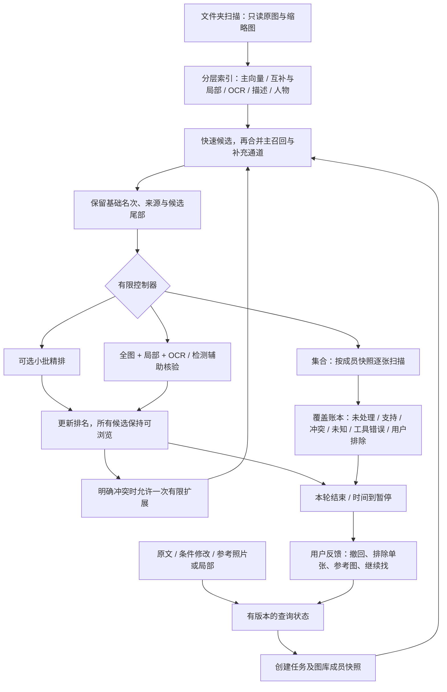

# PhotoRecall v0.6：完整链路开发说明

日期：2026-10-27。工作目录：`/Volumes/Lexar/桌面项目归档/PhotoRecall`。

本次按用户要求开发代码和架构，没有执行照片检索、模型推理、效果测评、自动化功能测试，也没有启动服务或浏览器验收。静态源码检查不能证明没有运行时问题。

## 1. 实现结构



只有一个本地 Python 服务和 SQLite 数据库。新链路在 `app/flow/` 中，不依赖多 Agent 或图数据库。

| 文件 | 职责 |
|---|---|
| `domain.py` | 条件 ID 与规范化键、逻辑表达式、三态判决、家族排名融合、保守排名 |
| `store.py` | 独立表、事务、查询版本检查、持久化任务和观察缓存 |
| `recall.py` | 主召回、SigLIP、局部、OCR、描述、人物和邻近事件入口 |
| `tools.py` | 本地结构化核验、全图与局部、OCR 重读、检测辅助、观察来源 |
| `providers.py` | Qwen Embedding／Reranker、Grounding DINO、InsightFace 的本地适配 |
| `indexing.py` | 按层建立并复用索引、组件状态、暂停后增量恢复 |
| `service.py` | 搜索、精排、核验、恢复、集合执行、停止和继续 |
| `api.py` | 请求约束、查询／任务／索引／配置／人物接口 |
| `web/flow.html / flow.js / flow.css` | 新默认页面、候选分页、局部框选、操作与进度 |

原 `app/engine.py` 继续管理文件和图库；旧 `pipeline.py`、`hybrid.py` 的有效索引可以读取。原前端位于 `/legacy`。

## 2. 查询与状态约定

每个会话有稳定 ID 和递增的查询版本。每次条件改变、恢复、参考图或排除操作都创建一个新运行 ID。创建请求提交 `expected_revision`，服务端以事务检查，避免旧请求改写新状态。

条件包含 ID、语义键、版本、原文依据、是否猜测和解析状态。原文始终保留；解析失败时把完整自然语言谓词留在系统中，数字、否定和实体关系不会因回退而被关键词表吞掉。

常见条件由本机解析模型辅助整理。含“或者”等组合时保留完整谓词供视觉模型检查，避免错误拆成逻辑交集。高级调用还可提交显式嵌套表达式：

```json
{"all":[{"condition":"条件ID-A"},{"any":[{"condition":"条件ID-B"},{"not":{"condition":"条件ID-C"}}]}]}
```

表达式只引用当前条件 ID；深度、节点数和引用合法性会校验。修改条件后默认重建表达式；高级调用者应同时提交相应表达式。参考图和恢复操作在条件不变时保留原表达式。

猜测条件参与召回，另保留放松猜测的通道。明确条件不会被恢复动作静默删除。“不是这张”由照片 ID 排除，只作用于单张；不会继承为整个事件或整个人物组的排除。

参考照片可以附带 0–1 归一化的框坐标 `[x1,y1,x2,y2]`。方向以 EXIF 校正后的画面为准。参考图只提供相似线索，不自动确认其全部属性。

## 3. 候选与排名

默认首轮池 200；用户恢复时扩大到 1,000。配置可调整，内部候选池与每轮核验张数相互独立。集合任务的全集由图库快照定义，不受 topK 限制。

同一表示家族的原文、改写和局部结果只取有上限的一份排名贡献。不同表示空间的原始分数不直接相加。OCR 和用户命名人物有少量入口保留配额，避免在截断时全部丢失。

图像空间只读取模型版本、照片指纹和维度匹配的向量。Qwen 和 WeMM 不混用；描述向量也不会与图像向量点积。

初步结果先发布；较重通道完成后发布新排名版本。页面保留用户正在浏览的结果，提供“有新结果，点击更新”。分页和照片操作使用稳定 ID；页面轮询不会把新查询替换为旧查询。

相关性精排默认关闭，可在设置中启用。默认精排预算 24 张，部分精排只在已选择的位置中排列。条件证据采用小幅更新，恢复搜索重新形成基础候选排名。未核验、未知和工具失败不会成为主列表准入门槛。

默认“所有相关候选”；“逐项核对较符合”是可选视图。原版“默认只展示少量 matched”的问题已在新页面路径中移除。

## 4. 核验和缓存

每次核验传入全图及最多两个局部，询问各个条件，同时检查全局条件的共同实体绑定。结构返回支持、冲突、未知；工具失败单列。支持属于模型观察，不是真值认证。

- 数量：检测提供下限和位置，不能用零框证明不存在。
- 否定：不能用局部没有对象证明全图没有。
- 关系：要求描述同一个实体的属性、位置和关联对象；画面左右作为默认坐标语义。
- 细分类：可使用召回命中区域、开放定位或固定重叠局部；看不清保留未知。
- 文字：强制重读可绕过低清文字检测的“无文字”门控，保留 OCR 辅助结果；最终仍需回看文字所属对象。
- 模型输出缺项、缺少依据或明显内部矛盾时，对应条件降为未知。

整次核验缓存绑定照片 ID／指纹、条件与逻辑、区域、模型摘要、输入规格和模板版本。确切谓词也保存可复用观察及原始上下文，作为新查询的辅助信息；条件改变后重新检查实体绑定，不把旧结论自动当事实。

核验前后检查原图可访问性及文件属性；文件改变后不再把新观察写到旧指纹下。原文件不会被改写。

## 5. 控制器与停止

动作集合固定：快速召回、主召回、精排、原图／局部核验、有限扩展、暂停、继续。模型不会自行执行任意工具代码。

默认每轮核验 4 张，时间片 60 秒。时间预算决定是否开始下一项工作；已经进入本地模型的调用不可保证立即中断，单次请求另有超时。

当至少两张已核验照片有明确冲突、没有支持结果且预算尚有余量时，控制器允许一次有限扩展，加入更大候选池和邻近时间线索。它不会据此判断图库没有目标，也不会继续无限核验。

用户“继续找”创建可追溯的新恢复运行；默认最多连续恢复两次，修改线索或选择参考图后重新计数。进一步缩小意图通过用户挑参考照片／局部实现，首版不生成连续自由追问。

每个动作保存原因、输入对象、观察结果、缓存是否命中、耗时和停止原因。首次候选与累计执行耗时分别保存；这些是运行记录，不构成预先达成的性能承诺。

## 6. 集合检索与恢复

“尽量找齐全部”创建当前图库的固定成员快照；API 也可以提供 `scope` 照片 ID 列表限定范围。范围在同一会话的条件修改／恢复中保留，清空或明确替换后可以重设。

每张成员独立记录状态。相似度只安排优先检查次序，候选尾部和无相似线索的照片仍在待处理队列中。处理结果逐项落盘，时间片结束或用户暂停后，点击继续从未处理成员开始。

“已处理”包含未知和失败，不包含用户排除；页面分别展示这些数量。处理失败可以单独重试。重启服务会把未结束任务标记为暂停，不伪装成已完成。未知项可以打开照片后手动再次核对或指定局部。

图库新增照片不会偷偷加入已创建的任务；原照片变化或移除会被记录为当前快照无法处理。要使用新范围，请重新开始查询。

扫描结束仅表示当前范围本轮模型处理完毕，不能推导“没有漏检”或“已经全部找齐”。

## 7. 分层索引

“更新文件”使用 `scan_only` 路径：扫描、读取元数据、生成缩略图，不自动启动图像理解或全库 OCR。

“建立搜索索引”按所选组件执行：主图像向量 → 互补整图及重叠局部 → OCR → 描述及描述向量 → 可选人物。主向量和互补向量分阶段集中计算，减少大模型在每张照片间反复装卸。

每个组件保存独立指纹、版本、处理中、完成、空结果或错误状态。重新选择相同步骤即可复用有效记录并继续，不因 OCR 失败丢失图像索引。

新版本使用独立 `flow_vectors`；旧版可用向量也可读取。没有隐式更换模型或重建旧空间。描述和 OCR 继续写入已有观察／全文索引，便于复用。

## 8. 默认模型与可选组件

默认沿用已有模型，先确保架构可以与现有环境连接：

| 角色 | 默认 | 可选 |
|---|---|---|
| 主召回 | `data/models/wemm-2b` | `data/models/Qwen3-VL-Embedding-2B` |
| 精排 | `data/models/core-reranker-2b` | `data/models/Qwen3-VL-Reranker-2B` |
| 互补与局部 | `data/models/siglip2`，现有 224 配套索引 | 不与不同分辨率配置混用 |
| 视觉与描述 | 本地 Ollama `qwen3-vl:4b-instruct` | 设置中指定本地已准备的其他模型，例如 8B |
| 文字 | Mac 上 Apple Vision 优先，保留现有 Paddle 分支 | 不强制把已用版本替换成文档中的 v5 |
| 描述向量 | 本地 `qwen3-embedding:0.6b` | 未准备时保留描述关键词入口 |
| 对象定位 | 默认关闭 | Transformers 格式本地 Grounding DINO |
| 人物 | 默认关闭 | 本地 InsightFace buffalo_l + 用户命名 |

Qwen 适配使用官方参考代码，本地副本位于 `app/flow/vendor/`。原始内容摘要、来源和修改记录在 `SOURCES.json`，附上游许可。加载器限制本地权重并选择 CUDA／MPS／CPU，程序不自动下载权重。

Qwen 的目录需包含完整配置、处理器、分词器和全部 safetensors 分片；权重目录内容摘要参与索引版本。Qwen 官方精排辅助代码使用 scipy，按需安装；完整可选依赖清单在 `requirements-flow-optional.txt`。没有在本次开发中安装模型运行依赖或下载模型权重。

Grounding DINO：把 Transformers 格式权重放到 `data/models/grounding-dino/`，设置中打开对象定位。没有权重时保留固定局部与手动局部路径。

人物：把 buffalo_l 的完整 ONNX 文件放到 `data/models/insightface/models/buffalo_l/`，准备可选依赖，明确启用后建立人物索引。界面支持命名分组和选择分组作为检索入口。相似聚类不是已确认身份；预训练权重的上游用途限制需在商业化前处理。本次没有下载人脸模型。

学校 A40 上可运行同一服务和本地模型进程；CUDA 路径已加入模型设备选择。服务仍只绑定本机地址。跨机器权重、索引和资料接入需要用户自行配置，Mac 和服务器分别使用兼容索引；本次没有连接学校服务器或启用云端照片上传。

## 9. 持久化表与接口

新增表均以 `flow_` 开头：

- `sessions / runs`：查询状态、配置快照、运行和排名版本。
- `members`：固定范围、候选优先级、逐张处理状态和观察。
- `actions / evidence`：动作日志与带版本观察缓存。
- `vectors / index_state`：分模型／区域向量及组件覆盖。
- `people / faces`：人物分组、用户命名和照片区域。
- `config`：下一轮新任务的设置。

接口前缀 `/api/flow`：

| 方法与路径 | 用途 |
|---|---|
| `GET /config`、`POST /config` | 当前设置与本地组件准备状态；修改下一轮配置 |
| `POST /search` | 新建／补充／恢复／撤回／参考图／单张排除 |
| `GET /runs/{id}` | 分页结果、条件、排名版本、覆盖、停止原因 |
| `POST /runs/{id}/pause` | 在当前调用结束后暂停 |
| `POST /runs/{id}/continue` | 继续未处理、指定 1–8 张核验或重试失败 |
| `GET /runs/{id}/actions` | 有序动作日志，可用 `after` 继续读取 |
| `GET /libraries/{id}/sessions` | 最近会话与可恢复运行 |
| `POST /libraries/{id}/scan` | 只扫描文件 |
| `POST /libraries/{id}/index` | 建立选定索引组件 |
| `GET /libraries/{id}/coverage` | 新旧索引覆盖 |
| `GET /libraries/{id}/people` | 本地人物分组 |
| `POST /people/{id}/name` | 用户命名 |

所有写请求继续使用原有本机来源检查与页面令牌。GET 查询状态不会启动模型推理；本地模型准备状态可能读取 Ollama 的模型列表。

## 10. 用户自行运行的入口

双击「启动.command」。如果旧服务仍在运行，先停止再启动，避免旧版进程继续提供旧页面。修改前代码位于 `data/backups/flow-development-20261027/`；原照片和旧索引保留。

可从以下操作逐步自行检查，无需准备额外格式的数据：

1. 更新文件，建立所选索引，查看每层完成和失败数量。
2. 搜索一张照片，观察所有候选、逐项状态和原图。
3. 撤回一个条件，选择参考图或框选局部，继续查找。
4. 只排除单张照片，观察其他候选是否继续可见。
5. 切换集合模式，暂停、继续，或重启后恢复任务。
6. 在“本轮查找过程”查看动作；可保存当前页、覆盖与动作记录供后续排查。

这份交付没有预设成功率、速度成绩或“无 bug”认证。需要实际运行后才能发现的依赖兼容、显存、模型输出和界面行为问题仍待用户自行反馈。
