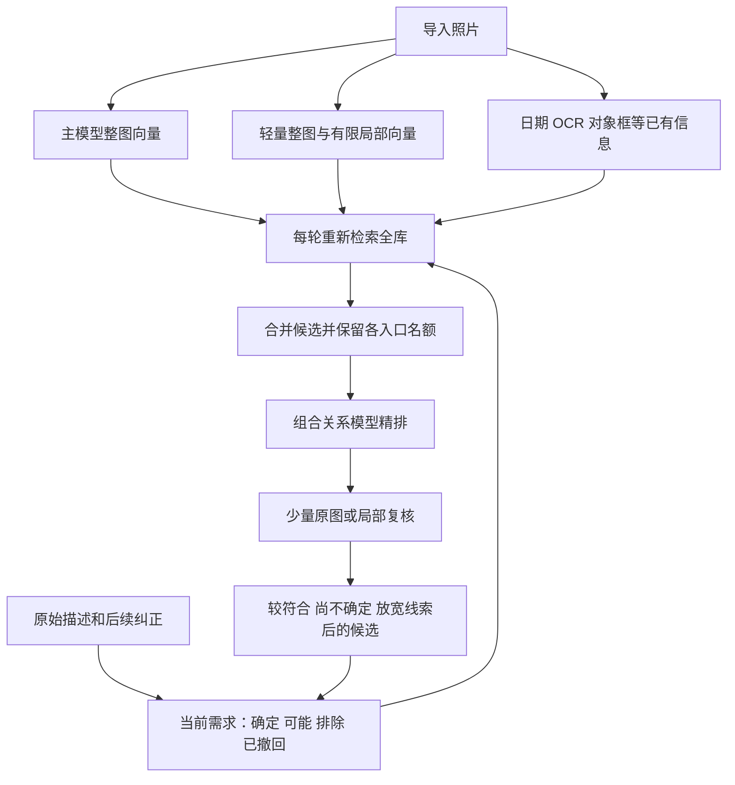

# PhotoRecall：准确率优先的照片检索方案与评估

**实施更新：v0.4 已完成本机原型，实测与未达标项见 [本机实现与实测](v0.4本机实现与实测.md)。以下保留原调研方案，验收目标不等于成绩。**

调研日期：2026-10-13。适用范围：中文、多轮、模糊记忆的自然照片搜索；约 1 万张照片；沿用前序讨论中的 M1 Pro / 16GB 作为本地约束。

本报告完成了前序聊天复核、现有检索代码审阅和公开一手资料核对。没有下载新权重、运行私人照片评测或修改搜索程序。下面的“验收目标”“预算”均为设计要求，不是实测成绩。公开网页优先通过 Lightpanda 提取，arXiv 被拦截时使用内置网页工具回退。

## 1. 明确选择

推荐的下一版是：**较强的视觉检索模型建立整图索引，轻量局部索引负责补漏；查询时从全库广泛取候选，再用组合关系精排模型排序；只给最难的一小批照片补查原图。**

具体首选组合：

- **主召回：WeMM-Embedding-2B，完整 2048 维。**作为优先验证候选，Qwen3-VL-Embedding-2B 为兼容性与质量对照。最终只保留一个主模型。
- **精排：CORE-Reranker-2B。**优先测试属性与对象绑定、位置关系、否定；Qwen3-VL-Reranker-2B 为同体量对照。CORE 官方实现要求 CUDA，Mac 适配是上线前置条件。
- **补漏：复用现有 SigLIP 2，对整图和有限局部建立轻量索引。**只有实测提高候选命中率才保留这条支路，不为“模型多”而堆叠。
- **细节复核：已有 Qwen3-VL-4B-Instruct，按需检查原图或带上下文裁剪。**不让它对几十上百张候选逐张写长解释。
- **对象位置：复用已有 YOLO26n 的框，作为线索与裁剪建议。**检测数不是准确总人数。首版不再强制引入 SAM、深度模型或整套场景图。
- **保存与搜索：SQLite + 全文索引 + 内存向量矩阵。**1 万张规模先做精确向量扫描，避免近似索引额外漏召回和部署复杂度。

“最好的方案”在这里指当前约束下最值得落地验证的选择。公开资料不能证明任何组合在你的照片库上准确率最高，尤其不能证明已达到 95%。模型最终按真实照片的质量—延迟比较确定，而不是按综合排行榜确定。

## 2. 第一版的问题在哪里

### 已知用户失败

1. “生日、暗光、双手合十许愿”：前序聊天记录中，目标 DSC00122.JPG / DSC00123.JPG 曾在第 10、11 位，而核对范围只有前 8 张。后来修正到前 1、2 名，只能说明该例改善，不能证明泛化。
2. “一个人和车”：能找出车，但人数、车色、人物与车辆关系不能稳定缩小到正确结果。
3. 用户会记错颜色、日期，且随追问修改条件；严格求交容易把真目标排掉。

### 当前代码可以确认的设计风险

| 位置 | 观察 | 影响与修正 |
|---|---|---|
| `app/providers/siglip.py` | 使用 `google/siglip2-base-patch16-224` 整图单向量 | 小手势和小车标在输入缩小时可能丢失；增加较强主索引与局部补漏，但不把分辨率当唯一原因 |
| `app/retrieval.py:115–117` | 排除条件用 `1 - 相似度百分位` | “不像有人”不等于“确定无人”；取消这种否定证明，用直接图文精排和三态证据 |
| `app/retrieval.py:99–150` | 多组人工权重混合英文、中文、分项、亮度和描述排名 | 分别相关不等于同时满足；这些信号只用于找候选，最终交给完整需求—图片联合评分 |
| `app/retrieval.py:75–88` | 核对等级先于检索分数排序 | 误判“全部符合”的照片会压过未核对的真目标；不能把模型自报的 matched 当绝对事实 |
| `app/retrieval.py:34–39` | 每个值都与整列比较来算百分位 | 单次约 O(N²)，每条线索重复；应换成排序排名或秩融合，不必靠换 GPU 解决这个问题 |
| `app/engine.py` 年份筛选 | 年份 include 分支直接排除不匹配及缺日期项，未在该处分辨 soft | “大概某一年”可能误删照片；确认的精确条件与模糊记忆必须分开处理 |
| `app/providers/detector.py` | 当前检测固定 CPU、输入 1280 | 新查人数若触发整批检测可能慢；前置到后台索引、缓存，另测硬件加速收益 |

这些是静态代码观察，尚未用同一批照片量化每项影响。当前 `search()` 本身已经读取全库，不能把“只在上一轮结果内检索”误写成现版本的已证实缺陷；需要保留全库重检索，并修复后续候选截断和证据排序偏置。

## 3. 论文、开源与企业实践给了什么依据

### 3.1 WeMM：新的主召回候选

腾讯 WeChat Vision 团队发布 2B、4B、9B 权重与推理代码。其报告的文字找图片评测中，WeMM-2B 在 MSCOCO 的 Recall@1 为 62.6，Flickr30K 为 86.9；同表 Qwen3-VL-Embedding-8B 分别为 58.7、84.6。但 DOCCI 上 WeMM-2B 为 94.0，Qwen-8B 为 95.0，说明并非每项领先。数据是作者评测，不能跨数据集或候选规模换算成私人相册命中率。

因此，它比“继续默认旧 SigLIP 是最优入口”更值得测试，但仍要验证中文细节、量化影响与 Mac 实际运行。2B 模型卡标注 Apache-2.0，并标明中文、英文。[官方仓库](https://github.com/Tencent/WeMM-Embedding)、[报告表 3](https://arxiv.org/html/2608.24053v1)、[模型卡](https://huggingface.co/tencent/WeMM-Embedding-2B)。

### 3.2 CORE：与本项目失败类型最接近

CORE 专门处理“概念都在，属性却绑错对象”的检索问题。在作者表 1 的组合基准综合分中，CORE-Reranker-2B 为 0.776，Qwen3VL-Reranker-2B 为 0.676；8B CORE 为 0.827。该表混合 COLA、SugarCrepe++、NegBench 指标，不能称为相册准确率。CORE-2B 的 NegBench MCQ 仍只有 0.646，否定也没有彻底解决。

采用其已发布模型，不复现昂贵的数据合成与训练。主要风险是新项目的成熟度、中文迁移与 Mac 部署。官方仓库要求 CUDA；模型卡标注 CC-BY-4.0，不能将所有候选统一说成 Apache-2.0。[论文表 1](https://arxiv.org/html/2609.04083v1)、[官方代码](https://github.com/Alibaba-NLP/core-emb)、[权重与许可标注](https://huggingface.co/Alibaba-NLP/core-reranker-2b)。

### 3.3 Qwen：可靠对照，但不要无条件加精排

Qwen 提供专门的 Embedding 和 Reranker、官方前处理与评分实现。其当前仓库图像检索列：Embedding-2B 为 74.8，Reranker-2B 为 74.0，Reranker-8B 为 78.2。尽管文字介绍强调总体提升，表格说明小精排在图像子项并未提升。

因此，模型必须在同一候选集上做“有无精排”对照。相关性分数也不是正确率或“找到目标的概率”。[官方模型与评测表](https://github.com/QwenLM/Qwen3-VL-Embedding)。

### 3.4 已有产品与流程

| 来源 | 已公开的做法 | 本项目借鉴及边界 |
|---|---|---|
| Apple ANSA，2022 | 多任务共享视觉骨干、标签、图文向量及知识图谱信号 | 支持多信号协作；这篇较早资料不是今天 Apple Intelligence 全部实现的披露 |
| Google Ask Photos，2024 | 理解问题与制订搜索计划，检索后由 Gemini 看结果，记住纠正 | 借鉴“先找候选、再看图、接受纠正”；未公布可套用的私人相册成功率 |
| Immich | CLIP 语义搜索、元数据、人脸、OCR、标签等搜索入口 | 借鉴图库管理和多入口搜索；没有证据表明原样部署就解决本项目的复杂关系 |
| ImageScope，WWW 2025 | 意图组织、候选验证、结果比较的研究流程 | 借鉴分阶段；原版多模型和 CUDA 软件栈太重，不整体搬进 16GB Mac |
| RAM++ | 批量多标签，默认标签表 4,585 项，并支持自定义开放类别 | 适合粗标签和辅助召回；标签集合本身不表达“哪个对象的颜色、谁在谁左边” |

来源：[Apple ANSA](https://machinelearning.apple.com/research/on-device-scene-analysis)、[Google Ask Photos](https://blog.google/products-and-platforms/products/photos/ask-photos-google-io-2024/)、[Immich](https://docs.immich.app/features/searching/)、[ImageScope](https://github.com/pengfei-luo/ImageScope)、[RAM++](https://github.com/xinyu1205/recognize-anything)。

选择轻量标签作为唯一基础，会让标签漏检成为系统不可恢复的漏检；对本项目准确率优先的目标，不建议采用这条主路线。

## 4. 具体流程

### 4.1 导入：主要成本提前支付

每张照片保存原图引用、内容指纹、拍摄信息、索引状态、模型及前处理版本。不要复制或改写原片。

主模型默认生成 1 个整图向量，使用官方预处理；先比较两档像素预算，例如约 0.25MP 与 0.6MP，而不是先锁死极低分辨率。是否使用更高预算由困难样本质量及吞吐决定。

补漏索引以现有 SigLIP 2 建立：整图加 4 个有重叠的区域窗口起步。已有检测框可以提供 1–2 个主体区域，单图设置上限。裁剪必须记录坐标、关联回原图，不要求每张图成功检测全部物体。只对已有漏召回证据的类别扩充局部索引。

**局部图用于找小细节；空间关系最终仍看整图或包含相关对象的联合区域。**人物裁剪不能证明画面里没有第二个人；车标裁剪不能证明人物站在车左边。

已有描述可以复用；详细长描述不是全库建索引的前置条件。OCR、日期和人工标签独立存储。没有描述到“合十”，不影响以后直接拿原图判定。

索引中断可以续跑，新照片增量处理。模型更换建平行索引，完成后切换；不同模型、维度及前处理的向量不能混算。

### 4.2 每轮保留完整需求，支持真正的修改

保存两层内容：原始对话，以及可编辑的当前需求。每条条件有来源原句、对象、属性/关系、确定程度、作用范围和修改版本。

例子：

| 用户线索 | 系统表示 |
|---|---|
| “只有一个人和车合影” | 需要一名合影主体；全画面总人数是否也必须为一人，保留范围歧义 |
| “车好像是蓝色” | 车辆颜色的软偏好 |
| “人站车左边” | 默认画面左侧，界面显示这个解释；车自身左右另行确认 |
| “不是蓝色，我记错了” | 撤回旧颜色线索，不把蓝色和非蓝色同时累积 |
| “大概是前年” | 软日期区间，按查询时日期解析，缺失 EXIF 不自动排除 |

只输出简短结构，不要每轮生成长推理。模型解析失败时，仍以用户原文做检索；不得静默退化为少数固定关键词。中英文转换只能补充，不能覆盖中文原意。

### 4.3 召回：先避免漏掉目标

初始预算（需要调参，非固定真理）：

1. 主模型完整需求：前 200 个照片 ID。
2. 主模型放宽一个最不确定线索后的需求：前 100 个 ID；最多 2 个改写，不做指数级组合。
3. 轻量局部索引按关键细节检索：最多 100 个 ID。
4. 有对应线索时加入 OCR、时间、人工标签命中的结果，以及少量上一轮较相关结果。

按照片 ID 去重，正常候选池约 200–500 张。主模型与 SigLIP 的原始分数不能直接相加：使用秩融合，例如 RRF；它只决定候选优先级，不产生置信概率。各检索支路保留最低入选名额，避免主路挤掉补漏结果。

**不能把 500 张又按旧 SigLIP 截成前 8 张，然后称为召回改进。**常规先精排 64 张，并保留来自主查询、放宽查询与局部检索的候选配额。分别记录 Hit@500 与“实际精排输入 Hit@64”；后者过低时扩到 128 或调整入口，不能只报告较好看的大池召回率。

小图库可扩大候选占比。只有 10 张时直接精排全部；上万张不逐张调用视觉模型。

### 4.4 精排：联合判断完整画面要求

将当前完整需求和候选图片一起输入 CORE，使用作者的模板与评分实现；不要直接用通用 `pipeline(feature-extraction)` 代替精排，也不要把普通聊天模型输出的 0–100 分当可靠排序分。

先用整图判断联合条件。查询中有细小手势、车标、文字时，优先从边界候选和前排候选中选最多 6–12 张做原图/区域检查。细节复核输出：符合、矛盾、无法确认，以及简短可见依据。

对象绑定示例：“红衣的人站在黑车左边”必须在同一张图中同时定位相关人和车。不能因为画面别处有红色、有黑车，就拼成满足。缺乏证据的品牌、手势、隐藏人物保持未知。

全图亮度统计只辅助“暗光”，不能把黑色衣服、大面积黑背景或逆光剪影直接当暗室。真实树龄、没有尺度的树高、不可见部位不强行识别。

### 4.5 证据和展示：既不能假符合，也不能把目标藏掉

主界面仍显示按当前需求排序的候选，并标明关键条件哪些有支持、哪些尚未确认。明确反证降权或移到“不符合”的分组；未知项不当成符合，也不直接删掉。

不让一次模型的 matched 结果成为不可推翻的硬等级。精排和证据冲突时进入补查；尚未补查的高相关候选仍可见。模型输出分数未经标注集校准，不展示“匹配概率 97%”。

近重复照片可以在视觉上折叠，但必须可展开；用户找的可能正是连拍中手势不同的一帧。评测同时报告精确文件与同组照片命中，不用重复照片填满前五名来制造高成功率。

### 4.6 记错条件：保留另一种解释

用户说“可能蓝车”，但黑车符合其余四项时，保留并说明“其余线索较符合，车色偏黑”。确切要求“必须蓝车”时，黑车不算严格符合，可放在单独的放宽条件候选中。系统不能偷偷改写用户要求。

每次追问都重搜全库。用户点“更像这张”可加入参考图检索；点“不是这张”先排除该文件，不能推断整类照片都不要。只有结果间确有区分价值时才提一个问题，例如“人物在车左侧还是右侧”。

### 4.7 找不到时的补救有上限

常规预算内没有可信结果时，依次放宽软线索、提高候选配额、补查局部，并显示还有多少候选未核对。更深搜索可扩到 128–256 张，但需要显式进度、停止入口和时限。

任何有限索引和预算都可能漏掉未被表示的小细节。若目标从所有召回入口均未进入候选，原图复核也救不回来。必须把这些失败收集成“召回失败”，而不是继续加精排模型。

## 5. 速度、内存和部署的真实约束

### 建议用户体验门槛

以下都是拟定验收要求，不是本机预测：

| 环节 | 目标 |
|---|---|
| 普通查询首批候选 | P50 ≤ 3 秒，P95 ≤ 6 秒 |
| 常规复杂查询完成精排 | P50 ≤ 10 秒，P95 ≤ 20 秒 |
| 困难原图补查 | 单次完整请求预算 30 秒，超时显示部分结果和未完成状态 |
| 冷启动/换模型 | 单独统计，并另外报告包含冷启动的端到端等待 |
| 第二、第三轮 | 记录新增计算与复用缓存后的耗时，不能只测重复原句 |

一万张的主模型整图向量按 2048 维、float32 计算约 81.9MB；4 个局部向量若为 768 维、float32，约 122.9MB。另加补漏整图、元数据、缩略图与缓存。向量存储不是主要压力，模型权重、视觉 token、临时激活和模型切换更值得关注。

离线时间必须按本机 100–200 张代表性照片吞吐推算。仅作算术例子：单张主索引若平均 1 秒，一万张约 2.8 小时；3 秒约 8.3 小时；5 秒约 13.9 小时，尚未算局部、OCR、检测和磁盘。不能承诺“一万张几分钟”。首屏显示分阶段完成率，已索引部分先可用。

在线成本可写为：T = 查询编码 + 索引检索 + 精排图片数 / 实测吞吐 + 细节复核 + 模型装卸与排队。若精排吞吐只有 2 张/秒，64 张仅精排就需要 32 秒，已经不合格。只输出一个相关性分数也仍需处理图像 token，并非免费。

### Mac 路线的上线前置条件

1. WeMM 按官方专用 embedding token 的池化与前处理运行，核验中文、图像及混合输入；不要用任意平均池化替代。主、辅模型各用自己的输入规范。
2. CORE 保留原评分行为，移除 CUDA 专用路径后检查 MPS 可用性及 CPU 回退。没有官方 Mac 性能保证，不能把 2B 体量等同于已适配。
3. 先单模型建立质量基线，再测低精度与量化。embedding 维度缩短、权重量化和输入降分辨率是三个不同改动，都可能损失细节。
4. 16GB 不同时常驻主检索、精排、4B 对话和4B视觉。轻量索引常驻；大型任务分阶段执行。能否让两个 2B 模型同时常驻，要测峰值内存及交换行为，不能只看权重文件总大小。
5. 在固定分辨率、候选数下验证速度；若为了过速度门槛把候选减到遗漏目标，方案仍不合格。

若 Mac 无法同时达到准确率和延迟要求，决策顺序是：优化缓存/批处理/减少无用长输出；比较更轻组合的真实损失；仍不达标时，将同一检索服务部署到用户自有 NVIDIA 主机或经同意的服务器。**服务器是待选择的部署路径，不是本次已经授权上传照片的动作，也不是保证换硬件就解决识别错误。**

纯本地与服务器用相同查询接口。现有网页、照片目录、会话和缩略图保留，替换检索后端即可。直接接 iPhone 全相册另做原生授权接入，不混入本轮检索质量改造。

## 6. 怎样评估，才不会又只修好两张照片

### 测试资料

先用已有 338 张定位失败，再扩充到 2,000 张和 10,000 张自然照片，保留大量相似干扰项。不能靠复制同一批照片伪造规模。

建议最终至少 240 个相互独立的搜索任务：80 个开发任务、160 个锁定测试任务，按拍摄事件和近重复组隔离，而不是随机拆连拍。任务有独立人工答案，模型不能给自己判卷。测试查询作者尽量不同于调参人员。

锁定集建议构成：物体/场景 20%；动作/光影/构图 20%；颜色绑定/关系/计数/否定 25%；2–4 轮补充与错误记忆 20%；无匹配、不可判断、索引缺失等 15%。多轮记忆错误任务的最终真实目标已知，且明确标出哪些线索故意错误。

包括已知生日例、单人与车例作为回归集；它们已经参与过开发，不计入未见测试成绩。品牌、小物体、逆光、远景人物、黑蓝难分、连拍动作差异都应有覆盖。

### 核心指标

| 指标 | 定义 | 初始验收目标 |
|---|---|---|
| 主/补漏候选池 Hit@500 | 有明确目标的任务中，至少一个可接受目标进入候选的比例 | ≥98% |
| 实际精排输入 Hit@64 | 同样目标真正进入64张精排集合的比例 | 争取≥97%，不足需扩容并复测延迟 |
| 首轮 Success@5 | 有目标任务中，前5张出现目标的比例 | ≥90% |
| 最多3轮 Success@5 | 最多3轮后前5张出现目标 | ≥95% |
| 严格结果条件违反率 | 被标记为符合的结果中，人工确认违反明确条件的比例 | ≤5% |
| 无匹配误确认率 | 没有符合照片的任务，系统却宣称已经找到的比例 | ≤5% |
| 质量—延迟 | 上述全部质量指标与端到端 P50/P95 配对报告 | 满足第5节预算 |

只有一个目标时用 Hit/Success；查“一批照片”时另外测 Recall@K、Precision@K 和 nDCG@10，不能把两种任务混成一个“准确率”。同组近似命中和精确文件命中分开。

98% 候选命中并不保证95%最终成功。粗略说，如果精排输入保住97%的任务、最终排序又只保住其中95%，总成功率约92.2%；因此要同时压低每阶段损失。

小测试集上的95%只是点估计，应报告任务数、事件级置信区间和分类型结果。多轮的三个回合不是三个独立成功样本。不能宣布“已证明≥95%”却不说明统计不确定性。

### 控制实验，分阶段淘汰

1. A：冻结现有版本，记录原始排名、耗时及失败位置。
2. B：主检索对照 SigLIP、Qwen-Embedding-2B、WeMM-2B；同一测试资料、记录各自像素预算及前处理。开发集选一个胜者后再开锁定集。
3. C：给胜者加入轻量局部和 OCR/元数据，检查候选命中提升是否值得离线成本；没有收益就删支路。
4. D：固定同一批候选，比较不精排、Qwen-Reranker-2B、CORE-Reranker-2B。重点看关系/否定/计数，不只看总体均值。
5. E：加入预算内原图复核与软线索容错，测多轮质量以及完整延迟。

8B或9B仅在已有更强硬件、2B确有能力瓶颈时做少量上限对照，不作为16GB第一版默认。没有证据就不启动微调；确有稳定错误分布和足够人工标注后，才考虑困难负例训练。

每个失败按“需求丢失 → 索引缺失 → 候选漏召回 → 精排错误 → 证据误判 → 展示藏结果”归因，保留各阶段目标排名、模型版本、缓存命中与耗时。特别记录未索引照片和损坏文件，不能将其悄悄排除后称为全库搜索。

## 7. 实施顺序与工作量

以下是沿用现有代码、单人熟悉项目情况下的工程估算，不是日历承诺。

| 阶段 | 交付 | 估算与退出条件 |
|---|---|---|
| 质量基线与候选模型小试 | 回归任务、原始排名、Mac兼容性/内存/吞吐报告 | 2–4个工作日；模型无法稳定运行立即记录，停止整库投入 |
| 主索引与多入口召回 | 一个主模型、局部补漏、可续跑索引、可追踪候选来源 | 3–5个工作日；候选命中不升则调整或回退 |
| 精排与对话状态 | 同候选精排对照、撤回/替换条件、软记忆与未知展示 | 3–5个工作日；不能满足质量与速度则不替换默认 |
| 独立验收与界面整合 | 锁定测试报告、规模测试、缓存/取消/进度、平行索引切换 | 2–4个工作日；标注与照片准备可能额外耗时 |

合计约2–4周，前提是候选模型适配顺利；若CORE需要深度移植或新增硬件，另算。先完成第一阶段就能判断这条组合值不值得继续，避免再次几天都花在逐图等待。

程序分为五个清楚模块：索引任务、需求状态、候选检索、图片精排、结果与评测。无需自主Agent循环、十余模型编排或完整知识图谱。统一接口让主模型与精排可替换。

## 8. 对本方案的评估

| 维度 | 判断 | 主要不确定性 |
|---|---|---|
| 针对当前失败的合理性 | 较强：直接修复候选截断、属性关系弱、原图细节缺失和错误记忆 | 不等于所有图都能被模型正确理解 |
| 公开研究依据 | 比单标签或单向量完整，但多来自模型作者评测 | 缺少私人中文相册、同硬件独立复现 |
| 开发复杂度 | 中等：两级检索是核心，局部与证据是有限辅助 | 如果首版叠加分割/深度/训练，会失控 |
| 一万张存储与索引 | 可实现，向量体量可控 | 初次视觉推理可能数小时，须实测 |
| M1 Pro 16GB交互速度 | 尚未证实，是最大工程风险 | 新模型适配、图像输入成本、装卸模型与内存交换 |
| 达到95%目标 | 可以作为验收目标，当前不能承诺 | 难图、否定、精确人数、含糊记忆与测试分布 |
| 后续扩展 | 网页与索引服务可沿用，主模型可替换 | 原生手机后台处理需另做产品工程 |

**建议采用这套架构，先验证 WeMM-2B + CORE-2B 的质量和本机吞吐，再决定正式切换。**与上一版相比，关键不是给现有排名再加几个规则，而是把“保住目标候选”“判断多个条件同时成立”“对未知和记错留余地”分别做对，并通过独立评测共同验收。若本机跑不进预算，应如实说明硬件与精度的取舍，不能以减掉目标候选换取表面速度。
