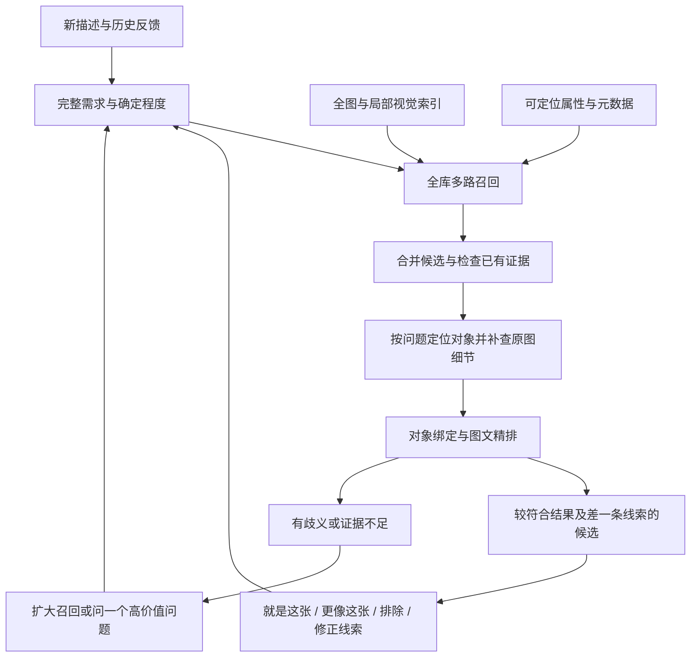

# PhotoRecall 下一版流程规划 · 多条件、多轮与记忆容错

日期：2026-10-13。状态：方案，尚未接入新模型，尚未测得 95% 或速度指标。原图、已有索引及实验代码保留；当前慢速逐图验证已暂停。

## 目标与基本原则

目标是帮助用户从十张至一万张本地自然照片中，逐轮找到少数目标；输入可以模糊、包含错误记忆或只关心很小的细节。核心采用原始视觉证据、全图与局部索引、对象绑定、按问题精排和可修正的会话状态。文字描述只作辅助，不作为照片全部内容的替代。

下面是结合公开研究提出的 PhotoRecall 设计，不是某篇论文或某家公司内部实现的复刻。研究与组件依据见 [开源项目与论文调研](开源项目与论文调研.md)。

## 三个必要的表示层

1. 原图：唯一保留完整可见像素信息的来源；模型处理仍可能漏看或误判。
2. 视觉索引：保存全图及有限的局部视图向量。先用全图 + 四个有重叠的局部视图作为可调整起点，对已定位的对象另存裁剪特征。固定视图不是无损表示，不承诺覆盖所有细节。
3. 可定位证据：对象 ID、位置、可选掩膜、属性、关系、证据来源和未知状态。描述和 OCR 是补充。没有预先写“无叶树”，也能先从视觉索引找树，再依据用户问题重新查看树区域。

不直接拿任意视觉模型的 patch hidden states 当作已对齐的文字检索向量。局部裁剪用经过训练的图文编码器生成特征；真正的 late-interaction 模型作为后续可选实验，先确认自然照片域效果和存储预算。

## 导入阶段：一次准备，增量复用

- 保留原图位置，按内容指纹缓存缩略图、元数据和模型结果；支持暂停、续建和新增照片增量处理。
- 候选编码器从 Qwen3-VL-Embedding-2B 起步，已有 SigLIP 2 保留作基线。主索引以原始图片的全图 / 裁剪视觉特征建立，不要求每张图片先生成完整标签。
- 常见对象检测结果可预计算，记录位置和可能漏检的不确定性。树等开放类别在查询出现后可按需定位，不能误认为固定类别检测器已经看到了所有物体。
- 可见文字 / 日期 / 地点按可获得数据建立辅助索引，缺失就是未知。
- 主体区域与图像视图保留坐标与缩放关系。全图表达构图 / 光影，局部表达纹理 / 手势 / 车标；两者不能互相替代。

## 查询阶段：全库召回，预算内逐步精排

### 1. 会话需求是可修正状态

每条要求记录：用户原文、作用对象、属性 / 关系 / 数量、确定程度、当前值和替代假设、产生和修正的轮次。保留原始问题，不让解析模型丢弃细节。清楚的数词与否定还需结构校验。

区分“画面里只有一个人”和“一个主要人物在车旁”。条件的左右是观察者坐标还是对象自身左右，要有明确约定。用户纠正颜色时替换原值，保留其他条件；“可能蓝色 / 应该蓝色”先作为偏好，而非永久删除黑车。

### 2. 多路召回并允许找回旧候选

每轮都允许从全库重新召回。上一轮结果用于加速和提供参考，不能成为不可恢复的筛选全集。

召回可包含：完整描述、核心对象、局部视觉、关键属性、文字与元数据。合并去重，初始候选池可从 200 张起，根据歧义和召回不足扩大到 500 / 1000；这些数量是实现参数，不是已验证最优值。多条线索取回的照片先取并集，避免早期错误的某条线索把目标不可逆地删掉。

### 3. 必须绑定同一个对象

“一个人站在黑色轿车左边”应表达为：存在人物 P、轿车 C；黑色属于 C；P 与 C 满足指定关系。画面里远处有黑车 C1、人物实际站在蓝车 C2 边上，不能算完整匹配。

对象定位可选 Grounding DINO；已有常见对象检测可复用。颜色 / 树叶等问题需要时用分割或裁剪排除背景，Grounded SAM 2 是可参考的组合。先在少量候选定位，不为每个新形容词重跑整个图库。每个新增证据按照片指纹、对象范围、问题与模型版本缓存。

### 4. 关系不能一律由框决定

| 用户说法 | 处理方法 | 不足时如何处理 |
|---|---|---|
| 人在车的画面左边 / 右边 | 对同一对对象的图像位置进行比较，再核对全图 | 重叠、遮挡或对象定位不稳定时未知 |
| 人在车旁 | 相对位置与距离作提示，结合原图 / 两对象联合区域判断 | 二维靠近不能直接证明现实中靠近 |
| 人在车前 / 后 | 区分图像前景遮挡与车头 / 车尾方位；必要时使用相对深度提示 | 语义有歧义时询问，不把单个中心点当三维证明 |
| 只有一个人 | 明确全图或主体范围，结合可见人数下限与疑似目标 | 未检出不等于零；遮挡与背景小人物保留未知 |

### 5. 属性按问题重新读取

| 属性 | 证据 | 边界 |
|---|---|---|
| 蓝车 / 黑车 | 车区域 / 掩膜的颜色信息、语义判断和光照 | 暗光、反射和深蓝 / 黑色相近时允许多种候选 |
| 汽车品牌 | 可见车标、局部外观、OCR 或专门识别 | 模糊、遮挡或只露出局部时未知，不凭车型感觉补品牌 |
| 有叶 / 无叶、树冠大小 | 树区域的视觉特征和原图细节 | 低分辨率、遮挡与季节关系不能自动补成确定事实 |
| 老树 / 小树 | 树干、树冠和周边参照的可见外观 | 看起来老不等于知道实际树龄 |
| 大概多高 | 优先使用画面相对大小与可解释参照 | 无尺度的单张照片不能可靠给出米数；米制高度保留估计或未知 |

### 6. 专业精排，少量生成式补查

候选优先为 core-reranker-2b，与 Qwen3-VL-Reranker-2B / 不精排作对照。输入是完整原始问题和候选原图、相关区域及有证据的条件，不以一段旧 caption 替代图片。先比较约 20 至 40 张，再对最有争议的少数照片作局部细节补查；不足时扩召回，不无限循环生成解释。

训练的相关性分数用于排序，不标成找对概率，也不能覆盖明确数量或排除矛盾。对关系与数量需要明确证据；对树龄 / 品牌 / 暗色等难题要允许未知。通用看图聊天模型仅作为辅助，而非每张候选都生成长篇文字的主排序器。

## 错误记忆与反馈

例如用户说“只有一个人、站在车右边、旁边有无叶树，车应该是蓝色”，但目标车为黑色：

- 主假设保留蓝色；因“应该”表不确定，颜色作为软线索。
- 保留放宽颜色的备选，其他线索照常核对。对象、人数、位置和树形高度一致的黑车图不永久淘汰。
- 明确显示“其他线索较符合，车色看起来偏黑 / 深色”，让用户确认，而不是声称蓝色条件已满足。
- 用户说“就是这张 / 更像这张”，引用该图的视觉特征辅助下一轮；“排除”才移出本次候选，撤销可恢复。
- 若找不到强匹配，对主要线索逐项放宽进行冲突诊断，展示差一条条件的候选。用户明确要求严格蓝色时主结果遵守要求，近似候选单列，不能偷偷改写条件。
- 展示少量有差异的代表图供用户比较，避免前几位全是同一组近重复连拍；原索引仍保留所有图。

这种需求状态与候选假设是 PhotoRecall 的系统设计，不声称任一论文已经解决所有错误记忆。第一版用可解释的硬 / 软要求和分支，不显示未经校准的概率；后续有独立反馈数据才学习权重或概率模型。

## 简化版与完善版

### 首版的最小可用链路

原图 + 全图 / 局部向量 → 全库多路召回 → 少量候选按问题定位 → 同对象属性 / 关系核对 → 专业精排 → 用户反馈与软线索分支。

组件只选一套专业检索模型、一套专业精排模型、一种开放对象定位工具；描述与 OCR 可选。保留已有网页和基础索引，用新引擎替换原逐图解释排序，不整体重写图库管理。

### 后续完善

增加更稳定的对象区域索引、局部细节缓存、掩膜颜色、相对深度辅助、参考图反馈、冲突诊断与结果多样性。只有独立标注证明特定模块长期失败时，才考虑训练检索 / 精排模型或蒸馏，不在首版重新训练大模型。

## 一万张规模与 M1 Pro 16GB

- 一万张不是一万次在线大模型判断；向量准备放在导入阶段，查询时搜索引，在线视觉处理有候选预算。
- 若每图 5 个 2048 维向量，向量本身 fp16 约 205MB、fp32 约 410MB，不包括检索索引、模型、对象数据和缩略图。先用 SQLite 管证据，CPU FAISS / 精确矩阵检索管理向量；无需先上复杂集群。
- 多区域会提高首次导入成本，支持增量、暂停、缓存和后台处理；固定区域数需在质量与成本之间选择。
- 小模型分阶段加载，不让检索、精排、聊天、定位模型全部常驻。CORE 2B 权重并不都一样大；按官方处理器、评分和池化方式适配，先确认 Mac 正确性与峰值内存，再决定精度和批大小。
- MLX / MPS 是候选运行路线，不宣称已完成这些新模型的适配。单独的一次硬件兼容检查与固定集合比较有必要，停止反复围绕个别照片调规则。
- 简单描述可以先给快速排序；复杂关系与品牌进入预算内精排。尚未解决时说明证据不足或允许扩搜，不能伪装成已精准匹配。

## 如何解释 95% 与速度

建议后续把理想目标定义为：在照片中存在目标、所需线索可观察的独立任务集上，95% 的任务在最多 3 轮交互后，前 5 张出现至少一个人工确认的目标。分别报告首轮命中、召回覆盖、条件矛盾率、未知 / 空结果率与每轮耗时；这不是把模型分数标成 95%，也不等于任意要求都能达成。

评测覆盖数量 / 排除、属性绑定、二维关系、含糊前后、光影、细微动作、多轮纠正、颜色记错、无目标和无法观察的信息；按 10、1000、10000 张分层，加入相似干扰图。训练 / 调参样本与保留任务分开，不能用已经反复修改过的生日与汽车例子宣布达标。

先采用召回优先指标，确认目标不会在第一阶段丢掉，再看前 5 排名。先设热启动初筛 P95 ≤2 秒、默认精排 P95 ≤10 秒作为待验证预算目标，复杂深查另列；均不是已测性能。若目标与本机预算冲突，依据失败阶段选择更好的模型、缩小默认深查或提升硬件，不能承诺所有情况同样快。

## 实现模块边界

现有文件夹扫描、原图读取边界、网页与数据库继续复用。新引擎分离视觉索引、全库召回、对象证据、关系判断、预算内精排及会话需求 / 反馈状态。状态与结果必须带照片内容指纹、模型版本、条件版本，避免旧问题的核对结果用于新问题。无需先引入复杂图数据库，SQLite 的对象与关系表即可表达首版。

本次交付是流程与组件规划，不代表以上模型已下载或流程已完成准确率验收。
